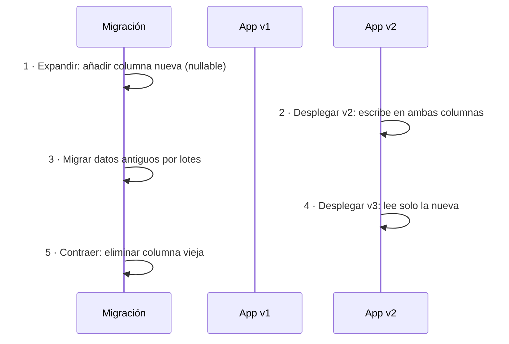

# Migraciones, DevOps y cloud

El esquema de una base de datos **evoluciona** con la aplicación, y cambiarlo mal es una de las causas más habituales de caída. Este bloque cubre cómo versionar los cambios, aplicarlos sin parar el servicio y qué cambia al usar bases de datos gestionadas en la nube.

_Revisado: 2026-10-06_

## El esquema como código

```mermaid
flowchart LR
  DEV["Desarrollador<br/>escribe migración"] --> GIT["Git<br/>revisión"]
  GIT --> CI["CI<br/>aplica sobre BD limpia<br/>+ pruebas"]
  CI --> ST["Entorno de pruebas<br/>datos realistas"]
  ST --> PR["Producción<br/>despliegue"]
  style CI fill:#1a2233,stroke:#58a6ff
  style PR fill:#1a2d1a,stroke:#39d353
```



Reglas:

1. **Todo cambio de esquema es una migración** versionada en Git; nada se hace a mano en producción.
2. Las migraciones aplicadas **no se editan**: se crea una nueva.
3. La misma migración corre en desarrollo, CI, pruebas y producción.
4. El esquema se valida en CI contra una base **vacía** y contra una copia anonimizada de producción.

### Flyway

```text
db/migration/
├── V1__esquema_inicial.sql
├── V2__anadir_email_verificado.sql
├── V3__indice_pedido_cliente.sql
└── R__vista_resumen.sql
```

```sql title="V2__anadir_email_verificado.sql"
ALTER TABLE cliente ADD COLUMN email_verificado boolean NOT NULL DEFAULT false;
```

```bash
flyway -url=jdbc:postgresql://db:5432/tienda -user=app -password="$DB_PASSWORD" info
flyway -url=jdbc:postgresql://db:5432/tienda -user=app -password="$DB_PASSWORD" migrate
flyway validate
```

Flyway guarda en `flyway_schema_history` qué versiones se aplicaron y su **checksum**: si alguien edita una migración ya aplicada, `validate` falla. Los ficheros `R__` (repetibles) se reaplican cuando cambian: útiles para vistas y funciones. **Liquibase** es la alternativa con formato XML/YAML y reversiones.

## Cambios sin parada: expandir y contraer

Un despliegue convive un tiempo con **versión vieja y nueva** de la aplicación sobre la misma base de datos. Un cambio incompatible rompe a una de las dos.



Ejemplo: renombrar `telefono` a `movil`.

```sql
ALTER TABLE cliente ADD COLUMN movil text;

UPDATE cliente SET movil = telefono WHERE id BETWEEN 1 AND 50000 AND movil IS NULL;

ALTER TABLE cliente DROP COLUMN telefono;
```

Un `RENAME COLUMN` directo rompe al instante a la versión que aún use el nombre antiguo. El patrón **expandir y contraer** convierte un cambio incompatible en varios compatibles.

### Operaciones peligrosas en tablas grandes

| Operación | Riesgo | Alternativa |
|---|---|---|
| `ADD COLUMN ... DEFAULT` (motores antiguos) | reescribe la tabla | PostgreSQL 11+ y MySQL 8 `INSTANT` son seguros |
| `CREATE INDEX` | bloquea escrituras | `CREATE INDEX CONCURRENTLY` |
| `ALTER COLUMN TYPE` | reescribe y bloquea | columna nueva + copia por lotes |
| `ADD CONSTRAINT` (FK, CHECK) | escaneo con bloqueo | `NOT VALID` y luego `VALIDATE CONSTRAINT` |
| `ADD COLUMN NOT NULL` sin default | falla con filas existentes | añadir nullable, rellenar, luego `SET NOT NULL` |
| `DROP COLUMN` | rompe versiones antiguas | contraer solo cuando nadie la use |

```sql
SET lock_timeout = '3s';

ALTER TABLE pedido ADD CONSTRAINT fk_pedido_cliente FOREIGN KEY (cliente_id) REFERENCES cliente(id) NOT VALID;
ALTER TABLE pedido VALIDATE CONSTRAINT fk_pedido_cliente;

CREATE INDEX CONCURRENTLY idx_pedido_estado ON pedido (estado);
```

:::danger lock_timeout
Un `ALTER TABLE` necesita un bloqueo exclusivo breve, pero si hay una transacción larga abierta **espera detrás**, y todas las consultas posteriores esperan detrás de él: la tabla queda bloqueada. Define siempre `lock_timeout` corto y reintenta; mejor que falle rápido a tumbar la tabla.
:::

## Datos de prueba y entornos

- **Nunca uses datos reales** de producción en desarrollo sin **anonimizar** (RGPD): enmascara nombres, emails, teléfonos, documentos.
- Una copia **representativa en volumen** descubre consultas lentas y migraciones largas que una base pequeña oculta.
- Genera datos sintéticos con scripts reproducibles.

```sql
UPDATE cliente SET
  nombre = 'Cliente ' || id,
  email = 'cliente' || id || '@ejemplo.invalid',
  telefono = NULL;
```

- En CI, levanta la base con **contenedores efímeros** (Testcontainers o `docker compose`) y aplica todas las migraciones desde cero en cada ejecución.
- Una restauración periódica de la copia de producción en un entorno aparte sirve a la vez de **prueba de recuperación**.

## Bases de datos gestionadas

| Opción | Qué gestiona el proveedor | Qué sigues gestionando tú |
|---|---|---|
| Servidor propio / VM | nada | todo: SO, parches, copias, HA |
| BD gestionada (RDS, Cloud SQL, Azure Database) | SO, parches, copias, failover | esquema, consultas, índices, parámetros, seguridad |
| Serverless / Aurora | además, escalado y almacenamiento | diseño y consultas |

Lo que **obtienes**: copias automáticas con restauración a un punto en el tiempo, **Multi-AZ** (réplica síncrona en otra zona con failover automático), réplicas de lectura, parches y cifrado integrados.

Lo que **pierdes o debes vigilar**:

- Sin acceso de superusuario ni al sistema de ficheros; algunas extensiones no están disponibles.
- Parámetros limitados a los que expone el grupo de parámetros.
- **Mantenimientos** programados y reinicios: planifica la ventana.
- **Costes** que crecen con almacenamiento, IOPS, tráfico entre zonas y réplicas.

```mermaid
flowchart TB
  APP["Aplicación<br/>subred privada"] --> EP["Endpoint<br/>de escritura"]
  EP --> P[("Primario<br/>zona A")]
  P -->|"replicación síncrona"| S[("Standby<br/>zona B")]
  APP -.-> RE["Endpoint de lectura"]
  RE --> R[("Réplica de lectura")]
  P -->|"copias + WAL"| B["Almacenamiento de copias<br/>PITR"]
  style P fill:#1a2d1a,stroke:#39d353
  style S fill:#1a2233,stroke:#58a6ff
```



Buenas prácticas en la nube:

1. **Sin acceso público**: la base de datos en una subred privada, accesible solo desde la aplicación (grupo de seguridad restrictivo).
2. **Cifrado** en reposo y en tránsito (TLS obligatorio).
3. **Credenciales rotadas** desde un gestor de secretos, o autenticación IAM.
4. **Pool de conexiones** (RDS Proxy, PgBouncer): las funciones serverless y los microservicios agotan conexiones rápido.
5. **Alertas** de CPU, memoria libre, espacio, conexiones, retraso de réplica y latencia.
6. **Pruebas de failover** periódicas y de restauración.
7. **Etiquetas de coste** y revisión mensual de instancias sobredimensionadas.

## Observabilidad de la base de datos

| Señal | Qué indica | Acción habitual |
|---|---|---|
| CPU alta sostenida | consultas costosas, falta de índices | `pg_stat_statements`, `EXPLAIN` |
| Memoria libre baja / swap | buffers mal dimensionados | ajustar o escalar |
| Conexiones cerca del máximo | pool mal configurado | pooler, límites |
| Retraso de réplica | transacciones grandes, E/S saturada | lotes, más IOPS |
| Espacio en disco | crecimiento, bloat, WAL retenido | purga, `VACUUM`, particiones |
| Bloqueos largos | transacciones abiertas | tiempos máximos, reintentos |
| Latencia p95 de consultas | degradación | revisar plan y estadísticas |

```sql
SELECT now() - xact_start AS duracion, pid, state, left(query, 80)
FROM pg_stat_activity
WHERE xact_start IS NOT NULL
ORDER BY duracion DESC
LIMIT 5;

SELECT datname, numbackends, xact_commit, xact_rollback, blks_hit::float / nullif(blks_hit + blks_read, 0) AS ratio_cache
FROM pg_stat_database
WHERE datname = current_database();
```

Un **ratio de acierto de caché** menor del 99 % en una carga transaccional apunta a memoria insuficiente. Las métricas se exportan a Prometheus con `postgres_exporter` o `mysqld_exporter` ([monitorización](/linux/monitorizacion-logs)).

## Recuperación ante desastres

| Concepto | Pregunta | Ejemplo |
|---|---|---|
| RPO | ¿cuántos datos puedo perder? | 5 minutos |
| RTO | ¿cuánto puedo tardar en volver? | 30 minutos |

| Estrategia | RPO / RTO | Coste |
|---|---|---|
| Copias diarias | horas / horas | bajo |
| PITR con WAL/binlog | minutos / decenas de minutos | medio |
| Réplica en otra región | segundos / minutos | alto |
| Activo-activo multirregión | ~0 / ~0 | muy alto y complejo |

Documenta el **runbook de restauración** y ensáyalo: quién decide, qué se restaura, cómo se valida y cuánto tarda de verdad.

## Trampas frecuentes

- **Editar una migración ya aplicada**: el checksum falla o los entornos divergen.
- **Cambios incompatibles en un solo despliegue**: se rompe una de las dos versiones.
- **`CREATE INDEX` sin `CONCURRENTLY`** en producción: bloquea escrituras.
- **Sin `lock_timeout`**: un `ALTER` esperando bloquea toda la tabla.
- **Datos reales sin anonimizar** en entornos de desarrollo.
- **Probar con 1 000 filas** una migración que en producción tiene 200 millones.
- **Base de datos en la nube con IP pública** y contraseña débil.
- **Multi-AZ tomado como copia de seguridad**: replica los borrados.
- **Funciones serverless sin pool**: `too many connections`.
- **No ensayar la restauración** hasta el día del desastre.

## Comprueba que lo entiendes

1. ¿Por qué un `RENAME COLUMN` directo puede causar una caída aunque la migración tarde milisegundos?
2. ¿Qué hace `NOT VALID` seguido de `VALIDATE CONSTRAINT` y por qué ayuda?
3. ¿Qué responsabilidades siguen siendo tuyas con una base de datos gestionada?
4. Tu negocio tolera perder 5 minutos y estar caído 30. ¿Qué estrategia mínima necesitas?

**Mini-ejercicio.** Añade a `pedido` una columna `canal` obligatoria con valor por defecto `web`, sin bloquear la tabla en un motor antiguo.

```sql
ALTER TABLE pedido ADD COLUMN canal text;
UPDATE pedido SET canal = 'web' WHERE canal IS NULL AND id BETWEEN 1 AND 100000;
ALTER TABLE pedido ADD CONSTRAINT canal_no_nulo CHECK (canal IS NOT NULL) NOT VALID;
ALTER TABLE pedido VALIDATE CONSTRAINT canal_no_nulo;
ALTER TABLE pedido ALTER COLUMN canal SET DEFAULT 'web';
```

<details>
  <summary>Respuestas</summary>

1. Porque durante el despliegue la versión antigua de la aplicación sigue ejecutándose con el nombre anterior y empieza a fallar al instante. Hay que expandir (añadir la nueva), migrar y contraer en varias etapas compatibles.
2. `NOT VALID` crea la restricción sin comprobar las filas existentes (bloqueo mínimo) y se aplica ya a las nuevas; `VALIDATE` escanea después con un bloqueo más débil que no impide escribir.
3. El esquema, los índices y las consultas, los parámetros, los usuarios y permisos, la seguridad de red, las pruebas de recuperación y el control de costes.
4. Copias con **PITR** (WAL/binlog archivado) para un RPO de minutos y un procedimiento de restauración ensayado para un RTO menor de 30 minutos; Multi-AZ para failover más rápido.

</details>

## Referencias

- [Flyway — documentación](https://documentation.red-gate.com/flyway)
- [Liquibase](https://docs.liquibase.com/)
- [Amazon RDS — buenas prácticas](https://docs.aws.amazon.com/AmazonRDS/latest/UserGuide/CHAP_BestPractices.html)
- [Postgres: cambios de esquema seguros — Braintree](https://medium.com/paypal-tech/postgresql-at-scale-database-schema-changes-without-downtime-20d3749ed680)
