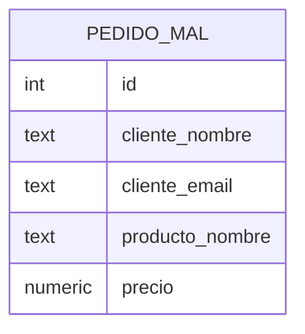

# Modelado e índices

Dos decisiones determinan casi todo el comportamiento de una base de datos: **cómo modelas los datos** (difícil de cambiar después) y **qué índices pones** (fácil de cambiar, pero la causa nº 1 de lentitud). Este bloque cubre ambas y cómo comprobarlas con `EXPLAIN`.

_Revisado: 2026-10-06_

## Del requisito al modelo

```mermaid
flowchart LR
  R["Requisitos"] --> C["Modelo conceptual<br/>entidades · relaciones"]
  C --> L["Modelo lógico<br/>tablas · claves"]
  L --> F["Modelo físico<br/>tipos · índices · particiones"]
  style L fill:#1a2233,stroke:#58a6ff
```



Cardinalidades que se traducen en esquema:

| Relación | Cómo se implementa |
|---|---|
| 1:N (cliente → pedidos) | clave foránea en el lado "N" |
| N:M (pedidos ↔ productos) | tabla intermedia con clave compuesta |
| 1:1 | clave foránea con `UNIQUE`, o la misma tabla |

## Normalización

Normalizar es eliminar redundancia para evitar anomalías al insertar, actualizar o borrar.

| Forma | Regla | Ejemplo de violación |
|---|---|---|
| 1FN | valores atómicos, sin listas ni grupos repetidos | columna `telefonos = '600,611'` |
| 2FN | sin dependencias parciales de una clave compuesta | `nombre_producto` en la línea de pedido |
| 3FN | sin dependencias transitivas | `ciudad` y `codigo_postal` → `provincia` en la misma tabla |

Idea práctica: **cada dato vive en un solo sitio**. Si cambiar el nombre de un producto obliga a tocar mil filas, el diseño está desnormalizado sin querer.



En el diseño anterior, el nombre y el email del cliente se repiten en cada pedido. Corregirlo es separar `cliente`, `producto`, `pedido` y `linea`, como en [SQL esencial](/bbdd/sql).

**Desnormalizar** es legítimo cuando se mide un problema de rendimiento de lectura (informes, contadores) y se asume el coste de mantener la copia coherente. Hazlo deliberadamente, no por defecto.

## Claves y restricciones

- **Clave primaria**: identifica la fila, única y no nula. Prefiere **claves sustitutas** (`identity` o UUID) que no cambian, frente a claves naturales (email, DNI) que sí pueden cambiar.
- **Clave foránea**: garantiza que la referencia existe. Define `ON DELETE` conscientemente.
- **`UNIQUE`**, **`CHECK`**, **`NOT NULL`**: reglas de negocio donde no se pueden saltar.

| `ON DELETE` | Efecto | Cuándo |
|---|---|---|
| `RESTRICT` / `NO ACTION` | rechaza el borrado | por defecto, lo más seguro |
| `CASCADE` | borra los hijos | datos propiedad del padre (líneas de un pedido) |
| `SET NULL` | pone la referencia a nulo | relación opcional |

```sql
ALTER TABLE pedido
  ADD CONSTRAINT pedido_cliente_fk FOREIGN KEY (cliente_id) REFERENCES cliente(id) ON DELETE RESTRICT;
```

:::warning Índices en claves foráneas
PostgreSQL **no** indexa automáticamente las claves foráneas. Sin índice en `pedido.cliente_id`, cada `JOIN` y cada borrado de un cliente recorre toda la tabla de pedidos.
:::

## Tipos de datos

Elegir bien el tipo ahorra espacio, valida y evita errores sutiles.

| Dato | Usa | Evita |
|---|---|---|
| Dinero | `numeric(12,2)` o enteros en céntimos | `float`/`double` (error de redondeo) |
| Fechas con hora | `timestamptz` (con zona horaria) | `timestamp` sin zona o guardar texto |
| Texto | `text` / `varchar(n)` | longitudes arbitrarias sin motivo |
| Identificador | `bigint identity` o `uuid` | `int` si puede superar 2 000 M |
| Booleano | `boolean` | `char(1)` con `'S'`/`'N'` |
| Semiestructurado | `jsonb` | columnas "JSON en texto" |

```sql
SELECT 0.1::float + 0.2::float = 0.3::float;
SELECT 0.1::numeric + 0.2::numeric = 0.3::numeric;
```

La primera devuelve falso por la aritmética binaria de coma flotante; en dinero siempre `numeric`.

## Índices: cómo funcionan

Un índice B-tree es una estructura ordenada que permite localizar filas sin recorrer la tabla. Convierte una búsqueda de **O(n)** (escaneo secuencial) en **O(log n)**.

```mermaid
flowchart TB
  R["Raíz<br/>M"] --> A["A · F"]
  R --> B["P · T"]
  A --> L1["hojas → punteros<br/>a filas"]
  A --> L2["hojas"]
  B --> L3["hojas"]
  B --> L4["hojas"]
  style R fill:#1a2233,stroke:#58a6ff
```



```sql
CREATE INDEX idx_pedido_cliente ON pedido (cliente_id);
CREATE UNIQUE INDEX idx_cliente_email ON cliente (lower(email));
CREATE INDEX idx_pedido_pagado ON pedido (fecha) WHERE estado = 'pagado';
CREATE INDEX idx_pedido_cliente_fecha ON pedido (cliente_id, fecha DESC) INCLUDE (estado);
```

| Tipo de índice | Para qué |
|---|---|
| B-tree (por defecto) | igualdad, rangos, orden |
| Compuesto | consultas que filtran por varias columnas |
| Parcial (`WHERE`) | solo un subconjunto de filas, mucho más pequeño |
| Cubriente (`INCLUDE`) | responde sin tocar la tabla (index-only scan) |
| De expresión | `lower(email)`, `date(fecha)` |
| GIN / GiST | `jsonb`, texto completo, arrays, geometría |
| Hash | solo igualdad exacta |

### Índices compuestos: el orden importa

Un índice `(a, b, c)` sirve para filtros por `a`, `a+b` o `a+b+c`, pero **no** para `b` solo (regla del prefijo izquierdo). Pon primero las columnas de **igualdad** y después la de **rango** u orden.

```sql
CREATE INDEX idx_pedido_busqueda ON pedido (cliente_id, estado, fecha);

SELECT * FROM pedido WHERE cliente_id = 7 AND estado = 'pagado' AND fecha >= '2026-01-01';
```

### Cuándo un índice no se usa

- **Función sobre la columna**: `WHERE lower(email) = ...` no usa un índice sobre `email`; crea uno de expresión.
- **Comodín al principio**: `LIKE '%abc'` no puede usar B-tree; `LIKE 'abc%'` sí.
- **Baja selectividad**: un índice sobre una columna booleana rara vez compensa; el planificador prefiere el escaneo.
- **Conversión implícita de tipos**: comparar un `text` con un número impide el índice.
- **Estadísticas obsoletas**: ejecuta `ANALYZE` tras cargas masivas.

:::tip El coste de los índices
Cada índice acelera lecturas pero **ralentiza escrituras** (hay que mantenerlo) y ocupa disco. No indexes "por si acaso": indexa lo que `EXPLAIN` demuestra que se necesita y elimina los que nadie usa (`pg_stat_user_indexes`).
:::

## EXPLAIN: leer el plan

`EXPLAIN` muestra el plan estimado; `EXPLAIN (ANALYZE, BUFFERS)` lo **ejecuta** y da tiempos reales.

```sql
EXPLAIN (ANALYZE, BUFFERS)
SELECT c.nombre, count(*)
FROM cliente c
JOIN pedido p ON p.cliente_id = c.id
WHERE p.fecha >= '2026-01-01'
GROUP BY c.nombre;
```

```text
HashAggregate  (cost=1240.5..1250.1 rows=960 width=40) (actual time=18.2..18.4 rows=950 loops=1)
  ->  Hash Join  (cost=35.2..1180.3 rows=12040 width=32) (actual time=0.9..14.1 rows=11870 loops=1)
        Hash Cond: (p.cliente_id = c.id)
        ->  Seq Scan on pedido p  (cost=0.0..1090.0 rows=12040 width=4) (actual time=0.02..9.3 rows=11870 loops=1)
              Filter: (fecha >= '2026-01-01'::date)
              Rows Removed by Filter: 88130
```

| Nodo | Significa |
|---|---|
| `Seq Scan` | recorre toda la tabla; bien en tablas pequeñas, mal en grandes con filtros selectivos |
| `Index Scan` / `Index Only Scan` | usa el índice (el segundo ni toca la tabla) |
| `Bitmap Heap Scan` | combina varias condiciones con índice |
| `Nested Loop` | bien con pocas filas externas y buen índice interno |
| `Hash Join` / `Merge Join` | uniones grandes |
| `Sort` | ordena en memoria o en disco (señal si hay `Disk`) |

Qué mirar primero:

1. **`rows` estimadas frente a reales**: una gran diferencia indica estadísticas malas (`ANALYZE`).
2. **`Rows Removed by Filter`** alto con `Seq Scan`: falta un índice.
3. **`loops`** alto en un `Nested Loop` interno: el problema N+1 en la base de datos.
4. **`Sort Method: external merge Disk`**: `work_mem` insuficiente o falta índice con el orden.

```sql
CREATE INDEX CONCURRENTLY idx_pedido_fecha ON pedido (fecha);
ANALYZE pedido;
```

`CONCURRENTLY` crea el índice sin bloquear escrituras (más lento, no se puede ejecutar dentro de una transacción).

## Consultas lentas: método

```mermaid
flowchart TD
  S["Consulta lenta"] --> M["Medir<br/>pg_stat_statements · slow log"]
  M --> E["EXPLAIN ANALYZE"]
  E --> Q{"¿Seq Scan o<br/>estimación errónea?"}
  Q -->|"índice falta"| I["Crear índice adecuado"]
  Q -->|"estadísticas"| A["ANALYZE"]
  Q -->|"consulta mal escrita"| R["Reescribir"]
  I --> V["Medir de nuevo"]
  A --> V
  R --> V
  style V fill:#1a2d1a,stroke:#39d353
```



```sql
SELECT query, calls, round(total_exec_time::numeric, 1) AS total_ms, round(mean_exec_time::numeric, 2) AS media_ms
FROM pg_stat_statements
ORDER BY total_exec_time DESC
LIMIT 10;
```

Ordena por **tiempo total** (frecuencia × coste), no solo por la consulta más lenta: una consulta de 20 ms ejecutada un millón de veces pesa más que una de 5 s ejecutada una vez.

Problemas clásicos:

- **N+1**: la aplicación lanza una consulta por cada fila de un listado. Se arregla con un `JOIN` o `WHERE id = ANY(...)`.
- **Paginación con `OFFSET` grande**: recorre y descarta filas. Usa paginación por **clave** (`WHERE id > :ultimo ORDER BY id LIMIT 50`).
- **`count(*)` exacto en tablas enormes**: es un escaneo; usa estimaciones o contadores aparte si no hace falta precisión.

## Particionado

Divide una tabla enorme en trozos (por rango de fechas, normalmente) para consultar y purgar por partes.

```sql
CREATE TABLE evento (
  id      bigint GENERATED ALWAYS AS IDENTITY,
  fecha   timestamptz NOT NULL,
  detalle jsonb
) PARTITION BY RANGE (fecha);

CREATE TABLE evento_2026_10 PARTITION OF evento FOR VALUES FROM ('2026-10-01') TO ('2026-11-01');
```

Ventajas: el planificador **poda** particiones que no tocan el filtro, y retirar datos antiguos es `DROP` o `DETACH` de una partición, no un `DELETE` masivo. Solo compensa a partir de decenas de millones de filas.

## Trampas frecuentes

- **Claves foráneas sin índice**: `JOIN` y borrados lentos en tablas grandes.
- **Índice con las columnas en orden equivocado**: no se usa para el filtro real.
- **Función sobre la columna indexada**: el índice se ignora.
- **`float` para importes**: errores de céntimos acumulados.
- **Indexar todo**: escrituras más lentas y disco desperdiciado.
- **`OFFSET` con valores altos**: se vuelve más lento con cada página.
- **Optimizar sin medir**: crear índices por intuición sin mirar el plan.

## Comprueba que lo entiendes

1. Una tabla tiene un índice `(cliente_id, fecha)`. ¿Sirve para `WHERE fecha = '2026-01-01'`? ¿Y para `WHERE cliente_id = 5`?
2. ¿Por qué `WHERE lower(email) = 'a@b.com'` no usa el índice sobre `email` y cómo lo arreglas?
3. En un `EXPLAIN ANALYZE`, las filas estimadas son 10 y las reales 900 000. ¿Qué haces?
4. ¿Por qué un índice sobre una columna `activo boolean` casi nunca ayuda, y qué alternativa existe?

**Mini-ejercicio.** Crea un índice parcial que acelere la búsqueda de pedidos pendientes de enviar y comprueba que se usa.

```sql
CREATE INDEX idx_pedido_pendiente ON pedido (fecha) WHERE estado = 'pagado';
EXPLAIN SELECT * FROM pedido WHERE estado = 'pagado' AND fecha < current_date - 2;
```

<details>
  <summary>Respuestas</summary>

1. Para `fecha` solo, no (no es el prefijo izquierdo); para `cliente_id = 5`, sí.
2. El índice está construido sobre el valor de `email`, no sobre `lower(email)`. Se crea un índice de expresión `CREATE INDEX ON cliente (lower(email))`.
3. Las estadísticas están obsoletas o son insuficientes: `ANALYZE` la tabla y, si persiste, subir el objetivo de estadísticas de la columna o crear estadísticas extendidas.
4. Con pocos valores distintos la selectividad es baja y el planificador prefiere el escaneo. Un índice parcial (`WHERE NOT activo`) sobre el subconjunto raro sí compensa.

</details>

## Referencias

- [PostgreSQL — índices](https://www.postgresql.org/docs/current/indexes.html)
- [PostgreSQL — usar EXPLAIN](https://www.postgresql.org/docs/current/using-explain.html)
- [Use The Index, Luke](https://use-the-index-luke.com/)
- [explain.depesz.com](https://explain.depesz.com/)
