# MySQL y MariaDB

MySQL (y su derivado MariaDB) es el motor relacional más desplegado en aplicaciones web. El SQL es parecido al de PostgreSQL, pero la **arquitectura, los valores por defecto y las trampas son distintos**: conviene conocerlos aparte.

_Revisado: 2026-10-06_

## Arquitectura

```mermaid
flowchart TB
  CL["Cliente"] --> CN["Conexiones<br/>hilos"]
  CN --> PA["Parser · optimizador"]
  PA --> SE["Motor de almacenamiento<br/>InnoDB"]
  subgraph IN["InnoDB"]
    BP["Buffer pool<br/>caché de páginas"]
    RL["Redo log<br/>durabilidad"]
    UN["Undo log<br/>MVCC · rollback"]
    TS[("Tablespaces<br/>.ibd")]
  end
  SE --> BP
  BP --> TS
  SE --> RL
  SE --> UN
  PA --> BL["Binlog<br/>replicación · PITR"]
  style IN fill:#1a2233,stroke:#58a6ff
```



- **InnoDB** es el motor por defecto: transaccional, con claves foráneas, MVCC y recuperación tras caída. MyISAM es obsoleto: sin transacciones.
- **Buffer pool**: la caché más importante. Se dimensiona al 60-75 % de la RAM en un servidor dedicado (`innodb_buffer_pool_size`).
- **Redo log**: garantiza durabilidad (equivalente al WAL).
- **Binlog**: registro lógico de cambios, base de la **replicación** y de la recuperación a un punto en el tiempo.

## Diferencias con PostgreSQL

| Aspecto | MySQL / InnoDB | PostgreSQL |
|---|---|---|
| Índice primario | tabla **agrupada** por la clave primaria | tabla en *heap*, índices aparte |
| Aislamiento por defecto | `REPEATABLE READ` | `READ COMMITTED` |
| `GROUP BY` laxo | permitido en modos antiguos | error |
| Upsert | `INSERT ... ON DUPLICATE KEY UPDATE` | `ON CONFLICT` |
| Tipos | `ENUM`, `TINYINT`, sin tipo `boolean` real | tipos ricos, arrays, `jsonb` |
| DDL transaccional | no (cada DDL confirma implícitamente) | sí |
| Extensibilidad | menor | muy alta |
| Autoincrement | `AUTO_INCREMENT` | `IDENTITY` / `SERIAL` |

La consecuencia de la **tabla agrupada**: la clave primaria **es** el orden físico. Una clave aleatoria (UUID v4) provoca inserciones por toda la tabla y fragmentación; usa enteros crecientes o UUID ordenables (v7). Además, **todos los índices secundarios guardan la clave primaria**: una clave primaria grande ensancha todos los índices.

```sql
CREATE TABLE pedido (
  id         BIGINT UNSIGNED NOT NULL AUTO_INCREMENT,
  cliente_id BIGINT UNSIGNED NOT NULL,
  estado     ENUM('nuevo','pagado','enviado','cancelado') NOT NULL DEFAULT 'nuevo',
  creado     DATETIME NOT NULL DEFAULT CURRENT_TIMESTAMP,
  PRIMARY KEY (id),
  KEY idx_cliente_fecha (cliente_id, creado),
  CONSTRAINT fk_pedido_cliente FOREIGN KEY (cliente_id) REFERENCES cliente (id)
) ENGINE=InnoDB DEFAULT CHARSET=utf8mb4 COLLATE=utf8mb4_0900_ai_ci;
```

:::warning Codificación
Usa siempre **`utf8mb4`**. El antiguo `utf8` de MySQL solo admite 3 bytes por carácter y **no almacena emojis** ni algunos caracteres. Define el juego de caracteres y la colación a nivel de servidor, base de datos y tabla.
:::

## Modo SQL estricto

```sql
SELECT @@sql_mode;
SET GLOBAL sql_mode = 'STRICT_TRANS_TABLES,ONLY_FULL_GROUP_BY,NO_ZERO_DATE,NO_ENGINE_SUBSTITUTION,ERROR_FOR_DIVISION_BY_ZERO';
```

Sin modo estricto, MySQL **trunca silenciosamente** un texto que no cabe, acepta fechas `0000-00-00` o devuelve valores arbitrarios en un `GROUP BY` incorrecto. Activa el estricto desde el principio: los errores aparecen en desarrollo, no con datos corruptos en producción.

## Configuración esencial

```ini title="/etc/mysql/conf.d/produccion.cnf"
[mysqld]
innodb_buffer_pool_size = 12G
innodb_log_file_size = 2G
innodb_flush_log_at_trx_commit = 1
sync_binlog = 1
max_connections = 300
innodb_file_per_table = 1
character_set_server = utf8mb4
slow_query_log = 1
long_query_time = 0.5
log_bin = mysql-bin
binlog_expire_logs_seconds = 604800
server_id = 1
```

| Parámetro | Efecto |
|---|---|
| `innodb_flush_log_at_trx_commit=1` | durabilidad completa (cada commit sincroniza); `2` es más rápido pero puede perder 1 s |
| `sync_binlog=1` | binlog sincronizado en cada commit |
| `innodb_buffer_pool_size` | caché principal; el ajuste de mayor impacto |
| `max_connections` | límite de conexiones; cada una consume memoria |
| `long_query_time` | umbral del registro de consultas lentas |

## Diagnóstico de rendimiento

```sql
SHOW FULL PROCESSLIST;
SHOW ENGINE INNODB STATUS\G
EXPLAIN ANALYZE SELECT * FROM pedido WHERE cliente_id = 7 ORDER BY creado DESC LIMIT 20;
SELECT * FROM sys.statements_with_full_table_scans LIMIT 5;
SELECT query, exec_count, avg_latency FROM sys.statement_analysis ORDER BY total_latency DESC LIMIT 10;
SELECT * FROM sys.innodb_lock_waits;
```

```bash
pt-query-digest /var/log/mysql/slow.log | head -60
mysqladmin -u root -p extended-status | grep -E "Threads_connected|Slow_queries|Innodb_buffer_pool_reads"
```

- El **registro de consultas lentas** y `pt-query-digest` (Percona Toolkit) agrupan las consultas por huella y ordenan por impacto.
- En `EXPLAIN` mira `type` (`ALL` = escaneo completo, `ref`/`range`/`const` = índice), `rows` y `Extra` (`Using filesort`, `Using temporary` son señales de coste).
- **Ratio del buffer pool**: si `Innodb_buffer_pool_reads` (lecturas a disco) es alto frente a `read_requests`, falta memoria.
- `sys.innodb_lock_waits` muestra quién bloquea a quién.

```sql
ALTER TABLE pedido ADD INDEX idx_estado_fecha (estado, creado);
ANALYZE TABLE pedido;
```

## Replicación

```mermaid
flowchart LR
  APP["Aplicación"] -->|"escrituras"| P[("Primario<br/>binlog")]
  P -->|"binlog"| IO["Hilo de E/S<br/>réplica"]
  IO --> RL["Relay log"]
  RL --> SQL["Hilo SQL<br/>aplica"]
  SQL --> R[("Réplica")]
  APP -.->|"lecturas"| R
  style P fill:#1a2d1a,stroke:#39d353
```



```sql
CHANGE REPLICATION SOURCE TO
  SOURCE_HOST = 'db1',
  SOURCE_USER = 'replicador',
  SOURCE_PASSWORD = 'CAMBIAR',
  SOURCE_AUTO_POSITION = 1,
  SOURCE_SSL = 1;

START REPLICA;
SHOW REPLICA STATUS\G
```

- Usa **GTID** (`gtid_mode=ON`): cada transacción tiene un identificador global, lo que facilita reconfigurar réplicas y promocionar.
- En `SHOW REPLICA STATUS` vigila `Replica_IO_Running`, `Replica_SQL_Running` y **`Seconds_Behind_Source`** (retraso).
- La réplica aplica en uno o pocos hilos: una transacción enorme en el primario retrasa a todas. Activa la replicación **paralela** (`replica_parallel_workers`).
- **Semisíncrona** (el primario espera confirmación de recibido) y **Group Replication/InnoDB Cluster** para alta disponibilidad con failover automático; **Galera** en MariaDB para multi-primario síncrono.
- **ProxySQL** o MySQL Router enrutan lecturas y escrituras y gestionan el failover de cara a la aplicación.

## Copias de seguridad

| Método | Tipo | Notas |
|---|---|---|
| `mysqldump --single-transaction` | lógica | consistente con InnoDB sin bloquear; lenta en bases grandes |
| **Percona XtraBackup** / `mariabackup` | física en caliente | rápida, incremental |
| Binlog | continuo | permite PITR hasta un instante |
| Instantáneas de volumen (LVM, nube) | física | rápida; requiere consistencia |

```bash
mysqldump --single-transaction --routines --triggers --events --set-gtid-purged=OFF -u backup -p tienda | gzip > tienda.sql.gz

xtrabackup --backup --target-dir=/srv/respaldo/base
xtrabackup --prepare --target-dir=/srv/respaldo/base
xtrabackup --copy-back --target-dir=/srv/respaldo/base

mysqlbinlog --start-datetime="2026-10-06 10:00:00" --stop-datetime="2026-10-06 12:29:59" mysql-bin.000123 | mysql -u root -p
```

Recuperación a un punto en el tiempo: restaurar la copia física, **aplicar el binlog** hasta justo antes del error. Prueba la restauración: una copia sin restaurar no es una copia (ver [Transacciones y operación](/bbdd/transacciones-operacion)).

## Seguridad

```sql
CREATE USER 'api'@'10.0.%' IDENTIFIED BY 'CAMBIAR' REQUIRE SSL;
GRANT SELECT, INSERT, UPDATE, DELETE ON tienda.* TO 'api'@'10.0.%';
CREATE ROLE lectura;
GRANT SELECT ON tienda.* TO lectura;
SHOW GRANTS FOR 'api'@'10.0.%';
```

- Cuentas por **usuario y origen** (`'api'@'10.0.%'`): restringe el host siempre.
- Nada de `root` remoto ni `GRANT ALL ON *.*` para aplicaciones.
- Ejecuta `mysql_secure_installation` en instalaciones nuevas; elimina cuentas anónimas y la base `test`.
- TLS en tránsito (`REQUIRE SSL`), cifrado en reposo (`innodb_encrypt_tables`) y registro de auditoría en producción.
- Las sentencias parametrizadas son la defensa contra la inyección SQL, igual que en cualquier motor.

## Mantenimiento

```sql
OPTIMIZE TABLE pedido;
SELECT table_name, round((data_length + index_length)/1024/1024) AS mb FROM information_schema.tables WHERE table_schema = 'tienda' ORDER BY mb DESC;
```

```bash
pt-online-schema-change --alter "ADD COLUMN notas TEXT" D=tienda,t=pedido --execute
gh-ost --alter="ADD COLUMN notas TEXT" --database=tienda --table=pedido --execute
```

En MySQL, un `ALTER TABLE` pesado puede bloquear escrituras: `pt-online-schema-change` y `gh-ost` crean una copia de la tabla, la sincronizan y hacen el cambio sin parada. MySQL 8 admite `ALGORITHM=INSTANT` para añadir columnas al final casi sin coste.

## Trampas frecuentes

- **`utf8` en lugar de `utf8mb4`**: pierde emojis y caracteres de 4 bytes.
- **Sin modo estricto**: truncados silenciosos y fechas cero.
- **Clave primaria aleatoria** (UUID v4) en InnoDB: fragmentación y escrituras lentas.
- **DDL sin herramienta online** en una tabla grande: bloquea escrituras.
- **`innodb_buffer_pool_size` por defecto** en un servidor grande: lecturas a disco constantes.
- **`DROP`/`ALTER` dentro de una transacción esperando rollback**: el DDL confirma implícitamente.
- **Retraso de réplica ignorado** y lecturas obsoletas tras escribir.
- **Aplicaciones con `root`** o `GRANT ALL`.
- **`SELECT COUNT(*)` en tablas enormes** esperando rapidez: es un escaneo en InnoDB.

## Comprueba que lo entiendes

1. ¿Por qué un UUID aleatorio como clave primaria perjudica más en InnoDB que en PostgreSQL?
2. Una réplica va 20 minutos por detrás tras un `UPDATE` masivo en el primario. ¿Qué ha ocurrido y cómo lo previenes?
3. ¿Qué dos comprobaciones te dicen si el buffer pool es insuficiente?
4. ¿Cómo recuperas la base a las 12:29 tras un `DELETE` erróneo a las 12:30?

**Mini-ejercicio.** Encuentra qué consultas hacen más escaneos completos de tabla.

```sql
SELECT query, exec_count, rows_examined_avg FROM sys.statements_with_full_table_scans ORDER BY exec_count DESC LIMIT 5;
```

<details>
  <summary>Respuestas</summary>

1. La tabla está agrupada por la clave primaria: los valores aleatorios insertan en posiciones arbitrarias (divisiones de página y fragmentación), y esa clave larga se copia en todos los índices secundarios.
2. Una transacción grande se aplica serializada en la réplica, que va por detrás hasta terminar. Se previene procesando en lotes pequeños en el primario y habilitando la replicación paralela.
3. Una tasa alta de `Innodb_buffer_pool_reads` (lecturas a disco) respecto a `Innodb_buffer_pool_read_requests` y mucha E/S de lectura en el sistema con consultas que antes estaban en memoria.
4. Restaurar la última copia física completa y aplicar el binlog con `mysqlbinlog --stop-datetime` hasta justo antes del `DELETE` (por ejemplo 12:29:59).

</details>

## Referencias

- [MySQL 8.4 — manual de referencia](https://dev.mysql.com/doc/refman/8.4/en/)
- [Percona Toolkit](https://docs.percona.com/percona-toolkit/)
- [Percona XtraBackup](https://docs.percona.com/percona-xtrabackup/8.4/)
- [MariaDB — base de conocimiento](https://mariadb.com/kb/en/)
