# Programación en la base de datos

SQL no es solo consultar: PostgreSQL y MySQL permiten **funciones, procedimientos y disparadores** que se ejecutan junto a los datos. Bien usados garantizan integridad y reducen viajes de red; mal usados, esconden lógica de negocio que nadie versiona ni prueba.

_Revisado: 2026-10-06_

## Cuándo sí y cuándo no

| Mover lógica a la base de datos cuando… | Mantenerla en la aplicación cuando… |
|---|---|
| garantiza **integridad** que no se puede saltar (auditoría, invariantes) | es lógica de negocio cambiante |
| procesa **grandes volúmenes** y evita traer datos a la aplicación | necesita llamar a servicios externos |
| varias aplicaciones comparten la misma regla | el equipo no versiona ni prueba el código SQL |
| operación por lotes de mantenimiento | se quiere portabilidad entre motores |

Regla práctica: **restricciones declarativas primero** (`CHECK`, `UNIQUE`, claves foráneas), después funciones, y los triggers solo cuando no hay otra opción.

## Funciones en PL/pgSQL

```sql
CREATE OR REPLACE FUNCTION total_pedido(p_pedido integer)
RETURNS numeric
LANGUAGE sql
STABLE
AS $$
  SELECT coalesce(sum(cantidad * precio), 0)
  FROM linea
  WHERE pedido_id = p_pedido;
$$;

SELECT id, total_pedido(id) FROM pedido WHERE estado = 'pagado';
```

```sql
CREATE OR REPLACE FUNCTION descontar_stock(p_producto integer, p_cantidad integer)
RETURNS void
LANGUAGE plpgsql
AS $$
DECLARE
  v_stock integer;
BEGIN
  SELECT stock INTO v_stock FROM producto WHERE id = p_producto FOR UPDATE;

  IF v_stock IS NULL THEN
    RAISE EXCEPTION 'producto % no existe', p_producto USING ERRCODE = 'P0002';
  END IF;

  IF v_stock < p_cantidad THEN
    RAISE EXCEPTION 'stock insuficiente: % disponibles, % pedidos', v_stock, p_cantidad;
  END IF;

  UPDATE producto SET stock = stock - p_cantidad WHERE id = p_producto;
END;
$$;
```

- **Volatilidad**: `IMMUTABLE` (mismo resultado siempre, indexable), `STABLE` (constante dentro de una consulta), `VOLATILE` (por defecto, puede cambiar). Declararla bien permite al optimizador y a los índices de expresión usar la función.
- `FOR UPDATE` bloquea la fila: evita la carrera de dos ventas simultáneas (ver [transacciones](/bbdd/transacciones-operacion)).
- Las funciones de **una sola consulta** (`LANGUAGE sql`) suelen incrustarse en el plan y son más rápidas que PL/pgSQL.
- **`SECURITY DEFINER`** ejecuta con los privilegios del dueño: útil, pero fija `SET search_path` para evitar suplantación de objetos.

## Procedimientos

A diferencia de una función, un `PROCEDURE` se invoca con `CALL` y puede **controlar transacciones** (`COMMIT`/`ROLLBACK` dentro), lo que sirve para procesos por lotes.

```sql
CREATE PROCEDURE archivar_pedidos(p_antes date)
LANGUAGE plpgsql
AS $$
DECLARE
  v_filas integer;
BEGIN
  LOOP
    WITH lote AS (
      DELETE FROM pedido
      WHERE id IN (SELECT id FROM pedido WHERE fecha < p_antes AND estado = 'enviado' LIMIT 5000)
      RETURNING *
    )
    INSERT INTO pedido_archivo SELECT * FROM lote;

    GET DIAGNOSTICS v_filas = ROW_COUNT;
    COMMIT;
    EXIT WHEN v_filas = 0;
  END LOOP;
END;
$$;

CALL archivar_pedidos(current_date - 365);
```

Procesar en **lotes con `COMMIT`** evita una transacción gigante que retiene bloqueos, hincha el WAL y retrasa las réplicas.

## Triggers

Un **trigger** ejecuta una función ante `INSERT`, `UPDATE` o `DELETE`.

```mermaid
flowchart LR
  A["UPDATE pedido"] --> B["BEFORE trigger<br/>valida · modifica NEW"]
  B --> C["Escritura"]
  C --> D["AFTER trigger<br/>auditoría · notificar"]
  D --> E["COMMIT"]
  style B fill:#1a2233,stroke:#58a6ff
  style D fill:#1a2233,stroke:#58a6ff
```



```sql
CREATE TABLE pedido_auditoria (
  id        bigint GENERATED ALWAYS AS IDENTITY PRIMARY KEY,
  pedido_id integer NOT NULL,
  anterior  text,
  nuevo     text,
  usuario   text NOT NULL DEFAULT current_user,
  cuando    timestamptz NOT NULL DEFAULT now()
);

CREATE OR REPLACE FUNCTION auditar_estado() RETURNS trigger
LANGUAGE plpgsql
AS $$
BEGIN
  IF NEW.estado IS DISTINCT FROM OLD.estado THEN
    INSERT INTO pedido_auditoria (pedido_id, anterior, nuevo) VALUES (OLD.id, OLD.estado, NEW.estado);
  END IF;
  RETURN NEW;
END;
$$;

CREATE TRIGGER trg_auditar_estado
AFTER UPDATE OF estado ON pedido
FOR EACH ROW
EXECUTE FUNCTION auditar_estado();

CREATE OR REPLACE FUNCTION tocar_actualizado() RETURNS trigger
LANGUAGE plpgsql
AS $$
BEGIN
  NEW.actualizado = now();
  RETURN NEW;
END;
$$;

CREATE TRIGGER trg_actualizado
BEFORE UPDATE ON pedido
FOR EACH ROW
EXECUTE FUNCTION tocar_actualizado();
```

- `BEFORE` puede **modificar** `NEW` o cancelar; `AFTER` ve el resultado definitivo (auditoría).
- `OLD` y `NEW` contienen la fila antes y después; `IS DISTINCT FROM` compara tratando `NULL` correctamente.
- Útiles para **auditoría**, columnas de fecha de modificación y mantener tablas resumen.

:::warning Efectos ocultos
Un trigger se ejecuta **por cada fila** y su coste va dentro de la transacción de quien escribe. Los triggers que llaman a otros triggers o a servicios lentos son una fuente clásica de latencias y bloqueos que nadie sabe de dónde vienen. Documéntalos y limítalos.
:::

## Vistas e integridad

```sql
CREATE VIEW v_pedidos_activos WITH (security_barrier) AS
SELECT id, cliente_id, fecha, estado
FROM pedido
WHERE estado <> 'cancelado';

ALTER TABLE producto ADD CONSTRAINT stock_no_negativo CHECK (stock >= 0);

CREATE UNIQUE INDEX uq_pedido_pendiente_cliente ON pedido (cliente_id) WHERE estado = 'nuevo';
```

El **índice único parcial** garantiza "solo un pedido nuevo por cliente" sin código. Las restricciones evitan datos inválidos aunque falle una aplicación.

## JSONB: datos semiestructurados

```sql
CREATE TABLE evento (
  id      bigint GENERATED ALWAYS AS IDENTITY PRIMARY KEY,
  tipo    text NOT NULL,
  detalle jsonb NOT NULL
);

CREATE INDEX idx_evento_detalle ON evento USING gin (detalle jsonb_path_ops);

INSERT INTO evento (tipo, detalle) VALUES ('compra', '{"cliente": 7, "items": [{"sku": "TEC-01", "cant": 2}], "pago": {"metodo": "tarjeta"}}');

SELECT detalle->>'cliente' AS cliente, detalle->'pago'->>'metodo' AS metodo FROM evento WHERE tipo = 'compra';
SELECT * FROM evento WHERE detalle @> '{"pago": {"metodo": "tarjeta"}}';
SELECT e.id, i->>'sku' AS sku, (i->>'cant')::int AS cantidad
FROM evento e, jsonb_array_elements(e.detalle->'items') AS i;
```

| Operador | Función |
|---|---|
| `->` | obtiene un campo o elemento como `jsonb` |
| `->>` | obtiene el valor como texto |
| `@>` | ¿contiene este fragmento? (usa el índice GIN) |
| `jsonb_array_elements` | expande un array en filas |

Usa JSONB para atributos **variables** (metadatos, configuraciones, eventos). Si un campo se consulta, filtra o une constantemente, **sácalo a una columna**: tipos, restricciones e índices de B-tree serán más eficientes.

## Búsqueda de texto completo

```sql
ALTER TABLE producto ADD COLUMN buscador tsvector
  GENERATED ALWAYS AS (to_tsvector('spanish', coalesce(nombre, '') || ' ' || coalesce(descripcion, ''))) STORED;

CREATE INDEX idx_producto_buscador ON producto USING gin (buscador);

SELECT nombre, ts_rank(buscador, q) AS relevancia
FROM producto, websearch_to_tsquery('spanish', 'teclado "mecánico" -inalámbrico') AS q
WHERE buscador @@ q
ORDER BY relevancia DESC
LIMIT 10;
```

Maneja derivaciones del idioma (`teclados` encuentra `teclado`) y ordena por relevancia. `LIKE '%texto%'` no puede usar índices B-tree y recorre la tabla. Para volúmenes y relevancia avanzada, se usan motores dedicados (Elasticsearch, OpenSearch); para muchos casos, esto basta.

```sql
CREATE EXTENSION IF NOT EXISTS pg_trgm;
CREATE INDEX idx_cliente_nombre_trgm ON cliente USING gin (nombre gin_trgm_ops);
SELECT nombre FROM cliente WHERE nombre ILIKE '%perez%';
SELECT nombre, similarity(nombre, 'Lucia Peres') FROM cliente ORDER BY nombre <-> 'Lucia Peres' LIMIT 5;
```

`pg_trgm` acelera `LIKE`/`ILIKE` con comodines y búsqueda aproximada tolerante a erratas.

## Extensiones útiles

| Extensión | Para qué |
|---|---|
| `pg_stat_statements` | consultas más costosas (imprescindible) |
| `pg_trgm` | similitud y `LIKE` indexado |
| `uuid-ossp` / `pgcrypto` | UUID y funciones criptográficas |
| `postgis` | datos geográficos |
| `timescaledb` | series temporales |
| `pgvector` | búsqueda por similitud de vectores |
| `pgaudit` | auditoría detallada |

## Columnas generadas, secuencias y fechas

```sql
ALTER TABLE linea ADD COLUMN subtotal numeric(12,2) GENERATED ALWAYS AS (cantidad * precio) STORED;

CREATE TABLE factura (
  numero text PRIMARY KEY DEFAULT 'F-' || to_char(now(), 'YYYY') || '-' || lpad(nextval('seq_factura')::text, 6, '0'),
  emitida timestamptz NOT NULL DEFAULT now()
);

SELECT now() AT TIME ZONE 'Europe/Madrid';
SELECT generate_series(date '2026-01-01', date '2026-12-01', interval '1 month')::date AS mes;
```

Las **secuencias** no son transaccionales: un `ROLLBACK` deja **huecos**. Si la ley exige numeración correlativa sin saltos, hace falta una tabla de contadores con bloqueo, no una secuencia.

## Trampas frecuentes

- **Triggers que hacen demasiado**: latencia inexplicable y bloqueos.
- **Lógica de negocio en procedimientos** que nadie versiona ni prueba.
- **`SECURITY DEFINER` sin `search_path` fijo**: escalada de privilegios.
- **Funciones declaradas `VOLATILE`** que podrían ser `IMMUTABLE`: no se pueden indexar ni optimizar.
- **Un `DELETE` de millones de filas** en una transacción: bloqueos, WAL y réplicas retrasadas. Procesa por lotes.
- **JSONB para todo**: pierdes tipos, restricciones y rendimiento de joins.
- **`LIKE '%x%'` sin `pg_trgm`**: escaneo completo en cada búsqueda.
- **Secuencias para numeración legal correlativa**: aparecen huecos tras un rollback.

## Comprueba que lo entiendes

1. ¿Por qué es mejor un `CHECK` o un índice único parcial que un trigger para validar una regla simple?
2. Un `DELETE` de 30 millones de filas retrasa las réplicas. ¿Cómo lo reestructuras?
3. ¿Qué diferencia hay entre `->` y `->>` y cuándo conviene sacar un campo de JSONB a una columna?
4. ¿Por qué una secuencia no sirve para numeración de facturas sin huecos?

**Mini-ejercicio.** Crea un trigger que impida modificar un pedido ya enviado.

```sql
CREATE OR REPLACE FUNCTION bloquear_enviado() RETURNS trigger
LANGUAGE plpgsql
AS $$
BEGIN
  IF OLD.estado = 'enviado' THEN
    RAISE EXCEPTION 'el pedido % ya fue enviado', OLD.id;
  END IF;
  RETURN NEW;
END;
$$;

CREATE TRIGGER trg_bloquear_enviado BEFORE UPDATE ON pedido FOR EACH ROW EXECUTE FUNCTION bloquear_enviado();
```

<details>
  <summary>Respuestas</summary>

1. Son declarativos, los comprueba el motor de forma eficiente, no se pueden saltar ni olvidar, y se ven en el esquema. Un trigger es código imperativo con efectos ocultos y por fila.
2. En lotes pequeños (`LIMIT` + `COMMIT`) dentro de un procedimiento o desde la aplicación, con pausas si el retraso de réplica sube; o, si es por fecha, particionando y haciendo `DROP`/`DETACH` de la partición.
3. `->` devuelve `jsonb` (para seguir navegando) y `->>` devuelve texto. Cuando un campo se usa constantemente para filtrar, unir u ordenar, se extrae a una columna con tipo, restricciones e índice B-tree.
4. Las secuencias no se revierten con el `ROLLBACK`; un número consumido en una transacción cancelada deja un hueco. La numeración correlativa legal exige una tabla de contadores actualizada con bloqueo dentro de la misma transacción.

</details>

## Referencias

- [PostgreSQL — PL/pgSQL](https://www.postgresql.org/docs/current/plpgsql.html)
- [PostgreSQL — triggers](https://www.postgresql.org/docs/current/triggers.html)
- [PostgreSQL — JSON](https://www.postgresql.org/docs/current/datatype-json.html)
- [PostgreSQL — búsqueda de texto](https://www.postgresql.org/docs/current/textsearch.html)
