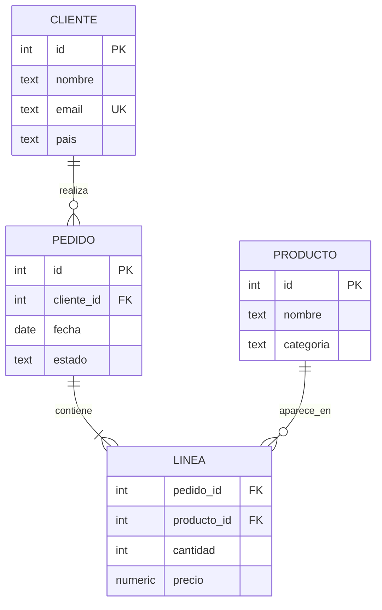

# SQL esencial

SQL es declarativo: describes **qué** quieres y el optimizador decide **cómo**. Este bloque va de consultas que se escriben a diario y de los errores que dan resultados incorrectos sin lanzar ningún error. Los ejemplos usan PostgreSQL; las diferencias con MySQL se señalan donde importan.

_Revisado: 2026-10-06_

## Esquema de ejemplo

Todo el bloque usa el mismo modelo: clientes, pedidos y líneas de pedido.



```sql
CREATE TABLE cliente (
  id      integer GENERATED ALWAYS AS IDENTITY PRIMARY KEY,
  nombre  text NOT NULL,
  email   text NOT NULL UNIQUE,
  pais    text NOT NULL DEFAULT 'ES'
);

CREATE TABLE producto (
  id        integer GENERATED ALWAYS AS IDENTITY PRIMARY KEY,
  nombre    text NOT NULL,
  categoria text NOT NULL
);

CREATE TABLE pedido (
  id         integer GENERATED ALWAYS AS IDENTITY PRIMARY KEY,
  cliente_id integer NOT NULL REFERENCES cliente(id),
  fecha      date NOT NULL DEFAULT current_date,
  estado     text NOT NULL CHECK (estado IN ('nuevo', 'pagado', 'enviado', 'cancelado'))
);

CREATE TABLE linea (
  pedido_id   integer NOT NULL REFERENCES pedido(id) ON DELETE CASCADE,
  producto_id integer NOT NULL REFERENCES producto(id),
  cantidad    integer NOT NULL CHECK (cantidad > 0),
  precio      numeric(10,2) NOT NULL CHECK (precio >= 0),
  PRIMARY KEY (pedido_id, producto_id)
);
```

Las restricciones (`NOT NULL`, `CHECK`, `UNIQUE`, `FOREIGN KEY`) son la última línea de defensa: **garantizan integridad aunque la aplicación falle**. Mejor en la base de datos que solo en el código.

## DML: insertar, actualizar, borrar

```sql
INSERT INTO cliente (nombre, email) VALUES ('Lucía Pérez', 'lucia@ejemplo.com'), ('Marc Soler', 'marc@ejemplo.com');

INSERT INTO cliente (nombre, email) VALUES ('Lucía P.', 'lucia@ejemplo.com')
ON CONFLICT (email) DO UPDATE SET nombre = EXCLUDED.nombre;

UPDATE pedido SET estado = 'enviado' WHERE id = 42 AND estado = 'pagado';

DELETE FROM pedido WHERE estado = 'cancelado' AND fecha < current_date - interval '1 year';

INSERT INTO pedido (cliente_id, estado) VALUES (1, 'nuevo') RETURNING id;
```

- `ON CONFLICT` (en MySQL, `ON DUPLICATE KEY UPDATE`) hace el **upsert** de forma atómica.
- `RETURNING` devuelve filas afectadas sin una segunda consulta.
- Un `UPDATE` o `DELETE` **sin `WHERE`** afecta a toda la tabla. Ejecuta primero el mismo `WHERE` como `SELECT` y dentro de una transacción.

## SELECT: el orden lógico

Se escribe en un orden pero se evalúa en otro; entenderlo explica por qué un alias del `SELECT` no sirve en el `WHERE`.


```sql
SELECT pais, count(*) AS clientes
FROM cliente
WHERE email LIKE '%@ejemplo.com'
GROUP BY pais
HAVING count(*) > 10
ORDER BY clientes DESC
LIMIT 5;
```

`WHERE` filtra **filas** antes de agrupar; `HAVING` filtra **grupos** después. Filtrar en `WHERE` siempre que se pueda reduce el trabajo.

## NULL: la lógica de tres valores

`NULL` significa "desconocido", no "vacío" ni cero. Cualquier comparación con `NULL` da `NULL` (ni verdadero ni falso).

```sql
SELECT 1 WHERE NULL = NULL;
SELECT 1 WHERE NULL IS NULL;
SELECT coalesce(telefono, 'sin telefono') FROM cliente;
SELECT count(*), count(telefono) FROM cliente;
```

| Expresión | Resultado |
|---|---|
| `NULL = NULL` | `NULL` (no cuenta como verdadero) |
| `NULL IS NULL` | verdadero |
| `x NOT IN (1, NULL)` | nunca verdadero: devuelve 0 filas |
| `count(*)` vs `count(col)` | `count(col)` ignora los `NULL` |

:::warning NOT IN con NULL
`WHERE id NOT IN (subconsulta)` devuelve **cero filas** si la subconsulta contiene algún `NULL`. Usa `NOT EXISTS`.
:::

## JOIN

```mermaid
flowchart LR
  subgraph INNER["INNER JOIN"]
    A1["A ∩ B"]
  end
  subgraph LEFT["LEFT JOIN"]
    A2["todo A + coincidencias de B"]
  end
  subgraph ANTI["Anti-join"]
    A3["A sin coincidencia en B"]
  end
  style INNER fill:#1a2233,stroke:#58a6ff
  style LEFT fill:#1a2233,stroke:#58a6ff
  style ANTI fill:#2d1a1a,stroke:#ff7b72
```



```sql
SELECT c.nombre, p.id, p.fecha
FROM cliente c
JOIN pedido p ON p.cliente_id = c.id
WHERE p.estado = 'pagado';

SELECT c.nombre, count(p.id) AS pedidos
FROM cliente c
LEFT JOIN pedido p ON p.cliente_id = c.id
GROUP BY c.id, c.nombre;

SELECT c.nombre
FROM cliente c
WHERE NOT EXISTS (SELECT 1 FROM pedido p WHERE p.cliente_id = c.id);
```

- `INNER JOIN` solo devuelve filas con coincidencia en ambos lados.
- `LEFT JOIN` conserva todo el lado izquierdo; los huecos del derecho son `NULL`. Si filtras una columna del lado derecho en el `WHERE`, **conviertes el LEFT en INNER**: el filtro debe ir en el `ON`.
- Una unión mal condicionada produce un **producto cartesiano** (filas × filas) y duplica totales.

```sql
SELECT c.nombre, p.id
FROM cliente c
LEFT JOIN pedido p ON p.cliente_id = c.id AND p.estado = 'pagado';
```

## Agregación

```sql
SELECT p.estado,
       count(*)                       AS pedidos,
       sum(l.cantidad * l.precio)     AS importe,
       round(avg(l.precio), 2)        AS precio_medio,
       count(DISTINCT p.cliente_id)   AS clientes
FROM pedido p
JOIN linea l ON l.pedido_id = p.id
GROUP BY p.estado;
```

Regla de `GROUP BY`: toda columna del `SELECT` que no sea un agregado debe aparecer en el `GROUP BY`. PostgreSQL lo exige; MySQL en modo laxo devuelve un valor arbitrario, que es un error silencioso.

```sql
SELECT date_trunc('month', fecha) AS mes, count(*) FROM pedido GROUP BY 1 ORDER BY 1;

SELECT count(*) FILTER (WHERE estado = 'pagado') AS pagados,
       count(*) FILTER (WHERE estado = 'cancelado') AS cancelados
FROM pedido;
```

## Subconsultas y CTE

Una **CTE** (`WITH`) da nombre a un paso intermedio y hace la consulta legible de arriba abajo.

```sql
WITH ventas AS (
  SELECT p.cliente_id, sum(l.cantidad * l.precio) AS total
  FROM pedido p
  JOIN linea l ON l.pedido_id = p.id
  WHERE p.estado <> 'cancelado'
  GROUP BY p.cliente_id
)
SELECT c.nombre, v.total
FROM ventas v
JOIN cliente c ON c.id = v.cliente_id
WHERE v.total > (SELECT avg(total) FROM ventas)
ORDER BY v.total DESC;
```

Las CTE recursivas recorren jerarquías (organigramas, categorías anidadas):

```sql
WITH RECURSIVE arbol AS (
  SELECT id, nombre, padre_id, 1 AS nivel FROM categoria WHERE padre_id IS NULL
  UNION ALL
  SELECT c.id, c.nombre, c.padre_id, a.nivel + 1
  FROM categoria c
  JOIN arbol a ON c.padre_id = a.id
)
SELECT * FROM arbol ORDER BY nivel, nombre;
```

## Funciones de ventana

Calculan sobre un conjunto de filas **sin colapsarlas** como hace `GROUP BY`.

```sql
SELECT cliente_id, fecha, id,
       row_number() OVER (PARTITION BY cliente_id ORDER BY fecha DESC) AS orden,
       sum(total)   OVER (PARTITION BY cliente_id ORDER BY fecha)      AS acumulado,
       lag(total)   OVER (PARTITION BY cliente_id ORDER BY fecha)      AS anterior
FROM pedido_total;
```

Patrón muy habitual, **el último registro por grupo**:

```sql
SELECT *
FROM (
  SELECT p.*, row_number() OVER (PARTITION BY cliente_id ORDER BY fecha DESC, id DESC) AS rn
  FROM pedido p
) t
WHERE rn = 1;
```

| Función | Uso |
|---|---|
| `row_number()` | numeración única dentro de la partición |
| `rank()` / `dense_rank()` | ranking con empates (con o sin huecos) |
| `lag()` / `lead()` | valor de la fila anterior / siguiente |
| `sum() OVER` | acumulados y medias móviles |

## Conjuntos y fechas

```sql
SELECT email FROM cliente WHERE pais = 'ES'
UNION
SELECT email FROM cliente_newsletter;

SELECT id FROM pedido EXCEPT SELECT pedido_id FROM linea;

SELECT now(), current_date, now() - interval '7 days';
SELECT * FROM pedido WHERE fecha >= date_trunc('month', current_date);
```

`UNION` elimina duplicados (con coste de ordenación); `UNION ALL` no, y es más rápido. Usa `ALL` salvo que necesites deduplicar.

## Vistas

```sql
CREATE VIEW v_ventas_cliente AS
SELECT c.id, c.nombre, sum(l.cantidad * l.precio) AS total
FROM cliente c
JOIN pedido p ON p.cliente_id = c.id
JOIN linea l ON l.pedido_id = p.id
GROUP BY c.id, c.nombre;

CREATE MATERIALIZED VIEW mv_ventas_mes AS
SELECT date_trunc('month', fecha) AS mes, count(*) AS pedidos FROM pedido GROUP BY 1;

REFRESH MATERIALIZED VIEW CONCURRENTLY mv_ventas_mes;
```

Una **vista** es una consulta con nombre y no guarda datos; una **materializada** guarda el resultado y hay que refrescarla. `CONCURRENTLY` exige un índice único y no bloquea lecturas.

## Trampas frecuentes

- **`NOT IN` con NULL**: devuelve vacío. Usa `NOT EXISTS`.
- **`LEFT JOIN` con filtro en `WHERE`** sobre la tabla derecha: se vuelve INNER. Filtra en el `ON`.
- **Totales duplicados** al unir dos relaciones uno-a-muchos en la misma consulta: agrega cada una por separado y luego une.
- **`SELECT *`** en código de aplicación: rompe al añadir columnas y trae datos de más.
- **`ORDER BY` sin desempate** con `LIMIT`: la paginación devuelve filas repetidas o saltadas. Añade una clave única al final.
- **`UPDATE`/`DELETE` sin `WHERE`**: toda la tabla. Prueba antes con `SELECT` y transacción.
- **Comparar fechas con funciones sobre la columna** (`WHERE date(fecha) = ...`): anula el índice; usa rangos.

## Comprueba que lo entiendes

1. ¿Por qué `SELECT * FROM cliente WHERE id NOT IN (SELECT cliente_id FROM pedido)` puede devolver cero filas aunque existan clientes sin pedidos?
2. ¿Cuál es la diferencia entre filtrar en `ON` y en `WHERE` en un `LEFT JOIN`?
3. Escribe una consulta que devuelva el pedido más reciente de cada cliente.
4. ¿Por qué suma de más una consulta que une `pedido` con `linea` y con `pago` y calcula `sum(importe)`?

**Mini-ejercicio.** Obtén los 3 clientes con mayor gasto, con su posición en el ranking.

```sql
SELECT nombre, total, dense_rank() OVER (ORDER BY total DESC) AS posicion
FROM v_ventas_cliente
ORDER BY total DESC
LIMIT 3;
```

<details>
  <summary>Respuestas</summary>

1. Porque `cliente_id` en `pedido` puede contener `NULL`; `x NOT IN (..., NULL)` nunca es verdadero. `NOT EXISTS` o excluir los `NULL` lo resuelve.
2. En el `ON` el filtro se aplica durante la unión y se conservan las filas izquierdas sin coincidencia. En el `WHERE` se aplica después y elimina esas filas (porque la columna derecha es `NULL`), con lo que equivale a un INNER JOIN.
3. `row_number() OVER (PARTITION BY cliente_id ORDER BY fecha DESC, id DESC)` en una subconsulta y filtrar `rn = 1`; o `SELECT DISTINCT ON (cliente_id) ... ORDER BY cliente_id, fecha DESC` en PostgreSQL.
4. Al unir dos relaciones uno-a-muchos se produce un producto cartesiano por pedido: cada línea se repite por cada pago. Hay que agregar cada lado por separado y unir los resultados.

</details>

## Referencias

- [PostgreSQL — documentación de SQL](https://www.postgresql.org/docs/current/sql.html)
- [Use The Index, Luke](https://use-the-index-luke.com/)
- [Modern SQL](https://modern-sql.com/)
- [MySQL — referencia de SQL](https://dev.mysql.com/doc/refman/8.4/en/sql-statements.html)
