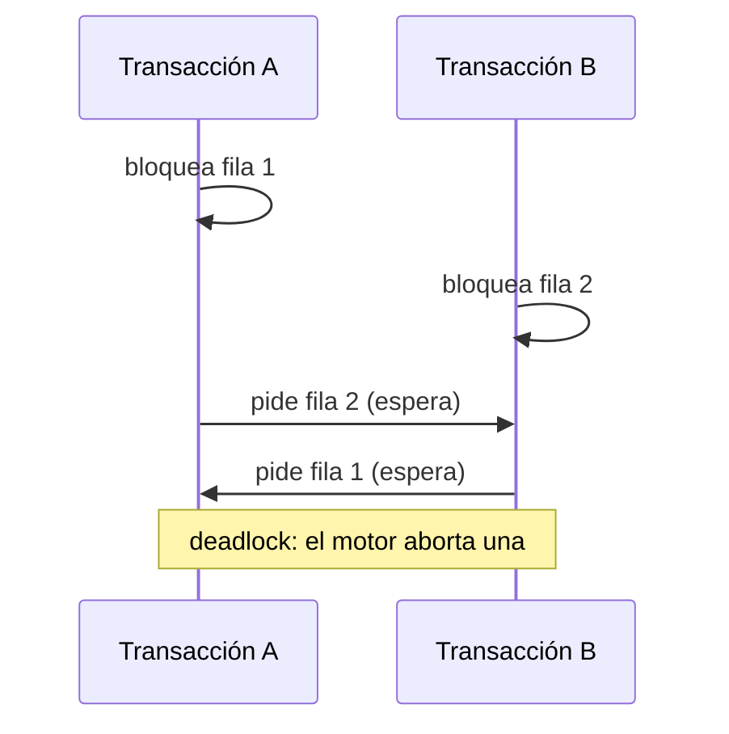

# Transacciones y operación

Consultar bien no basta: una base de datos en producción tiene que ser **correcta bajo concurrencia, recuperable tras un fallo y segura**. Este bloque cubre transacciones, bloqueos, copias, replicación y permisos.

_Revisado: 2026-10-06_

## ACID

| Propiedad | Garantía | Cómo se consigue |
|---|---|---|
| Atomicidad | todo o nada | transacciones, rollback |
| Consistencia | las restricciones se cumplen siempre | constraints, claves foráneas |
| Aislamiento | transacciones concurrentes no se pisan | MVCC, bloqueos |
| Durabilidad | lo confirmado sobrevive a un fallo | WAL (write-ahead log) |

```sql
BEGIN;
UPDATE cuenta SET saldo = saldo - 100 WHERE id = 1;
UPDATE cuenta SET saldo = saldo + 100 WHERE id = 2;
COMMIT;
```

Si algo falla entre las dos sentencias, `ROLLBACK` deja ambas cuentas intactas. Las operaciones relacionadas siempre van en la **misma transacción**; la aplicación no debe asumir que dos sentencias sueltas son atómicas.

**WAL**: antes de modificar los datos, el motor escribe el cambio en un registro secuencial y lo sincroniza a disco. Tras una caída, reaplica el WAL y la base queda consistente. Es también la base de la replicación y de la recuperación a un punto en el tiempo.

## Anomalías de concurrencia y aislamiento

| Anomalía | Qué ocurre |
|---|---|
| Lectura sucia | leer datos de otra transacción sin confirmar |
| Lectura no repetible | releer una fila y ver otro valor |
| Lectura fantasma | repetir una consulta y aparecen filas nuevas |
| Anomalía de serialización | resultado imposible en ejecución en serie (write skew) |

| Nivel | Sucia | No repetible | Fantasma | Serialización |
|---|---|---|---|---|
| `READ UNCOMMITTED` | posible | posible | posible | posible |
| `READ COMMITTED` | no | posible | posible | posible |
| `REPEATABLE READ` | no | no | según motor | posible |
| `SERIALIZABLE` | no | no | no | no |

PostgreSQL usa `READ COMMITTED` por defecto y MySQL/InnoDB `REPEATABLE READ`. Con **MVCC** los lectores no bloquean a los escritores: cada transacción ve una instantánea.

```sql
BEGIN ISOLATION LEVEL SERIALIZABLE;
SELECT sum(saldo) FROM cuenta;
UPDATE cuenta SET saldo = saldo - 50 WHERE id = 1;
COMMIT;
```

En `SERIALIZABLE` el motor puede abortar una transacción con error de serialización; la aplicación debe **reintentar**.

### Pérdida de actualización

El fallo más habitual: leer, calcular en la aplicación y escribir.

```sql
SELECT stock FROM producto WHERE id = 5;
UPDATE producto SET stock = 7 WHERE id = 5;
```

Si dos peticiones leen `8` a la vez, ambas escriben `7` y se pierde una venta. Tres soluciones:

```sql
UPDATE producto SET stock = stock - 1 WHERE id = 5 AND stock > 0;

SELECT stock FROM producto WHERE id = 5 FOR UPDATE;

UPDATE producto SET stock = stock - 1, version = version + 1 WHERE id = 5 AND version = 12;
```

1. **Operación atómica** en la propia sentencia (la mejor cuando es posible).
2. **Bloqueo pesimista** con `FOR UPDATE`: nadie más modifica la fila hasta el fin de la transacción.
3. **Bloqueo optimista** con una columna `version`: si el `UPDATE` afecta a 0 filas, otro ganó y se reintenta.

## Bloqueos y deadlocks



Un **deadlock** ocurre cuando dos transacciones se esperan mutuamente. El motor detecta el ciclo y aborta una. Se previenen **accediendo a las filas siempre en el mismo orden** y manteniendo las transacciones **cortas**.

```sql
SELECT pid, state, wait_event_type, wait_event, now() - xact_start AS duracion, query
FROM pg_stat_activity
WHERE state <> 'idle'
ORDER BY duracion DESC;

SELECT blocked.pid AS bloqueado, blocking.pid AS bloqueante, blocking.query
FROM pg_locks bl
JOIN pg_stat_activity blocked ON blocked.pid = bl.pid
JOIN pg_locks kl ON kl.locktype = bl.locktype AND kl.relation IS NOT DISTINCT FROM bl.relation AND kl.granted AND NOT bl.granted
JOIN pg_stat_activity blocking ON blocking.pid = kl.pid;

SELECT pg_terminate_backend(12345);
```

:::warning Transacciones abiertas
Una transacción abierta durante horas (típico: `BEGIN` sin `COMMIT` en una sesión interactiva o un job colgado) retiene bloqueos y **impide que `VACUUM` limpie** filas muertas: la tabla se hincha y todo se ralentiza. Fija `idle_in_transaction_session_timeout`.
:::

## Conexiones

Cada conexión de PostgreSQL es un proceso del sistema operativo: cientos son caros. Se usa un **pool** (en la aplicación, o PgBouncer entre ambos).

```mermaid
flowchart LR
  A1["App 1"] --> P["Pool<br/>PgBouncer"]
  A2["App 2"] --> P
  A3["App N"] --> P
  P -->|"pocas conexiones"| DB[("PostgreSQL")]
  style P fill:#1a2233,stroke:#58a6ff
```



El error `too many connections` suele ser un pool mal dimensionado o conexiones que no se devuelven. Tamaño de pool habitual: pocas conexiones por núcleo del servidor, no "tantas como peticiones".

## Copias de seguridad y recuperación

Una copia que no se ha restaurado **no es una copia**.

| Tipo | Qué es | Ventaja | Límite |
|---|---|---|---|
| Lógica (`pg_dump`) | SQL o formato custom | portable, selectiva | lenta en bases grandes |
| Física (`pg_basebackup`) | copia de ficheros | rápida, base de réplicas | misma versión mayor |
| WAL archivado + base | copia física + logs | recuperación a un punto en el tiempo (PITR) | requiere gestión del archivo |

```bash
pg_dump -Fc -h db -U app -d tienda -f tienda.dump
pg_restore -h destino -U app -d tienda_prueba --clean --if-exists tienda.dump
pg_basebackup -h db -U replicador -D /srv/respaldo -X stream -P
```

Conceptos que se preguntan siempre:

- **RPO** (Recovery Point Objective): cuántos datos puedes perder. Define la frecuencia de copia o el uso de WAL continuo.
- **RTO** (Recovery Time Objective): cuánto puedes tardar en recuperar. Define el método.
- **PITR**: restaurar la base copia y reaplicar WAL hasta un instante concreto, por ejemplo justo antes de un `DELETE` erróneo.
- Regla **3-2-1**: tres copias, en dos soportes distintos, una fuera del sitio.

```text title="postgresql.conf"
wal_level = replica
archive_mode = on
archive_command = 'cp %p /srv/wal_archive/%f'
```

Para restaurar, se parte de la copia base y se indican `restore_command = 'cp /srv/wal_archive/%f %p'` y `recovery_target_time = '2026-10-06 12:30:00'`; PostgreSQL reaplica WAL hasta ese instante.

:::tip Prueba de restauración
Programa la restauración automática de la última copia en un entorno aparte y valida con un `count(*)` y una consulta de negocio. Es la única forma de saber que la copia sirve.
:::

## Replicación y alta disponibilidad

```mermaid
flowchart LR
  APP["Aplicación"] -->|"escrituras"| P[("Primario")]
  P -->|"WAL en streaming"| R1[("Réplica 1")]
  P -->|"WAL en streaming"| R2[("Réplica 2")]
  APP -.->|"lecturas"| R1
  style P fill:#1a2d1a,stroke:#39d353
  style R2 fill:#1a2233,stroke:#58a6ff
```



| Modo | Garantía | Coste |
|---|---|---|
| Asíncrona | el primario no espera a la réplica; puede perder los últimos cambios al fallar | latencia mínima |
| Síncrona | el commit espera a la réplica; sin pérdida | latencia mayor, depende de la réplica |

- Las **réplicas de lectura** reparten consultas, pero tienen **retraso** (replication lag): leer tras escribir puede no ver el cambio. Lecturas que exigen coherencia van al primario.
- **Failover**: promover una réplica cuando cae el primario. Herramientas como Patroni lo automatizan con un consenso para evitar **split-brain** (dos primarios a la vez), el peor escenario.
- La replicación **no es una copia de seguridad**: un `DROP TABLE` se replica al instante.

```sql
SELECT client_addr, state, sent_lsn, replay_lsn, replay_lag FROM pg_stat_replication;
```

## Mantenimiento

- **`VACUUM`**: PostgreSQL no borra filas muertas al actualizar o borrar (MVCC); `autovacuum` las recicla. Si no da abasto, la tabla se hincha (*bloat*).
- **`ANALYZE`**: actualiza las estadísticas que usa el planificador.
- **Migraciones de esquema** sin parada: añadir columnas nulables es barato; `CREATE INDEX CONCURRENTLY`; evita `ALTER TABLE` que reescriban tablas grandes en horas de uso.

```sql
SELECT relname, n_dead_tup, last_autovacuum FROM pg_stat_user_tables ORDER BY n_dead_tup DESC LIMIT 10;
```

## Seguridad

```sql
CREATE ROLE app_lectura NOLOGIN;
GRANT CONNECT ON DATABASE tienda TO app_lectura;
GRANT USAGE ON SCHEMA public TO app_lectura;
GRANT SELECT ON ALL TABLES IN SCHEMA public TO app_lectura;

CREATE ROLE informes LOGIN PASSWORD 'CAMBIAR' IN ROLE app_lectura;

REVOKE ALL ON SCHEMA public FROM PUBLIC;
```

1. **Mínimo privilegio**: cada aplicación con su rol y solo los permisos que usa; nunca el superusuario.
2. **Cifrado en tránsito** (TLS, `sslmode=verify-full`) y en reposo (disco o cifrado de volumen).
3. **Inyección SQL**: nunca concatenar entrada de usuario; usa sentencias parametrizadas.

```sql
PREPARE buscar(text) AS SELECT id, nombre FROM cliente WHERE email = $1;
EXECUTE buscar('lucia@ejemplo.com');
```

4. **Auditoría**: registra DDL, conexiones y accesos a datos sensibles (`pgaudit`).
5. **Row-Level Security** cuando varios inquilinos comparten tabla.
6. **Secretos** fuera del código; rota credenciales.

## Modelos NoSQL

No sustituyen a lo relacional: resuelven problemas distintos.

| Familia | Ejemplo | Encaja con |
|---|---|---|
| Clave-valor | Redis | caché, sesiones, colas, contadores |
| Documentos | MongoDB | datos semiestructurados que se leen como un todo |
| Columnas anchas | Cassandra | escrituras masivas distribuidas, series |
| Grafos | Neo4j | relaciones profundas (recomendaciones, redes) |
| Series temporales | TimescaleDB, InfluxDB | métricas y eventos con tiempo |

**Teorema CAP**: ante una partición de red, un sistema distribuido elige entre **consistencia** y **disponibilidad**. Muchos NoSQL optan por consistencia eventual para escalar horizontalmente; un relacional con transacciones elige consistencia. Elegir NoSQL "porque escala" sin necesidad medida suele añadir problemas (joins, transacciones, consistencia) que ya estaban resueltos.

## Trampas frecuentes

- **Leer, calcular en la aplicación y escribir** sin protección: pérdida de actualizaciones.
- **Transacciones largas** o abiertas: bloqueos, bloat y fallos de `VACUUM`.
- **Replicación tomada como copia de seguridad**: un borrado erróneo se replica.
- **Copias nunca restauradas**: descubrir que no sirven cuando hacen falta.
- **Lecturas en réplica justo tras escribir**: datos antiguos por el retraso.
- **Aplicación con superusuario**: una inyección SQL se convierte en control total.
- **Pool sin límite** o demasiadas conexiones directas: `too many connections`.

## Comprueba que lo entiendes

1. Dos usuarios compran la última unidad de un producto a la vez y se venden dos. ¿Por qué ocurre y cómo se evita de tres formas?
2. ¿Qué diferencia práctica hay entre RPO y RTO?
3. ¿Por qué la replicación no sustituye a la copia de seguridad?
4. Una transacción abierta desde hace horas ralentiza toda una tabla. ¿Qué mecanismo se ve afectado?

**Mini-ejercicio.** Encuentra las 5 consultas activas más largas ahora mismo.

```sql
SELECT pid, now() - query_start AS duracion, state, left(query, 80)
FROM pg_stat_activity
WHERE state = 'active'
ORDER BY duracion DESC
LIMIT 5;
```

<details>
  <summary>Respuestas</summary>

1. Ambas transacciones leyeron `stock = 1` antes de que la otra escribiera. Se evita con una operación atómica (`stock = stock - 1 WHERE stock > 0`), con bloqueo pesimista (`FOR UPDATE`) o con bloqueo optimista (columna `version`).
2. RPO es cuántos datos puedes permitirte perder (determina la frecuencia de copia o WAL). RTO es cuánto puedes tardar en volver a operar (determina el método de recuperación).
3. Replica también los errores: un `DELETE` o `DROP` se aplica en las réplicas al instante. La copia permite volver a un momento anterior.
4. `VACUUM` no puede eliminar filas muertas más recientes que esa transacción, así que la tabla se hincha, además de retener bloqueos.

</details>

## Referencias

- [PostgreSQL — control de concurrencia](https://www.postgresql.org/docs/current/mvcc.html)
- [PostgreSQL — copias y PITR](https://www.postgresql.org/docs/current/continuous-archiving.html)
- [PostgreSQL — alta disponibilidad y replicación](https://www.postgresql.org/docs/current/high-availability.html)
- [OWASP — SQL Injection Prevention](https://cheatsheetseries.owasp.org/cheatsheets/SQL_Injection_Prevention_Cheat_Sheet.html)
