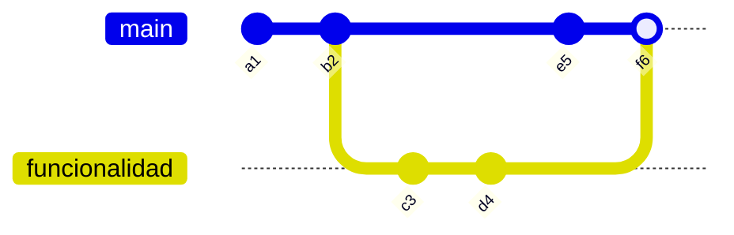

# Git y trabajo en equipo

Git es la herramienta común a todos los perfiles técnicos: código, infraestructura, configuración y documentación viven en repositorios. Dominarlo es entender su **modelo de datos**: con él, comandos como `rebase` o `reset` dejan de dar miedo.

_Revisado: 2026-10-06_

## Modelo mental

Un commit es una **instantánea completa** del proyecto con un puntero a su(s) padre(s). Una rama es solo un **puntero móvil** a un commit; `HEAD` indica dónde estás.

```mermaid
flowchart LR
  WD["Directorio de trabajo<br/>ficheros editados"] -->|"git add"| ST["Área de preparación<br/>staging"]
  ST -->|"git commit"| LO["Repositorio local<br/>commits"]
  LO -->|"git push"| RE["Remoto<br/>origin"]
  RE -->|"git fetch"| LO
  LO -->|"git checkout / restore"| WD
  style ST fill:#1a2233,stroke:#58a6ff
```





Por qué importa: crear una rama es **barato** (un puntero), los commits son **inmutables** (reescribir historia crea commits nuevos, no los modifica) y casi nada se pierde mientras exista un puntero o el `reflog`.

## Comandos del día a día

```bash
git status -sb
git diff
git diff --staged
git add -p
git commit -m "fix: corregir el cálculo del IVA en pedidos con descuento"
git switch -c feature/envio-gratis
git push -u origin feature/envio-gratis
git fetch --prune
git pull --rebase
git log --oneline --graph --decorate -20
git show HEAD~2:src/precio.js
git blame -L 10,30 src/precio.js
```

- `git add -p` prepara **trozos** de cambios: permite commits pequeños y coherentes aunque hayas tocado varias cosas.
- `git pull --rebase` evita commits de *merge* innecesarios al sincronizar tu rama.
- `git fetch` descarga sin tocar tu trabajo; `git pull` es `fetch` + integrar.

## Merge y rebase

```mermaid
flowchart TB
  subgraph M["merge"]
    M1["main: a — b — e"] --> M2["merge commit<br/>conserva la historia real"]
    M3["feature: c — d"] --> M2
  end
  subgraph R["rebase"]
    R1["main: a — b — e"] --> R2["c' — d'<br/>commits reescritos sobre e"]
  end
  style M fill:#1a2233,stroke:#58a6ff
  style R fill:#1a2d1a,stroke:#39d353
```



| | `merge` | `rebase` |
|---|---|---|
| Historia | conserva la bifurcación real | lineal, como si hubieras empezado después |
| Commits | no se modifican | se **reescriben** (nuevos hashes) |
| Riesgo | bajo | reescribe historia: no en ramas compartidas |
| Cuándo | integrar en `main`, ramas compartidas | actualizar tu rama privada antes del PR |

```bash
git switch feature/envio-gratis
git fetch origin
git rebase origin/main
git push --force-with-lease
```

:::danger Regla de oro del rebase
**Nunca reescribas** (rebase, `commit --amend`, `reset` + push forzado) commits que **otras personas ya tienen**. Si debes forzar un push en tu propia rama, usa `--force-with-lease`: falla si alguien más subió algo, en lugar de pisarlo.
:::

### Rebase interactivo: limpiar antes del PR

```bash
git rebase -i origin/main
```

```text
pick   a1b2c3 feat: añadir cálculo de envío
squash d4e5f6 wip
squash 7a8b9c arreglar test
reword 1f2e3d docs: actualizar README
drop   9c8b7a prueba temporal
```

Permite **fusionar** (`squash`), **renombrar** (`reword`), **reordenar** y **eliminar** commits para dejar una historia legible.

### Resolver conflictos

```text
<<<<<<< HEAD
total = base + iva;
=======
total = base * (1 + tipoIva);
>>>>>>> feature/envio-gratis
```

1. Entiende **ambos** cambios antes de elegir; no es "quedarse con uno".
2. Edita hasta dejar el resultado correcto y elimina los marcadores.
3. `git add fichero` y `git rebase --continue` (o `git merge --continue`).
4. **Ejecuta las pruebas**: un conflicto resuelto que compila puede estar mal.
5. `git rebase --abort` te devuelve al estado anterior si te pierdes.

```bash
git config --global rerere.enabled true
git config --global merge.conflictStyle zdiff3
```

`rerere` recuerda cómo resolviste un conflicto y lo reaplica; `zdiff3` muestra también el ancestro común, lo que facilita decidir.

## Deshacer errores

```mermaid
flowchart TD
  P["Algo salió mal"] --> A{"¿Ya publicado<br/>push?"}
  A -->|"no"| B{"¿Qué quieres?"}
  A -->|"sí"| REV["git revert<br/>crea un commit inverso"]
  B -->|"corregir último commit"| AM["git commit --amend"]
  B -->|"deshacer commits<br/>conservando cambios"| RS["git reset --soft / --mixed"]
  B -->|"descartar todo"| RH["git reset --hard"]
  B -->|"volver un fichero"| RE["git restore fichero"]
  style REV fill:#1a2d1a,stroke:#39d353
  style RH fill:#2d1a1a,stroke:#ff7b72
```



```bash
git restore src/precio.js
git restore --staged src/precio.js
git commit --amend --no-edit
git reset --soft HEAD~1
git reset --hard origin/main
git revert a1b2c3
git stash push -m "wip: cambio a medias"
git stash pop
git clean -nd
```

| Comando | Efecto |
|---|---|
| `reset --soft` | mueve la rama; deja los cambios **preparados** |
| `reset --mixed` (defecto) | mueve la rama; deja los cambios **sin preparar** |
| `reset --hard` | mueve la rama y **destruye** los cambios del directorio |
| `revert` | añade un commit que deshace otro; seguro en ramas compartidas |
| `restore` | recupera ficheros del índice o de un commit |

### El reflog: la red de seguridad

```bash
git reflog
git switch -c rescate HEAD@{3}
git cherry-pick a1b2c3
```

El **reflog** registra cada posición de `HEAD` de los últimos ~90 días: tras un `reset --hard` o un rebase equivocado, el commit sigue ahí y se recupera por su hash. Un commit **solo se pierde de verdad** si nunca fue referenciado y pasó el recolector de basura.

### Buscar el commit que rompió algo

```bash
git bisect start
git bisect bad
git bisect good v2.3.0
git bisect run ./scripts/prueba.sh
git bisect reset
```

`bisect` hace una **búsqueda binaria** en la historia: con 1 000 commits, unas 10 pruebas localizan al culpable; con `bisect run` es automático.

## Flujos de trabajo en equipo

| Flujo | Descripción | Encaja con |
|---|---|---|
| **Trunk-based** | ramas muy cortas (horas o un día), integración continua en `main`, *feature flags* | equipos con CI sólido y despliegue frecuente |
| **GitHub Flow** | rama por cambio, PR, revisión, merge a `main`, despliegue | la mayoría de equipos |
| **Gitflow** | `develop`, `release`, `hotfix` | productos con versiones instaladas y varias en soporte |


Estrategias de integración del PR:

- **Merge commit**: conserva todo; historia más ruidosa.
- **Squash and merge**: un solo commit por PR; historia limpia y fácil de revertir.
- **Rebase and merge**: historia lineal con los commits individuales.

Reglas de equipo útiles: **ramas pequeñas y de vida corta**, `main` siempre desplegable, **protección de rama** (CI obligatorio, al menos una aprobación, sin pushes directos), commits firmados cuando se exige trazabilidad.

## Commits y revisiones

Convención **Conventional Commits**:

```text
feat(pedidos): añadir envío gratuito a partir de 50 €
fix(auth): rechazar tokens con audiencia incorrecta
docs: actualizar guía de despliegue
refactor(catalogo): extraer cálculo de precio a un servicio
chore(deps): actualizar spring-boot a 3.3.4
feat!: eliminar el endpoint /api/v1/pedidos
```

| Tipo | Uso |
|---|---|
| `feat` | funcionalidad nueva (versión *minor*) |
| `fix` | corrección de error (*patch*) |
| `docs`, `chore`, `refactor`, `test`, `ci`, `perf` | sin cambio funcional visible |
| `!` o `BREAKING CHANGE:` | cambio incompatible (*major*) |

- **Asunto en imperativo y breve** (menos de 72 caracteres); el cuerpo explica el **porqué**, no el qué (el diff ya lo cuenta).
- **Un commit = un cambio lógico** que compila y pasa las pruebas: así `revert` y `bisect` funcionan.
- Con la convención se **automatizan** versiones y *changelogs* (semantic-release, release-please).

Un buen **pull request**: pequeño (idealmente menos de 400 líneas), descripción del contexto y del cómo probarlo, enlace a la tarea, capturas si hay interfaz y autorrevisión previa. Al **revisar**: pregunta antes de ordenar, distingue lo bloqueante de lo opcional (*nit:*), comenta diseño y riesgos antes que el estilo (que lo automatice el formateador).

## Hooks y automatización

```bash
git config core.hooksPath .githooks
```

```bash title=".githooks/pre-commit"
#!/usr/bin/env bash
set -euo pipefail
npx lint-staged
gitleaks protect --staged --redact
```

```bash title=".githooks/commit-msg"
#!/usr/bin/env bash
grep -qE '^(feat|fix|docs|chore|refactor|test|ci|perf)(\(.+\))?!?: .{1,72}$' "$1" || {
  echo "El mensaje debe seguir Conventional Commits"
  exit 1
}
```

Los hooks locales **se pueden saltar** (`--no-verify`): son comodidad. Lo que debe cumplirse de verdad se **repite en el CI**. Herramientas: **Husky** y **lint-staged** (JavaScript), **pre-commit** (cualquier lenguaje), `gitleaks` para detectar secretos.

## Secretos y repositorios

:::danger Un secreto subido está comprometido
Si una clave o contraseña llegó a un commit, **ya está comprometida**, aunque borres el fichero después: queda en la historia y en cualquier clon. **Revócala y rota la credencial primero**; reescribir la historia (`git filter-repo`) es secundario y no recupera copias ya descargadas.
:::

```bash
gitleaks detect --source . --verbose
git filter-repo --path secretos.env --invert-paths
```

```text title=".gitignore"
node_modules/
target/
build/
.env
*.pem
.idea/
.DS_Store
```

- **`.gitignore`** desde el primer commit: dependencias, artefactos, IDE y secretos.
- No versiones binarios grandes: **Git LFS** o un almacén de artefactos.
- Un repositorio por **unidad de despliegue** razonable; los monorepos exigen herramientas (Nx, Bazel) y CI que construya solo lo afectado.
- Configuración de identidad correcta: `git config user.name` y `user.email`; **firma de commits** con SSH o GPG si se requiere.

## Configuración útil

```bash
git config --global init.defaultBranch main
git config --global pull.rebase true
git config --global fetch.prune true
git config --global push.autoSetupRemote true
git config --global rebase.autoStash true
git config --global alias.lg "log --oneline --graph --decorate --all"
git config --global core.autocrlf input
```

## Trampas frecuentes

- **`git add .` a ciegas**: se cuelan ficheros temporales o secretos; revisa con `git status` y `git add -p`.
- **`reset --hard` sin mirar**: descarta cambios sin commit, que no están en el reflog.
- **Rebase de una rama compartida**: obliga a todos a rehacer su trabajo.
- **`push --force`** a `main` o sin `--force-with-lease`.
- **Commits gigantes** ("varios cambios") imposibles de revisar o revertir.
- **Mensajes inútiles** (`fix`, `wip`, `cambios`).
- **Ramas de larga vida**: conflictos enormes al integrar.
- **Resolver conflictos sin entenderlos** y sin ejecutar las pruebas.
- **Subir secretos o `node_modules`**.
- **Mezclar formato y cambios funcionales** en el mismo commit: el diff se vuelve ilegible.

## Comprueba que lo entiendes

1. ¿Por qué `git reset --hard` tras un rebase equivocado no destruye tu trabajo, pero sí lo hace sobre cambios sin commit?
2. Tu rama lleva una semana y `main` ha avanzado mucho. ¿Qué haces antes de abrir el PR y qué precaución tomas al subirla?
3. Subiste una clave de API a un repositorio público hace 5 minutos y ya la borraste. ¿Qué haces primero?
4. ¿Cuándo usas `revert` y cuándo `reset`?

**Mini-ejercicio.** Localiza automáticamente el commit que rompió las pruebas entre `v2.3.0` y `HEAD`.

```bash
git bisect start HEAD v2.3.0
git bisect run mvn -q test
git bisect reset
```

<details>
  <summary>Respuestas</summary>

1. Los commits antiguos siguen referenciados por el **reflog** (`git reflog`), así que se recuperan; los cambios sin commit nunca estuvieron en la base de datos de Git y `reset --hard` los elimina sin posibilidad de recuperarlos.
2. `git fetch` y `git rebase origin/main` (o merge, según la norma del equipo), resolver conflictos y ejecutar las pruebas; luego `git push --force-with-lease` si ya estaba publicada, porque el rebase reescribió los commits.
3. **Revocar y rotar la clave de inmediato**. Después, limpiar la historia si procede y añadir detección de secretos al hook y al CI. Borrar el fichero no sirve: la clave sigue en la historia y pudo ser copiada.
4. `revert` en ramas compartidas o ya publicadas: añade un commit inverso sin reescribir historia. `reset` solo sobre commits locales que nadie más tiene.

</details>

## Referencias

- [Pro Git (libro oficial)](https://git-scm.com/book/es/v2)
- [Conventional Commits](https://www.conventionalcommits.org/es/v1.0.0/)
- [GitHub Flow](https://docs.github.com/es/get-started/using-github/github-flow)
- [Trunk Based Development](https://trunkbaseddevelopment.com/)
- [Oh Shit, Git!?!](https://ohshitgit.com/es)
