# Apuntes

Apuntes técnicos de **Linux, Redes, BBDD, Java y Lenguaje de marcas**, más las herramientas comunes a todos. No son un temario de examen: recogen los temas, matices y trampas que distinguen a quien ya trabaja con estas tecnologías de quien solo las ha leído.

_Revisado: 2026-10-06_

## Para quién y para qué

- **Referencia de trabajo**: vas directo a un tema y encuentras el ejemplo y la decisión, no la definición.
- **Ruta de estudio**: cada bloque se apoya en el anterior y se puede leer en orden.
- **Práctica**: cada página termina con preguntas y un mini-ejercicio con su verificación.

## Dos formas de usarla

1. **Ruta**: sigue el orden 1 → 6.
2. **Referencia**: usa el buscador (atajo `Ctrl+F`) o salta al bloque que necesites.

## El recorrido

```mermaid
flowchart TB
  LIN["1 · Linux"] --> RED["2 · Redes"]
  LIN --> BD["3 · BBDD"]
  LIN --> JAV["4 · Java"]
  RED --> JAV
  BD --> JAV
  MAR["5 · Lenguaje de marcas"] --> JAV
  RED -.-> MAR
  GIT["6 · Herramientas"] -.-> LIN
  GIT -.-> JAV
  GIT -.-> MAR
  style LIN fill:#1a2233,stroke:#58a6ff
  style JAV fill:#1a2d1a,stroke:#39d353
  style GIT fill:#1a2233,stroke:#58a6ff
```

Las flechas sólidas indican qué conviene haber visto antes: Java en producción necesita Linux, red y base de datos. Las punteadas marcan relaciones de apoyo: HTTP y TLS enlazan con la web, y Git se usa en todos los bloques.

## Los bloques

### 1 · Linux

- [Administración](/linux/administracion): procesos, systemd, permisos, almacenamiento, rendimiento, Bash, SSH y hardening.
- [Automatización (Ansible)](/linux/automatizacion-ansible): inventarios, playbooks idempotentes, roles y Vault.
- [Seguridad (SELinux)](/linux/seguridad-selinux): MAC, firewalld, auditd, PAM, parches y línea base CIS.
- [Monitorización y logs](/linux/monitorizacion-logs): Prometheus, Grafana, alertas, SLO, journald y respuesta a incidentes.
- [Contenedores](/linux/contenedores-podman): namespaces, cgroups, Podman y Docker, Compose y seguridad.

### 2 · Redes

- [Fundamentos](/redes/fundamentos): modelo en capas, IP y CIDR, TCP/UDP, DNS, DHCP, HTTP y TLS.
- [Conmutación y enrutamiento](/redes/conmutacion-enrutamiento): VLAN, STP, OSPF, BGP, NAT, VPN y alta disponibilidad.
- [Seguridad y operación](/redes/seguridad-operacion): firewalls, balanceo, proxies, monitorización y troubleshooting.
- [Automatización](/redes/automatizacion): Netmiko, Nornir, Ansible, NETCONF, YANG y validación de cambios.
- [Wi-Fi, QoS y diseño](/redes/wifi-qos-diseno): inalámbrico, calidad de servicio, diseño jerárquico, SD-WAN y direccionamiento.

### 3 · BBDD

- [SQL esencial](/bbdd/sql): consultas, joins, agregación, CTE y funciones de ventana.
- [Modelado e índices](/bbdd/modelado-indices): normalización, tipos, índices y `EXPLAIN`.
- [Transacciones y operación](/bbdd/transacciones-operacion): ACID, aislamiento, copias, replicación y seguridad.
- [Programación SQL](/bbdd/programacion-sql): funciones, procedimientos, triggers, JSONB y búsqueda de texto.
- [MySQL y MariaDB](/bbdd/mysql-innodb): InnoDB, configuración, replicación y copias con xtrabackup.
- [Migraciones y cloud](/bbdd/migraciones-cloud): Flyway, cambios sin parada, bases gestionadas y recuperación ante desastres.

### 4 · Java

- [Lenguaje y colecciones](/java/lenguaje-colecciones): Java moderno, genéricos, colecciones, streams y excepciones.
- [JVM y concurrencia](/java/jvm-concurrencia): memoria, GC, hilos, hilos virtuales y diagnóstico.
- [Spring, persistencia y pruebas](/java/spring-persistencia-testing): Spring Boot, JPA, transacciones y Testcontainers.
- [Seguridad (Spring Security)](/java/seguridad-spring): OAuth2, JWT, autorización, CORS y OWASP.
- [Microservicios y Kafka](/java/microservicios-mensajeria): resiliencia, mensajería, Outbox y Saga.
- [Contenedores y CI/CD](/java/contenedores-ci): imágenes, GitHub Actions, Kubernetes y estrategias de release.
- [Diseño y arquitectura](/java/diseno-arquitectura): SOLID, patrones, hexagonal, DDD y diseño de APIs.

### 5 · Lenguaje de marcas

- [HTML y CSS](/marcas/html-css): semántica, formularios, Flexbox, Grid y responsive.
- [XML, JSON y YAML](/marcas/xml-json-yaml): esquemas, XPath, XSLT, JSON Schema y validación.
- [JavaScript y DOM](/marcas/javascript-dom): lenguaje, eventos, asincronía, módulos y TypeScript.
- [Seguridad web](/marcas/seguridad-web): XSS, CSRF, CORS, CSP, cookies y cabeceras.
- [Rendimiento y accesibilidad](/marcas/rendimiento-accesibilidad): Core Web Vitals, WCAG, ARIA y pruebas.

### 6 · Herramientas

- [Git y trabajo en equipo](/herramientas/git): modelo interno, merge y rebase, recuperación, flujos y hooks.

## Cómo está construida cada página

Todas siguen la misma plantilla:

1. **Intro**: qué problema resuelve el tema.
2. **Contenido**: ejemplos reales de código o CLI y diagramas donde aportan.
3. **Trampas frecuentes**: errores reales de producción.
4. **Comprueba que lo entiendes**: preguntas de razonamiento y un mini-ejercicio, con respuestas plegables.
5. **Referencias**: documentación oficial primero.
