# Contenedores, CI/CD y despliegue

Un servicio Java no termina en `mvn package`: hay que **construirlo de forma reproducible**, empaquetarlo, probarlo en cada cambio y desplegarlo sin interrupciones. Este bloque une el código con el pipeline y la plataforma donde se ejecuta.

_Revisado: 2026-10-06_

## El camino del código a producción

```mermaid
flowchart LR
  C["Commit / PR"] --> B["Compilar + pruebas"]
  B --> Q["Calidad + seguridad<br/>Sonar · dependencias"]
  Q --> I["Imagen<br/>contenedor"]
  I --> R["Registry"]
  R --> D1["Despliegue pruebas"]
  D1 --> D2["Producción<br/>gradual"]
  style B fill:#1a2233,stroke:#58a6ff
  style D2 fill:#1a2d1a,stroke:#39d353
```



Principio: **construir una vez, desplegar la misma imagen en todos los entornos**. Solo cambia la configuración, nunca el artefacto.

## Imagen eficiente para Java

```dockerfile
FROM maven:3.9-eclipse-temurin-21 AS build
WORKDIR /src
COPY pom.xml .
RUN --mount=type=cache,target=/root/.m2 mvn -q dependency:go-offline
COPY src ./src
RUN --mount=type=cache,target=/root/.m2 mvn -q package -DskipTests
RUN java -Djarmode=tools -jar target/api.jar extract --layers --destination /capas

FROM eclipse-temurin:21-jre-alpine
RUN addgroup -S app && adduser -S app -G app
WORKDIR /app
COPY --from=build /capas/dependencies/ ./
COPY --from=build /capas/spring-boot-loader/ ./
COPY --from=build /capas/snapshot-dependencies/ ./
COPY --from=build /capas/application/ ./
USER app
EXPOSE 8080
ENV JAVA_TOOL_OPTIONS="-XX:MaxRAMPercentage=75 -XX:+ExitOnOutOfMemoryError"
ENTRYPOINT ["java", "-jar", "api.jar"]
```

- **Capas de Spring Boot**: separa dependencias (cambian poco) del código (cambia a diario); la caché de capas hace que una nueva versión suba apenas unos KB.
- **Multi-stage**: el JDK y Maven no llegan a la imagen final; solo el JRE.
- `MaxRAMPercentage` respeta el límite del contenedor ([JVM y memoria](/java/jvm-concurrencia)).
- `ExitOnOutOfMemoryError` mata el proceso ante un OOM: Kubernetes lo reinicia limpio en lugar de dejarlo zombi.
- Usuario **no root** y etiquetas **fijas** de imagen base.

Alternativas sin Dockerfile:

```bash
mvn spring-boot:build-image -Dspring-boot.build-image.imageName=registro.ejemplo.com/api:1.4.0
```

Los **buildpacks** generan una imagen optimizada y con parches de seguridad del SO sin escribir un Dockerfile. Para arranque ultrarrápido y menos memoria, **GraalVM native image** (a costa de compilaciones largas y de reflexión limitada).

## Pipeline con GitHub Actions

```yaml title=".github/workflows/ci.yml"
name: ci
on:
  pull_request:
  push:
    branches: [main]

permissions:
  contents: read

concurrency:
  group: ci-${{ github.ref }}
  cancel-in-progress: true

jobs:
  construir:
    runs-on: ubuntu-latest
    steps:
      - uses: actions/checkout@v4

      - uses: actions/setup-java@v4
        with:
          distribution: temurin
          java-version: 21
          cache: maven

      - name: Compilar y probar
        run: mvn -B verify

      - name: Informe de cobertura
        uses: actions/upload-artifact@v4
        with:
          name: jacoco
          path: target/site/jacoco

      - name: Vulnerabilidades en dependencias
        run: mvn -B org.owasp:dependency-check-maven:check -DfailBuildOnCVSS=8

  imagen:
    needs: construir
    if: github.ref == 'refs/heads/main'
    runs-on: ubuntu-latest
    permissions:
      contents: read
      packages: write
      id-token: write
    steps:
      - uses: actions/checkout@v4
      - uses: docker/setup-buildx-action@v3
      - uses: docker/login-action@v3
        with:
          registry: ghcr.io
          username: ${{ github.actor }}
          password: ${{ secrets.GITHUB_TOKEN }}
      - uses: docker/build-push-action@v6
        with:
          push: true
          tags: ghcr.io/${{ github.repository }}/api:${{ github.sha }}
          cache-from: type=gha
          cache-to: type=gha,mode=max
      - name: Escanear imagen
        uses: aquasecurity/trivy-action@0.28.0
        with:
          image-ref: ghcr.io/${{ github.repository }}/api:${{ github.sha }}
          severity: CRITICAL,HIGH
          exit-code: "1"
```

- **Permisos mínimos** en `permissions`; el `GITHUB_TOKEN` por defecto es demasiado amplio.
- **Etiqueta por `sha`** del commit: trazabilidad exacta y sin `latest`.
- **Caché** de dependencias y de capas: pipelines de minutos en vez de decenas.
- `concurrency` cancela ejecuciones obsoletas de la misma rama.
- Bloquea el *merge* si fallan las pruebas, el análisis o el escaneo (protección de rama).
- **Secretos** en `secrets`, nunca en el repositorio; para la nube, **OIDC** en lugar de claves de larga duración.

## Calidad de código en el pipeline

| Comprobación | Herramienta | Qué detecta |
|---|---|---|
| Pruebas unitarias e integración | JUnit, Testcontainers | regresiones |
| Cobertura | JaCoCo | zonas sin probar (guía, no objetivo en sí) |
| Análisis estático | SonarQube, SpotBugs, Checkstyle | bugs, olores, vulnerabilidades |
| Formato | Spotless, google-java-format | estilo uniforme sin discusiones |
| Dependencias | OWASP Dependency-Check, Dependabot | CVE en librerías |
| Secretos | gitleaks, Trivy | claves en el repositorio |
| Licencias | licencias de dependencias | riesgo legal |

```xml
<plugin>
  <groupId>org.jacoco</groupId>
  <artifactId>jacoco-maven-plugin</artifactId>
  <version>0.8.12</version>
  <executions>
    <execution>
      <goals><goal>prepare-agent</goal></goals>
    </execution>
    <execution>
      <id>informe</id>
      <phase>verify</phase>
      <goals><goal>report</goal></goals>
    </execution>
  </executions>
</plugin>
```

Una cobertura del 100 % con pruebas sin aserciones no vale nada: **mide comportamiento** y revisa la cobertura de las ramas críticas, no la cifra global.

## Despliegue en Kubernetes

```yaml title="deployment.yaml"
apiVersion: apps/v1
kind: Deployment
metadata:
  name: api
spec:
  replicas: 3
  strategy:
    type: RollingUpdate
    rollingUpdate:
      maxUnavailable: 0
      maxSurge: 1
  selector:
    matchLabels:
      app: api
  template:
    metadata:
      labels:
        app: api
    spec:
      terminationGracePeriodSeconds: 40
      securityContext:
        runAsNonRoot: true
        runAsUser: 10001
      containers:
        - name: api
          image: ghcr.io/ejemplo/api:3f9a1c2
          ports:
            - containerPort: 8080
          envFrom:
            - configMapRef:
                name: api-config
            - secretRef:
                name: api-secretos
          resources:
            requests:
              cpu: 250m
              memory: 512Mi
            limits:
              memory: 768Mi
          startupProbe:
            httpGet:
              path: /actuator/health/liveness
              port: 8080
            failureThreshold: 30
            periodSeconds: 2
          readinessProbe:
            httpGet:
              path: /actuator/health/readiness
              port: 8080
            periodSeconds: 5
          livenessProbe:
            httpGet:
              path: /actuator/health/liveness
              port: 8080
            periodSeconds: 10
          lifecycle:
            preStop:
              exec:
                command: ["sleep", "10"]
          securityContext:
            allowPrivilegeEscalation: false
            readOnlyRootFilesystem: true
            capabilities:
              drop: ["ALL"]
```

| Sonda | Pregunta | Si falla |
|---|---|---|
| **startup** | ¿ha terminado de arrancar? (Java tarda) | no se evalúan las demás todavía |
| **readiness** | ¿puede recibir tráfico? | se saca del balanceo, no se reinicia |
| **liveness** | ¿sigue viva o bloqueada? | se reinicia el contenedor |

- **No uses la base de datos en la liveness**: si cae, Kubernetes reiniciaría todos los pods en cascada. La liveness comprueba solo el proceso.
- La **readiness** puede depender de lo imprescindible para servir peticiones.
- `maxUnavailable: 0` y `maxSurge: 1` aseguran que siempre hay réplicas sirviendo durante el despliegue.
- **Parada ordenada**: `server.shutdown=graceful` y `preStop` con una pausa dan tiempo a que el balanceador deje de enviar tráfico antes de que el proceso reciba `SIGTERM`.
- **Requests y limits**: el límite de memoria define cuándo se mata por OOM; en CPU, mejor sin límite estricto para evitar *throttling* de la JVM.

```bash
kubectl rollout status deployment/api
kubectl rollout undo deployment/api
kubectl logs deploy/api --since=10m
kubectl top pods -l app=api
kubectl describe pod -l app=api | grep -A5 "Last State"
```

## Configuración por entorno

```yaml title="ConfigMap y Secret"
apiVersion: v1
kind: ConfigMap
metadata:
  name: api-config
data:
  SPRING_PROFILES_ACTIVE: prod
  SPRING_DATASOURCE_URL: jdbc:postgresql://db:5432/tienda
  CATALOGO_URL: http://catalogo
---
apiVersion: v1
kind: Secret
metadata:
  name: api-secretos
type: Opaque
stringData:
  SPRING_DATASOURCE_PASSWORD: VALOR_DESDE_GESTOR
```

Spring Boot mapea variables de entorno a propiedades (`SPRING_DATASOURCE_URL` → `spring.datasource.url`). Los `Secret` de Kubernetes están solo codificados en Base64: gestiona su contenido con **External Secrets**, **Sealed Secrets** o un gestor del proveedor, no los subas en claro a Git.

## Estrategias de release

```mermaid
flowchart TB
  subgraph RU["Rolling update"]
    A1["v1 v1 v1"] --> A2["v1 v1 v2"] --> A3["v2 v2 v2"]
  end
  subgraph BG["Blue-green"]
    B1["Azul v1 · tráfico"] --> B2["Verde v2 · pruebas"] --> B3["Cambio de tráfico a verde"]
  end
  subgraph CA["Canario"]
    C1["95 % v1 · 5 % v2"] --> C2["Observar métricas"] --> C3["Subir porcentaje"]
  end
  style RU fill:#1a2233,stroke:#58a6ff
  style BG fill:#1a2233,stroke:#58a6ff
  style CA fill:#1a2d1a,stroke:#39d353
```



| Estrategia | Ventaja | Coste / riesgo |
|---|---|---|
| Rolling | sin recursos extra, sin parada | convive v1 y v2 (compatibilidad de BD y API) |
| Blue-green | cambio y vuelta atrás instantáneos | doble infraestructura |
| Canario | limita el impacto de un fallo | requiere métricas y automatización |
| Feature flags | separa despliegue de activación | deuda de flags viejos |

Con cualquiera, el cambio de base de datos debe ser **compatible hacia atrás** durante la transición ([expandir y contraer](/bbdd/migraciones-cloud)). Automatiza la **reversión** ante degradación de métricas (errores, latencia).

## GitOps y entornos

- El estado deseado vive en **Git** (manifiestos, Helm o Kustomize); un controlador (Argo CD, Flux) lo sincroniza con el clúster.
- Promoción entre entornos mediante **pull requests** sobre el repositorio de configuración: auditable y reversible.
- Entornos efímeros por pull request para probar de extremo a extremo y destruirlos después.

## Observabilidad en producción

```yaml
management:
  endpoints:
    web:
      exposure:
        include: health,info,prometheus
  endpoint:
    health:
      probes:
        enabled: true
  metrics:
    tags:
      application: ${spring.application.name}
```

Las métricas de Micrometer (`/actuator/prometheus`) alimentan [Prometheus y Grafana](/linux/monitorizacion-logs): tasa de peticiones, errores, latencia por percentil, uso de heap, pausas de GC, pool de conexiones (Hikari) y estado de hilos. Una alerta útil: **pool de conexiones agotado** o **p95 de latencia** por encima del SLO.

## Trampas frecuentes

- **Reconstruir la imagen por entorno**: lo probado no es lo desplegado.
- **Etiqueta `latest`** en producción.
- **JDK y Maven en la imagen final**: tamaño y superficie de ataque.
- **Memoria de la JVM igual al límite del contenedor**: `OOMKilled`.
- **Liveness que depende de la base de datos**: reinicios en cascada.
- **Sin startup probe** con aplicaciones de arranque lento: reinicios en bucle.
- **Sin parada ordenada**: peticiones cortadas en cada despliegue.
- **Secretos en variables del pipeline impresas en logs**, o en el repositorio.
- **Pipelines sin caché**: lentos, y la gente los salta.
- **Migrar la base de datos de forma incompatible** durante un rolling update.
- **Sin plan de reversión** probado.

## Comprueba que lo entiendes

1. ¿Por qué se construye la imagen una sola vez y se promociona entre entornos?
2. Los pods se reinician en bucle justo después del despliegue, con un arranque de 40 s. ¿Qué falta?
3. ¿Qué diferencia hay entre readiness y liveness, y por qué no se pone la base de datos en liveness?
4. ¿Qué hace `maxUnavailable: 0` y qué más hace falta para un despliegue sin cortes?

**Mini-ejercicio.** Reduce el tiempo de un pipeline de Maven que descarga dependencias en cada ejecución.

```yaml
- uses: actions/setup-java@v4
  with:
    distribution: temurin
    java-version: 21
    cache: maven
```

<details>
  <summary>Respuestas</summary>

1. Para que el artefacto probado sea **exactamente** el que llega a producción; reconstruir introduce diferencias (dependencias, fecha, entorno). La variación entre entornos se limita a la configuración.
2. Una **startup probe** (o un `initialDelaySeconds` suficiente) para que la liveness no mate el pod mientras arranca.
3. Readiness decide si recibe tráfico (se saca del balanceo); liveness decide si se reinicia. Con la base de datos en liveness, una caída de la base de datos reiniciaría todos los pods en cascada sin arreglar nada.
4. Garantiza que nunca baja el número de réplicas disponibles durante el despliegue. También hacen falta readiness correcta, parada ordenada (`graceful shutdown` + `preStop`) y que el balanceador deje de enviar tráfico antes de terminar.

</details>

## Referencias

- [Spring Boot — imágenes de contenedor](https://docs.spring.io/spring-boot/reference/packaging/container-images/index.html)
- [GitHub Actions — documentación](https://docs.github.com/en/actions)
- [Kubernetes — sondas](https://kubernetes.io/docs/tasks/configure-pod-container/configure-liveness-readiness-startup-probes/)
- [Micrometer](https://docs.micrometer.io/micrometer/reference/)
- [Argo CD](https://argo-cd.readthedocs.io/)
