# Diseño y arquitectura

Escribir código que funciona es lo mínimo; escribir código que **otros puedan cambiar** dentro de un año es lo que distingue un diseño sano. Este bloque cubre los principios y patrones que se usan de verdad, y cuándo no aplicarlos.

_Revisado: 2026-10-06_

## SOLID en la práctica

| Principio | Idea | Señal de que se viola |
|---|---|---|
| **S** · Responsabilidad única | una clase, una razón para cambiar | clase `Servicio` de 1 500 líneas |
| **O** · Abierto/cerrado | extender sin modificar | un `if/else` o `switch` que crece con cada tipo nuevo |
| **L** · Sustitución de Liskov | un subtipo funciona donde se espera el tipo base | subclase que lanza `UnsupportedOperationException` |
| **I** · Segregación de interfaces | interfaces pequeñas y cohesionadas | implementadores con métodos vacíos |
| **D** · Inversión de dependencias | depender de abstracciones | `new` de clases concretas dentro de la lógica |

Ejemplo de **abierto/cerrado** con **inversión de dependencias**:

```java
public interface Descuento {
  boolean aplica(Pedido pedido);
  BigDecimal sobre(BigDecimal subtotal);
}

@Component
class DescuentoVip implements Descuento {
  public boolean aplica(Pedido p) { return p.cliente().esVip(); }
  public BigDecimal sobre(BigDecimal s) { return s.multiply(new BigDecimal("0.10")); }
}

@Component
class DescuentoVolumen implements Descuento {
  public boolean aplica(Pedido p) { return p.lineas().size() >= 10; }
  public BigDecimal sobre(BigDecimal s) { return s.multiply(new BigDecimal("0.05")); }
}

@Service
public class CalculadoraPrecio {
  private final List<Descuento> descuentos;

  public CalculadoraPrecio(List<Descuento> descuentos) {
    this.descuentos = descuentos;
  }

  public BigDecimal total(Pedido pedido) {
    var subtotal = pedido.subtotal();
    var rebaja = descuentos.stream()
        .filter(d -> d.aplica(pedido))
        .map(d -> d.sobre(subtotal))
        .reduce(BigDecimal.ZERO, BigDecimal::add);
    return subtotal.subtract(rebaja);
  }
}
```

Añadir un descuento nuevo es **una clase nueva**: `CalculadoraPrecio` no cambia. Spring inyecta todas las implementaciones en la lista.

:::tip No abstraigas por adelantado
Una interfaz con una sola implementación y sin motivo es ruido. Introduce la abstracción cuando aparezca la **segunda variante** o cuando necesites sustituirla en pruebas. "Tres casos antes de abstraer" es una buena heurística.
:::

## Composición antes que herencia

```java
public class Notificador {
  private final Canal canal;
  private final Plantillas plantillas;

  public Notificador(Canal canal, Plantillas plantillas) {
    this.canal = canal;
    this.plantillas = plantillas;
  }

  public void avisarEnvio(Pedido pedido) {
    canal.enviar(pedido.cliente().contacto(), plantillas.envio(pedido));
  }
}
```

La herencia acopla a la subclase con los detalles internos de la base (el *problema de la clase base frágil*). Con **composición**, el comportamiento se cambia sustituyendo una pieza (`Canal` por correo, SMS o *push*). Reserva la herencia para relaciones "es un" estables y jerarquías cerradas (`sealed`).

## Patrones de diseño que sí se usan

| Patrón | Para qué | Dónde se ve |
|---|---|---|
| **Strategy** | intercambiar algoritmos | los descuentos de arriba, ordenaciones, `Comparator` |
| **Factory / Builder** | crear objetos complejos | `Builder` de objetos con muchos campos opcionales |
| **Adapter** | traducir una interfaz a otra | cliente de un API externo tras tu propia interfaz |
| **Decorator** | añadir comportamiento envolviendo | `BufferedReader`, filtros de seguridad |
| **Observer** | reaccionar a eventos | `ApplicationEventPublisher`, listeners |
| **Template Method** | esqueleto fijo con pasos variables | `JdbcTemplate`, `RestTemplate` |
| **Proxy** | intermediario transparente | `@Transactional`, `@Cacheable` en Spring |
| **Repository** | acceso a datos como colección | Spring Data |

```java
public record Pedido(Long id, Cliente cliente, List<Linea> lineas, Direccion envio, String notas) {

  public static Builder nuevo(Cliente cliente) {
    return new Builder(cliente);
  }

  public static class Builder {
    private final Cliente cliente;
    private final List<Linea> lineas = new ArrayList<>();
    private Direccion envio;
    private String notas = "";

    private Builder(Cliente cliente) { this.cliente = cliente; }

    public Builder linea(Producto p, int cantidad) { lineas.add(new Linea(p, cantidad)); return this; }
    public Builder envio(Direccion d) { this.envio = d; return this; }
    public Builder notas(String n) { this.notas = n; return this; }

    public Pedido construir() {
      if (lineas.isEmpty()) throw new IllegalStateException("el pedido necesita al menos una línea");
      return new Pedido(null, cliente, List.copyOf(lineas), Objects.requireNonNull(envio), notas);
    }
  }
}
```

Los patrones son **vocabulario compartido**, no una meta: si una solución simple funciona, no fuerces un patrón.

## Arquitectura por capas

```mermaid
flowchart TB
  C["Controladores<br/>HTTP · validación · DTO"] --> S["Servicios<br/>casos de uso · transacciones"]
  S --> D["Dominio<br/>entidades · reglas"]
  S --> R["Repositorios<br/>persistencia"]
  R --> DB[("Base de datos")]
  style S fill:#1a2233,stroke:#58a6ff
  style D fill:#1a2d1a,stroke:#39d353
```



Estructura de paquetes más sana: **por funcionalidad** (`pedidos`, `catalogo`, `facturacion`), cada uno con sus capas, y no por capa técnica global (`controllers`, `services`, `repositories`), que mezcla todo el sistema.

```text
com.ejemplo.tienda
├── pedidos
│   ├── PedidoController
│   ├── PedidoService
│   ├── Pedido
│   └── PedidoRepository
├── catalogo
└── facturacion
```

Reglas de dependencia: las capas altas dependen de las bajas, **nunca al revés**; el controlador no conoce el repositorio; las entidades no conocen HTTP. Un **modelo anémico** (entidades solo con *getters/setters* y toda la lógica en servicios) dispersa las reglas: pon el comportamiento donde están los datos.

```java
public class Pedido {
  private EstadoPedido estado = EstadoPedido.NUEVO;
  private final List<Linea> lineas = new ArrayList<>();

  public void pagar() {
    if (estado != EstadoPedido.NUEVO) {
      throw new IllegalStateException("solo se puede pagar un pedido nuevo");
    }
    if (lineas.isEmpty()) {
      throw new IllegalStateException("pedido vacío");
    }
    estado = EstadoPedido.PAGADO;
  }
}
```

La regla "solo se paga un pedido nuevo" vive **en el pedido**, no repetida en cada servicio que lo toca.

## Arquitectura hexagonal (puertos y adaptadores)

El **dominio** en el centro, sin depender de frameworks, base de datos ni HTTP. Todo lo externo se conecta mediante **puertos** (interfaces) con **adaptadores**.

```mermaid
flowchart LR
  subgraph IN["Adaptadores de entrada"]
    REST["Controlador REST"]
    KL["Listener Kafka"]
    CLI["Tarea programada"]
  end
  subgraph CORE["Aplicación + dominio"]
    UC["Casos de uso"]
    DOM["Modelo de dominio"]
    UC --> DOM
  end
  subgraph OUT["Adaptadores de salida"]
    JPA["Repositorio JPA"]
    PAG["Cliente de pagos"]
    MAIL["Correo"]
  end
  REST --> UC
  KL --> UC
  CLI --> UC
  UC -->|"puertos"| JPA
  UC --> PAG
  UC --> MAIL
  style CORE fill:#1a2d1a,stroke:#39d353
```



```java
public interface PedidoRepositorio {
  Optional<Pedido> porId(long id);
  Pedido guardar(Pedido pedido);
}

public interface PasarelaPago {
  ResultadoPago cobrar(long pedidoId, BigDecimal importe);
}

@Service
public class PagarPedido {
  private final PedidoRepositorio pedidos;
  private final PasarelaPago pasarela;

  public PagarPedido(PedidoRepositorio pedidos, PasarelaPago pasarela) {
    this.pedidos = pedidos;
    this.pasarela = pasarela;
  }

  @Transactional
  public void ejecutar(long pedidoId) {
    var pedido = pedidos.porId(pedidoId).orElseThrow(() -> new PedidoNoEncontrado(pedidoId));
    var resultado = pasarela.cobrar(pedidoId, pedido.total());
    if (resultado.aprobado()) {
      pedido.pagar();
      pedidos.guardar(pedido);
    }
  }
}
```

Beneficios: **pruebas rápidas** del caso de uso con implementaciones falsas, y cambiar JPA por otra tecnología, o Stripe por otra pasarela, sin tocar el dominio. Coste: más clases e interfaces. **Compensa en dominios con lógica rica o integraciones cambiantes**; en un CRUD simple es sobreingeniería.

## Domain-Driven Design: lo esencial

- **Lenguaje ubicuo**: el código usa los mismos términos que el negocio (`Pedido`, `Albarán`, `Devolución`), no `Data` ni `Manager`.
- **Contextos delimitados**: un mismo término significa cosas distintas en áreas distintas (un "cliente" en ventas no es el de soporte); cada contexto tiene su modelo. Marcan las fronteras de los futuros microservicios.
- **Entidades** (identidad) frente a **objetos de valor** (se definen por sus atributos, inmutables, como `Dinero`, `Direccion`).
- **Agregados**: grupo de objetos que se modifican **juntos** bajo una raíz (`Pedido` con sus `Linea`); se accede y guarda por la raíz y se mantienen las invariantes dentro. Un agregado = una transacción.

```java
public record Dinero(BigDecimal cantidad, Currency moneda) {
  public Dinero {
    Objects.requireNonNull(cantidad);
    Objects.requireNonNull(moneda);
    cantidad = cantidad.setScale(moneda.getDefaultFractionDigits(), RoundingMode.HALF_UP);
  }

  public Dinero sumar(Dinero otro) {
    if (!moneda.equals(otro.moneda)) throw new IllegalArgumentException("monedas distintas");
    return new Dinero(cantidad.add(otro.cantidad), moneda);
  }
}
```

Un objeto de valor `Dinero` evita el clásico `BigDecimal` suelto sin moneda ni escala y concentra las reglas de redondeo en un sitio.

## Diseño de APIs REST

| Aspecto | Buena práctica |
|---|---|
| Recursos | sustantivos en plural: `/pedidos/42/lineas` |
| Métodos | `GET` lee, `POST` crea, `PUT` reemplaza, `PATCH` modifica parcialmente, `DELETE` borra |
| Códigos | `200`, `201` + `Location`, `204`, `400`, `401`, `403`, `404`, `409` (conflicto), `422`, `429` |
| Errores | formato uniforme (**RFC 9457** Problem Details) |
| Paginación | `?page=2&size=50` o por cursor; límite máximo |
| Idempotencia | `PUT` y `DELETE` repetibles; `Idempotency-Key` en `POST` de pagos |
| Versionado | `/v1/` o cabecera; cambios compatibles hacia atrás |
| Concurrencia | `ETag` / `If-Match` para evitar pisar cambios |

```java
@ExceptionHandler(PedidoNoEncontrado.class)
public ProblemDetail noEncontrado(PedidoNoEncontrado e) {
  var problema = ProblemDetail.forStatusAndDetail(HttpStatus.NOT_FOUND, e.getMessage());
  problema.setTitle("Pedido no encontrado");
  problema.setType(URI.create("https://api.ejemplo.com/errores/pedido-no-encontrado"));
  return problema;
}
```

Cambios **compatibles**: añadir campos opcionales o endpoints nuevos. **Incompatibles**: eliminar o renombrar campos, cambiar tipos. Los clientes tolerantes ignoran campos desconocidos.

## Código mantenible

- **Nombres que explican la intención**: `pedidosPendientesDeEnvio` mejor que `lista2`.
- **Funciones pequeñas** con un nivel de abstracción; si necesitas un comentario para explicar un bloque, extráelo a un método con buen nombre.
- **Evita `null`**: `Optional` en retornos, colecciones vacías, `Objects.requireNonNull` en constructores.
- **Inmutabilidad** por defecto (`final`, `record`, `List.copyOf`).
- **Fallar pronto**: valida precondiciones al principio.
- **Sin números ni cadenas mágicas**: constantes y `enum`.
- **Duplicación**: extrae la **regla**, no solo el texto repetido; un poco de duplicación es mejor que una abstracción equivocada.
- **Revisión de código**: pequeña, frecuente y centrada en diseño y riesgos, con formato automatizado para no discutir estilo.

```java
public BigDecimal precioFinal(Pedido p) {
  if (p == null) throw new IllegalArgumentException("pedido obligatorio");
  if (p.lineas().isEmpty()) return BigDecimal.ZERO;

  var subtotal = p.subtotal();
  var descuento = calculadoraDescuentos.para(p);
  return subtotal.subtract(descuento).max(BigDecimal.ZERO);
}
```

### Deuda técnica y refactorización

Refactorizar es mejorar la estructura **sin cambiar el comportamiento**, y exige **pruebas** que lo verifiquen. Pasos pequeños (renombrar, extraer método, mover), con las pruebas en verde entre cada uno. La deuda se gestiona: se anota, se prioriza y se paga cuando se toca esa zona (*regla del boy scout*), no en una reescritura total.

## Decisiones de arquitectura

Registra las decisiones importantes en **ADR** (*Architecture Decision Records*): contexto, decisión y consecuencias, en un fichero corto versionado junto al código. Dentro de un año explicará **por qué** se eligió Kafka y no REST, o PostgreSQL y no MongoDB.

```text
docs/decisiones/
├── 001-usar-postgresql.md
├── 002-eventos-con-kafka.md
└── 003-arquitectura-hexagonal-en-pedidos.md
```

## Trampas frecuentes

- **Patrones por patrones**: `Factory` y `Strategy` donde bastaba un `if`.
- **Interfaces con una sola implementación** sin motivo.
- **Herencia profunda**: cambios que rompen subclases lejanas.
- **Modelo anémico**: reglas de negocio dispersas por todos los servicios.
- **Entidades JPA expuestas** en la API: acopla el contrato público al esquema.
- **Servicios "dios"** que lo hacen todo y no se pueden probar.
- **Paquetes por capa técnica** en un sistema grande.
- **Un `Util` o `Helper`** que acumula funciones sin relación.
- **Reescribir desde cero** en lugar de refactorizar de forma incremental.
- **Sin ADR**: nadie recuerda por qué las cosas son así.

## Comprueba que lo entiendes

1. Tienes un `switch` sobre el tipo de cliente que crece cada mes. ¿Qué principio se viola y cómo lo reestructuras?
2. ¿Por qué se dice "composición antes que herencia" y cuándo sí usas herencia?
3. ¿Qué es un agregado y por qué debe coincidir con el límite de una transacción?
4. ¿Cuándo no compensa la arquitectura hexagonal?

**Mini-ejercicio.** Convierte el `if/else` de cálculo de envío por tipo en un diseño abierto a nuevos tipos.

```java
public interface TarifaEnvio {
  boolean aplica(String tipo);
  BigDecimal coste(Pedido pedido);
}
```

<details>
  <summary>Respuestas</summary>

1. **Abierto/cerrado**: cada tipo nuevo obliga a modificar el `switch`. Se sustituye por una interfaz (`Strategy`) con una implementación por tipo y se inyecta la lista; añadir un tipo es añadir una clase.
2. La herencia acopla la subclase a los detalles de la base y es rígida; con composición se cambia el comportamiento sustituyendo una pieza. Se usa herencia para jerarquías estables "es un" y cerradas (`sealed`), o cuando el framework la exige.
3. Un agregado es un grupo de objetos con una raíz que garantiza sus invariantes; se carga y guarda entero. Si coincide con la transacción, las reglas internas son siempre consistentes; entre agregados se admite consistencia eventual.
4. En CRUD simples y servicios sin lógica de dominio ni integraciones cambiantes: añade capas e interfaces sin aportar beneficios.

</details>

## Referencias

- [Clean Architecture — Robert C. Martin](https://blog.cleancoder.com/uncle-bob/2012/08/13/the-clean-architecture.html)
- [Hexagonal Architecture — Alistair Cockburn](https://alistair.cockburn.us/hexagonal-architecture/)
- [RFC 9457 — Problem Details for HTTP APIs](https://www.rfc-editor.org/rfc/rfc9457.html)
- [Refactoring — Martin Fowler](https://refactoring.com/)
- [ADR — Architecture Decision Records](https://adr.github.io/)
