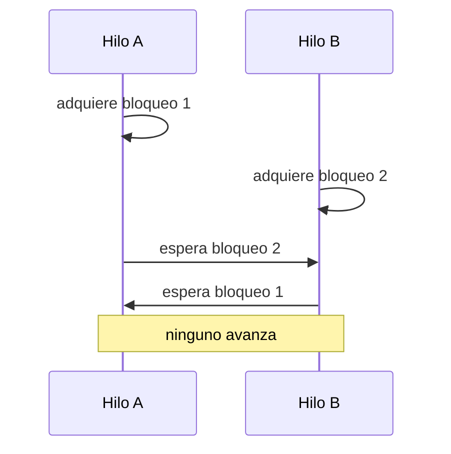

# JVM y concurrencia

Un servicio Java en producción falla por tres motivos recurrentes: **memoria** (heap agotado, GC largo), **hilos** (bloqueos, contención) y **condiciones de carrera** que solo aparecen bajo carga. Este bloque explica la JVM lo justo para diagnosticarlos.

_Revisado: 2026-10-06_

## De código a ejecución

```mermaid
flowchart LR
  J[".java"] -->|"javac"| B[".class<br/>bytecode"]
  B --> CL["Class loader"]
  CL --> INT["Intérprete"]
  INT -->|"código caliente"| JIT["Compilador JIT<br/>C1 · C2"]
  JIT --> NAT["Código nativo"]
  style JIT fill:#1a2233,stroke:#58a6ff
```



El bytecode es portable; la JVM lo interpreta y el **JIT** compila a nativo los métodos calientes. Por eso un servicio tarda en alcanzar su rendimiento máximo (*warm-up*): las primeras peticiones son más lentas.

## Modelo de memoria

```mermaid
flowchart TB
  subgraph HEAP["Heap · gestionado por el GC"]
    Y["Young<br/>Eden + Survivor"]
    O["Old<br/>objetos longevos"]
  end
  subgraph FUERA["Fuera del heap"]
    M["Metaspace<br/>clases"]
    S["Pilas de hilos<br/>~1 MB cada una"]
    D["Memoria directa<br/>NIO · buffers"]
  end
  Y -->|"sobreviven"| O
  style HEAP fill:#1a2233,stroke:#58a6ff
```



- **Heap**: todos los objetos. Se divide en *young* (objetos recientes, recogida frecuente y barata) y *old* (longevos, recogida cara).
- **Pila** (stack): una por hilo; variables locales y llamadas. Una recursión sin fin da `StackOverflowError`.
- **Metaspace**: metadatos de clases; fugas típicas con *class loaders* que no se liberan (despliegues en caliente).
- **Memoria directa** y **pilas** cuentan para el límite del contenedor aunque no estén en el heap: `-Xmx` no es el consumo total del proceso.

```bash
java -Xms2g -Xmx2g -XX:+UseG1GC -XX:MaxGCPauseMillis=200 -jar app.jar
java -XX:MaxRAMPercentage=75 -jar app.jar
java -XX:+HeapDumpOnOutOfMemoryError -XX:HeapDumpPath=/var/dumps -jar app.jar
```

:::tip En contenedores
Usa `-XX:MaxRAMPercentage` en lugar de un `-Xmx` fijo: respeta el límite del contenedor. Deja margen (~25 %) para metaspace, hilos y memoria nativa; si no, el kernel mata el proceso (`OOMKilled`) sin lanzar `OutOfMemoryError`.
:::

## Recolección de basura

El GC libera objetos inalcanzables. Los **objetos vivos** (alcanzables desde una raíz: pilas, estáticos) se conservan.

| Recolector | Perfil | Cuándo |
|---|---|---|
| G1 (por defecto) | equilibrado, pausas objetivo | casi siempre |
| ZGC / Shenandoah | pausas de milisegundos, heaps grandes | baja latencia estricta |
| Parallel | máximo rendimiento, pausas largas | procesos por lotes |
| Serial | mínimo | contenedores minúsculos |

```bash
java -Xlog:gc*:file=gc.log:time,uptime -jar app.jar
jstat -gcutil <PID> 1000
```

Señales de problema:

- **Pausas "stop-the-world" largas** o frecuentes: heap insuficiente o demasiada asignación.
- **Old gen que crece sin bajar tras un Full GC**: **fuga de memoria** (objetos retenidos por un mapa estático, una caché sin límite, listeners no eliminados).
- **`GC overhead limit exceeded`**: la JVM pasa casi todo el tiempo recogiendo basura.

Fuga clásica:

```java
public class Registro {
  private static final Map<String, Sesion> SESIONES = new HashMap<>();

  public static void abrir(String id, Sesion s) {
    SESIONES.put(id, s);
  }
}
```

Nadie elimina las sesiones cerradas: el mapa crece hasta agotar el heap. La solución es un límite y expiración explícitos (caché con tamaño máximo y TTL), no ampliar el heap.

## Hilos y el modelo de memoria

Un hilo ejecuta código concurrentemente. El problema no es crearlos sino **compartir estado mutable**.

```java
public class Contador {
  private int valor;

  public void incrementar() {
    valor++;
  }
}
```

`valor++` son tres pasos (leer, sumar, escribir): dos hilos pueden leer el mismo valor y perder un incremento (**condición de carrera**). Además, sin sincronización un hilo puede **no ver** lo que escribió otro (visibilidad). Las herramientas:

| Mecanismo | Garantiza | Uso |
|---|---|---|
| `synchronized` | exclusión mutua + visibilidad | secciones críticas simples |
| `volatile` | visibilidad, **no** atomicidad | banderas de parada |
| `AtomicInteger`, `LongAdder` | operaciones atómicas sin bloqueo | contadores |
| `ReentrantLock` | bloqueo con `tryLock` y timeout | casos avanzados |
| `ConcurrentHashMap` | mapa seguro con alta concurrencia | cachés, registros |
| Inmutabilidad | no hay nada que sincronizar | la mejor opción |

```java
public class ContadorSeguro {
  private final AtomicLong valor = new AtomicLong();

  public long incrementar() {
    return valor.incrementAndGet();
  }
}

Map<String, Integer> conteo = new ConcurrentHashMap<>();
conteo.merge("clave", 1, Integer::sum);
```

:::warning Compuestos no atómicos
`if (!mapa.containsKey(k)) mapa.put(k, v);` sobre un `ConcurrentHashMap` sigue siendo una carrera entre las dos llamadas. Usa `putIfAbsent`, `computeIfAbsent` o `merge`.
:::

### Deadlock



Se evita adquiriendo los bloqueos **siempre en el mismo orden**, usando `tryLock` con timeout y reduciendo el alcance de los bloqueos.

## Executors y pools de hilos

Nunca crees hilos a mano para cada tarea: usa un **pool** con límite.

```java
ExecutorService pool = Executors.newFixedThreadPool(8);

Future<Integer> f = pool.submit(() -> calcular());
int resultado = f.get(5, TimeUnit.SECONDS);

pool.shutdown();
if (!pool.awaitTermination(30, TimeUnit.SECONDS)) {
  pool.shutdownNow();
}
```

- **CPU-bound**: pool del tamaño del número de núcleos.
- **I/O-bound** (esperas de red o base de datos): más hilos, o hilos virtuales.
- Las colas **sin límite** (`newFixedThreadPool`, `newCachedThreadPool`) esconden sobrecarga: crecen hasta agotar memoria. En producción usa `ThreadPoolExecutor` con cola acotada y política de rechazo.
- Define siempre **timeouts** en las esperas.

```java
ThreadPoolExecutor pool = new ThreadPoolExecutor(
    4, 16, 60, TimeUnit.SECONDS,
    new ArrayBlockingQueue<>(200),
    new ThreadPoolExecutor.CallerRunsPolicy());
```

`CallerRunsPolicy` aplica **contrapresión**: si la cola se llena, el hilo que envía ejecuta la tarea y frena el ritmo.

## CompletableFuture

Composición asíncrona sin bloquear hilos:

```java
CompletableFuture<Cliente> cliente = CompletableFuture.supplyAsync(() -> clientes.buscar(id), pool);
CompletableFuture<List<Pedido>> pedidos = CompletableFuture.supplyAsync(() -> pedidosDe(id), pool);

CompletableFuture<Resumen> resumen = cliente
    .thenCombine(pedidos, Resumen::new)
    .orTimeout(3, TimeUnit.SECONDS)
    .exceptionally(e -> Resumen.vacio());

Resumen r = resumen.join();
```

Pasa siempre tu propio `Executor`: el `ForkJoinPool.commonPool()` por defecto es compartido y pequeño, y una tarea bloqueante lo satura.

## Hilos virtuales (Java 21)

Los **hilos virtuales** son baratos (miles o millones): la JVM los multiplexa sobre pocos hilos del sistema y los "aparca" mientras esperan I/O.

```java
try (var ejecutor = Executors.newVirtualThreadPerTaskExecutor()) {
  List<Future<String>> tareas = urls.stream()
      .map(u -> ejecutor.submit(() -> descargar(u)))
      .toList();
  for (var t : tareas) {
    System.out.println(t.get());
  }
}
```



```mermaid
flowchart LR
  subgraph V["Miles de hilos virtuales"]
    V1["v1"]
    V2["v2"]
    V3["v3 ..."]
  end
  V --> P["Pocos hilos de plataforma<br/>(carriers ≈ núcleos)"]
  P --> OS["Sistema operativo"]
  style V fill:#1a2d1a,stroke:#39d353
```

- Ideales para código **bloqueante de I/O** (servidor "un hilo por petición") con escalado casi gratuito.
- **No aceleran trabajo de CPU**.
- No los metas en un pool (se crean por tarea) y evita `synchronized` largo alrededor de I/O: puede "fijar" (*pinning*) al hilo portador. Prefiere `ReentrantLock`.
- Limita la **concurrencia hacia recursos** (base de datos, APIs) con un `Semaphore`: tener un millón de hilos no significa que el servidor de abajo aguante un millón de peticiones.

## Diagnóstico en producción

```bash
jps -lv
jcmd <PID> VM.flags
jcmd <PID> GC.heap_info
jcmd <PID> Thread.print > hilos.txt
jcmd <PID> GC.heap_dump /tmp/heap.hprof
jstack <PID> | grep -A 15 "BLOCKED"
top -H -p <PID>
```

Método según el síntoma:

```mermaid
flowchart TD
  S["Síntoma"] --> A{"CPU alta"}
  S --> B{"Memoria crece"}
  S --> C{"Peticiones colgadas"}
  A --> A1["top -H → hilo caliente<br/>→ jstack (hex del TID)"]
  B --> B1["heap dump → Eclipse MAT<br/>buscar el retenedor"]
  C --> C1["thread dump x3<br/>BLOCKED · WAITING · deadlock"]
  style A1 fill:#1a2233,stroke:#58a6ff
  style B1 fill:#1a2233,stroke:#58a6ff
  style C1 fill:#1a2233,stroke:#58a6ff
```



1. **CPU alta**: `top -H` identifica el hilo; conviértelo a hexadecimal y búscalo (`nid=0x...`) en el `jstack`.
2. **Memoria**: heap dump y análisis en Eclipse MAT: *dominator tree* y "leak suspects" muestran qué retiene el espacio.
3. **Peticiones colgadas**: tres *thread dumps* separados unos segundos; los hilos que siguen en el mismo sitio son el cuello de botella. `jstack` avisa de deadlocks.
4. **Latencia a ratos**: revisa el log de GC; correlaciona las pausas con los picos.

**JFR** (Java Flight Recorder) perfila en producción con coste mínimo:

```bash
jcmd <PID> JFR.start duration=60s filename=/tmp/perfil.jfr
```

## Trampas frecuentes

- **Ampliar el heap** para "arreglar" una fuga: solo retrasa el fallo.
- **`-Xmx` igual al límite del contenedor**: el proceso supera el límite con metaspace e hilos y recibe `OOMKilled`.
- **Estado mutable compartido** sin sincronizar, o `HashMap` usado desde varios hilos.
- **Pools con cola ilimitada**: sobrecarga disfrazada, memoria agotada.
- **Bloquear dentro del `commonPool`** de `CompletableFuture`.
- **Esperas sin timeout**: una dependencia lenta cuelga todos los hilos.
- **`Thread.sleep` como sincronización**: carreras que "funcionan en mi máquina".
- **Medir rendimiento sin calentar la JVM**: usa JMH para microbenchmarks.

## Comprueba que lo entiendes

1. Un servicio en un contenedor de 2 GB con `-Xmx2g` muere sin `OutOfMemoryError`. ¿Qué ha pasado?
2. ¿Por qué `volatile int contador; contador++;` no es seguro entre hilos?
3. ¿Qué diferencia práctica hay entre un hilo virtual y un hilo de plataforma, y cuándo no ayudan?
4. Un endpoint se cuelga de forma intermitente. ¿Cómo localizas el bloqueo?

**Mini-ejercicio.** Convierte este contador en uno seguro para múltiples hilos con el mínimo cambio.

```java
public class Visitas {
  private final LongAdder total = new LongAdder();

  public void registrar() {
    total.increment();
  }

  public long total() {
    return total.sum();
  }
}
```

<details>
  <summary>Respuestas</summary>

1. El proceso total (heap + metaspace + pilas + memoria directa) superó el límite del contenedor y el kernel lo mató (`OOMKilled`). Hay que dejar margen con `MaxRAMPercentage` (~75 %).
2. `volatile` garantiza visibilidad, no atomicidad: `contador++` son tres pasos (leer, sumar, escribir) y dos hilos pueden pisarse. Se usa `AtomicInteger` o `LongAdder`.
3. El hilo virtual es muy barato y se aparca durante el I/O bloqueante, permitiendo miles de tareas concurrentes con pocos hilos reales. No ayuda con trabajo de CPU ni elimina los límites de los recursos externos.
4. Varios `jstack`/`jcmd Thread.print` separados unos segundos: se buscan hilos `BLOCKED` o esperando el mismo monitor; `jstack` también reporta deadlocks. Se correlaciona con el log de GC por si son pausas.

</details>

## Referencias

- [Java Concurrency in Practice](https://jcip.net/)
- [JEP 444 — Virtual Threads](https://openjdk.org/jeps/444)
- [Oracle — Ajuste del recolector de basura](https://docs.oracle.com/en/java/javase/21/gctuning/)
- [Eclipse Memory Analyzer (MAT)](https://eclipse.dev/mat/)
