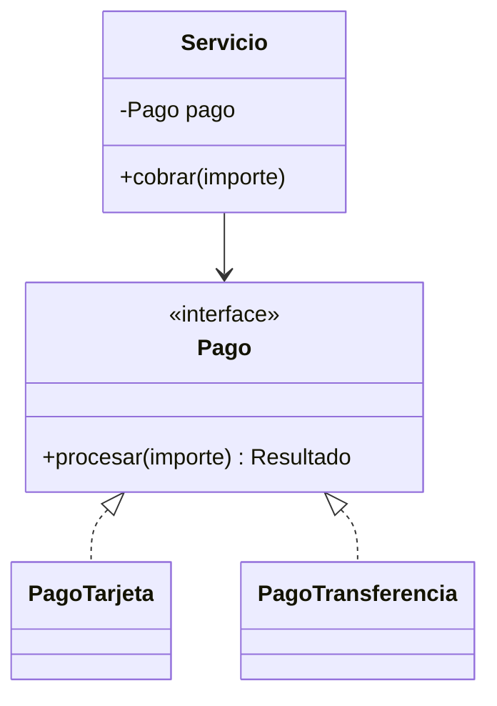

# Lenguaje y colecciones

Java se aprende en una semana y se domina en años: lo que distingue el código fiable son los detalles de **igualdad, mutabilidad, colecciones y excepciones**. Este bloque usa Java 21 (LTS) y va a lo que provoca errores reales.

_Revisado: 2026-10-06_

## Tipos y memoria

Hay **primitivos** (`int`, `long`, `double`, `boolean`...) que viven por valor, y **referencias** a objetos. `==` compara referencias en objetos y valores en primitivos.

```java
int a = 127;
Integer b = 127;
Integer c = 127;
Integer d = 1000;
Integer e = 1000;

System.out.println(b == c);
System.out.println(d == e);
System.out.println(d.equals(e));
```

La segunda comparación da `false`: `Integer` cachea valores entre -128 y 127, y fuera de ese rango son objetos distintos. **Los objetos se comparan con `equals`**, nunca con `==`.

| Pregunta | Respuesta |
|---|---|
| `String` es mutable | no, es inmutable; `+` en bucles crea objetos: usa `StringBuilder` |
| `float`/`double` para dinero | no; usa `BigDecimal` |
| `int` desborda | silenciosamente; `Math.addExact` lanza excepción |
| Paso de argumentos | siempre por valor (de la referencia, en objetos) |

```java
BigDecimal total = new BigDecimal("19.99").multiply(BigDecimal.valueOf(3)).setScale(2, RoundingMode.HALF_UP);

String csv = String.join(",", List.of("a", "b", "c"));
String texto = """
    {
      "estado": "ok"
    }
    """;
```

## Clases, interfaces y records



Programa contra **interfaces**: `Servicio` depende de `Pago`, no de una implementación concreta, lo que permite sustituirla en pruebas y en producción.

Un **record** es un tipo de datos inmutable con constructor, `equals`, `hashCode` y `toString` generados:

```java
public record Cliente(long id, String nombre, String email) {
  public Cliente {
    if (nombre == null || nombre.isBlank()) {
      throw new IllegalArgumentException("nombre obligatorio");
    }
  }
}

public sealed interface Resultado permits Ok, Error {}
public record Ok(String referencia) implements Resultado {}
public record Error(String motivo) implements Resultado {}

static String describir(Resultado r) {
  return switch (r) {
    case Ok ok -> "pagado " + ok.referencia();
    case Error err -> "fallo " + err.motivo();
  };
}
```

`sealed` limita las implementaciones, de modo que el `switch` es **exhaustivo**: el compilador avisa si falta un caso. Es la forma moderna de modelar "uno de varios tipos".

Otras piezas habituales de Java moderno:

- `var` infiere el tipo local: `var lista = new ArrayList<Cliente>();`.
- `enum` con campos y métodos para conjuntos cerrados de valores.
- **Pattern matching**: `if (obj instanceof String s && !s.isEmpty())`.
- **Composición antes que herencia**: la herencia acopla fuertemente; úsala solo para relaciones "es un" estables.

## equals y hashCode

Dos reglas que el contrato exige y que rompen las colecciones hash cuando se incumplen:

1. Si `a.equals(b)`, entonces `a.hashCode() == b.hashCode()`.
2. `hashCode` debe ser estable mientras el objeto esté dentro de un `HashMap` o `HashSet`.

```java
public final class Sku {
  private final String codigo;

  public Sku(String codigo) { this.codigo = codigo; }

  @Override
  public boolean equals(Object o) {
    return this == o || (o instanceof Sku s && codigo.equals(s.codigo));
  }

  @Override
  public int hashCode() {
    return codigo.hashCode();
  }
}
```

Si sobrescribes `equals` sin `hashCode`, `set.contains(new Sku("A1"))` da `false` aunque el elemento esté. Un **record** resuelve ambos automáticamente.

:::warning Claves mutables
Usar un objeto mutable como clave de un `HashMap` y modificarlo después cambia su `hashCode`: el elemento queda "perdido" en un bucket equivocado. Usa claves inmutables.
:::

## Genéricos

```java
public static <T extends Comparable<T>> T maximo(List<T> lista) {
  T mejor = lista.get(0);
  for (T t : lista) {
    if (t.compareTo(mejor) > 0) mejor = t;
  }
  return mejor;
}

List<? extends Number> lectura = List.of(1, 2.5);
List<? super Integer> escritura = new ArrayList<Number>();
```

Regla **PECS** (*producer extends, consumer super*): si solo lees de la colección, `? extends T`; si solo escribes, `? super T`. Por **borrado de tipos**, en tiempo de ejecución `List<String>` y `List<Integer>` son la misma clase.

## Colecciones

```mermaid
flowchart TB
  C["Collection"] --> L["List<br/>ordenada · duplicados"]
  C --> S["Set<br/>sin duplicados"]
  C --> Q["Queue / Deque"]
  M["Map<br/>clave → valor"]
  L --> AL["ArrayList"]
  L --> LL["LinkedList"]
  S --> HS["HashSet"]
  S --> TS["TreeSet<br/>ordenado"]
  M --> HM["HashMap"]
  M --> TM["TreeMap"]
  M --> LHM["LinkedHashMap<br/>orden de inserción"]
  style M fill:#1a2233,stroke:#58a6ff
```



| Estructura | Acceso | Inserción | Cuándo |
|---|---|---|---|
| `ArrayList` | O(1) por índice | O(1) amortizado al final | por defecto en listas |
| `LinkedList` | O(n) | O(1) en extremos | casi nunca; `ArrayDeque` es mejor |
| `HashMap` / `HashSet` | O(1) medio | O(1) medio | búsqueda por clave |
| `TreeMap` / `TreeSet` | O(log n) | O(log n) | orden o rangos |
| `ArrayDeque` | extremos O(1) | O(1) | pilas y colas |
| `PriorityQueue` | mínimo O(1) | O(log n) | siempre el siguiente por prioridad |

```java
List<String> fija = List.of("a", "b");
Map<String, Integer> conteo = new HashMap<>();
for (String palabra : palabras) {
  conteo.merge(palabra, 1, Integer::sum);
}
Map<Long, List<Pedido>> porCliente = pedidos.stream().collect(Collectors.groupingBy(Pedido::clienteId));
conteo.computeIfAbsent("clave", k -> 0);
```

- `List.of`, `Set.of`, `Map.of` crean colecciones **inmutables**; modificarlas lanza `UnsupportedOperationException`.
- Modificar una lista mientras la recorres con `for-each` lanza `ConcurrentModificationException`: usa `removeIf` o un `Iterator`.
- `HashMap` y `ArrayList` **no son seguros para hilos** (ver [JVM y concurrencia](/java/jvm-concurrencia)).

## Streams y Optional

```java
record Pedido(long id, long clienteId, String estado, BigDecimal importe) {}

BigDecimal totalPagado = pedidos.stream()
    .filter(p -> p.estado().equals("pagado"))
    .map(Pedido::importe)
    .reduce(BigDecimal.ZERO, BigDecimal::add);

Map<String, Long> porEstado = pedidos.stream()
    .collect(Collectors.groupingBy(Pedido::estado, Collectors.counting()));

List<Long> topClientes = pedidos.stream()
    .collect(Collectors.groupingBy(Pedido::clienteId, Collectors.reducing(BigDecimal.ZERO, Pedido::importe, BigDecimal::add)))
    .entrySet().stream()
    .sorted(Map.Entry.<Long, BigDecimal>comparingByValue().reversed())
    .limit(3)
    .map(Map.Entry::getKey)
    .toList();
```

Los streams son **perezosos**: no hacen nada hasta una operación terminal (`collect`, `toList`, `reduce`, `forEach`). No reutilices un stream ya consumido.

```java
Optional<Cliente> cliente = repositorio.buscarPorEmail(email);
String nombre = cliente.map(Cliente::nombre).orElse("desconocido");
Cliente c = cliente.orElseThrow(() -> new NoSuchElementException("cliente no encontrado"));
```

`Optional` es para **valores de retorno** que pueden faltar. No lo uses como campo, parámetro ni dentro de colecciones, y evita `.get()` sin comprobar.

## Excepciones

```mermaid
flowchart TB
  T["Throwable"] --> E["Exception"]
  T --> ER["Error<br/>OutOfMemoryError · StackOverflowError"]
  E --> CH["Comprobadas<br/>IOException · SQLException"]
  E --> RT["RuntimeException<br/>no comprobadas"]
  RT --> I["IllegalArgumentException"]
  RT --> N["NullPointerException"]
  style ER fill:#2d1a1a,stroke:#ff7b72
```



```java
public String leer(Path ruta) {
  try (var lineas = Files.lines(ruta)) {
    return lineas.collect(Collectors.joining("\n"));
  } catch (IOException e) {
    throw new UncheckedIOException("no se pudo leer " + ruta, e);
  }
}
```

- **try-with-resources** cierra automáticamente lo que implementa `AutoCloseable`: conexiones, ficheros, streams.
- Conserva la **causa** al relanzar (`new X(msg, e)`); perder el stack trace original hace imposible depurar.
- Nunca **tragues** una excepción con un `catch` vacío. Si capturas, registra o actúa.
- Lanza excepciones **específicas** y con contexto: `IllegalStateException("pedido 42 ya enviado")` y no `Exception("error")`.
- Las comprobadas obligan a manejar un fallo recuperable; las no comprobadas señalan errores de programación o de contrato.

## Fechas e inmutabilidad

```java
Instant ahora = Instant.now();
LocalDate hoy = LocalDate.now();
ZonedDateTime madrid = ZonedDateTime.now(ZoneId.of("Europe/Madrid"));
Duration espera = Duration.ofSeconds(30);
LocalDate venc = hoy.plusDays(30);
```

Usa `java.time` (inmutable y seguro para hilos), nunca `Date` ni `SimpleDateFormat`. Guarda y transmite **instantes en UTC** (`Instant`) y convierte a zona horaria solo al mostrar.

## Trampas frecuentes

- **`==` con `String` o `Integer`**: compara referencias. Usa `equals`.
- **`equals` sin `hashCode`**: las colecciones hash fallan en silencio.
- **`double` para dinero**: usa `BigDecimal` con escala y modo de redondeo explícitos.
- **`NullPointerException`**: devuelve colecciones vacías en lugar de `null`; usa `Objects.requireNonNull` en los constructores.
- **Modificar una colección durante la iteración**: `ConcurrentModificationException`.
- **`catch (Exception e) {}` vacío**: el error desaparece.
- **Concatenar `String` en bucles**: cuadrático; `StringBuilder` o `String.join`.
- **Streams con efectos secundarios** (modificar una lista externa): resultados impredecibles, sobre todo en paralelo.

## Comprueba que lo entiendes

1. ¿Por qué `new Integer(1000) == new Integer(1000)` puede dar `false` y `Integer.valueOf(100) == Integer.valueOf(100)` dar `true`?
2. Sobrescribes `equals` pero no `hashCode`. ¿Qué falla y dónde?
3. ¿Cuándo prefieres un `record` y cuándo una clase normal?
4. ¿Por qué el siguiente código no imprime nada? `lista.stream().filter(x -> x > 3).peek(System.out::println);`

**Mini-ejercicio.** Dada una lista de pedidos, devuelve los 3 clientes con mayor importe total.

```java
Map<Long, BigDecimal> totales = pedidos.stream()
    .collect(Collectors.groupingBy(Pedido::clienteId, Collectors.reducing(BigDecimal.ZERO, Pedido::importe, BigDecimal::add)));
```

<details>
  <summary>Respuestas</summary>

1. Los valores entre -128 y 127 se cachean y comparten la misma instancia; fuera de ese rango (o con `new`) son objetos distintos y `==` compara referencias.
2. Las colecciones hash (`HashMap`, `HashSet`) usan `hashCode` para elegir bucket: dos objetos iguales con hash distinto no se encuentran (`contains`, `get`, `remove` fallan) y se admiten duplicados.
3. Un `record` para datos inmutables y transparentes (DTOs, claves, valores de dominio). Una clase normal cuando hay estado mutable, identidad, herencia o lógica de ciclo de vida.
4. No hay **operación terminal**: los streams son perezosos y `peek` no se ejecuta sin un `collect`, `forEach`, `count`, etc.

</details>

## Referencias

- [Java SE 21 — API](https://docs.oracle.com/en/java/javase/21/docs/api/)
- [Effective Java — Joshua Bloch](https://www.oreilly.com/library/view/effective-java/9780134686097/)
- [Dev.java — tutoriales oficiales](https://dev.java/learn/)
- [JEP 441 — pattern matching para switch](https://openjdk.org/jeps/441)
