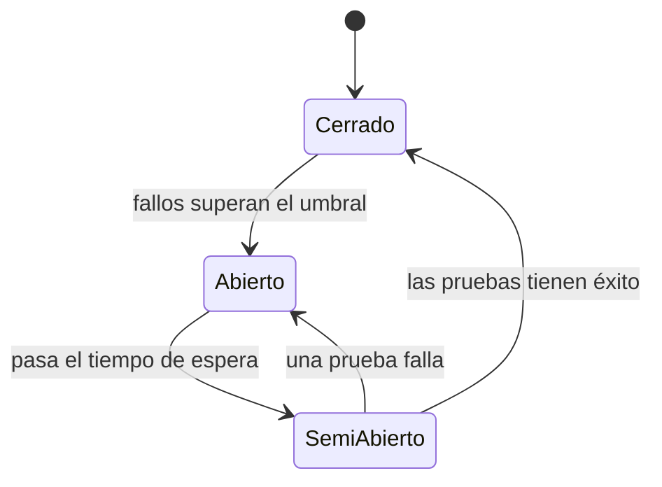
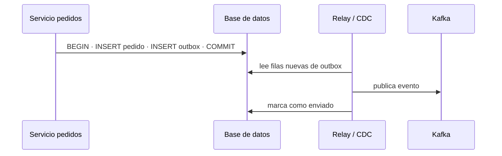

# Microservicios y mensajería

Dividir un sistema en servicios traslada la complejidad del **código** a la **red**: latencias, fallos parciales, datos repartidos. Este bloque explica cuándo compensa, cómo comunicar servicios sin crear dependencias frágiles y qué patrones evitan perder o duplicar datos.

_Revisado: 2026-10-06_

## Monolito, monolito modular y microservicios

| | Monolito | Microservicios |
|---|---|---|
| Despliegue | uno | independiente por servicio |
| Transacciones | locales (ACID) | distribuidas, consistencia eventual |
| Complejidad operativa | baja | alta (red, observabilidad, versionado) |
| Escalado | todo junto | por servicio |
| Equipos | un equipo o pocos | varios equipos autónomos |

:::tip Empieza modular
Un **monolito modular** (módulos con fronteras claras y sin acceso cruzado a tablas) cubre la mayoría de casos y permite extraer un servicio cuando haya un motivo real: escala distinta, ciclo de despliegue independiente o equipo propio. Los microservicios prematuros crean un **monolito distribuido**: todas las desventajas y ninguna ventaja.
:::

Cómo dividir: por **capacidad de negocio** (pedidos, catálogo, facturación), no por capa técnica. Cada servicio es **dueño de sus datos**: nadie más lee su base de datos; se comunica por su API o por eventos.

```mermaid
flowchart LR
  GW["API Gateway"] --> PED["Servicio pedidos<br/>BD propia"]
  GW --> CAT["Servicio catálogo<br/>BD propia"]
  PED -->|"evento: PedidoCreado"| BUS[("Kafka")]
  BUS --> STK["Stock"]
  BUS --> FAC["Facturación"]
  BUS --> NOT["Notificaciones"]
  style BUS fill:#1a2233,stroke:#58a6ff
  style GW fill:#1a2d1a,stroke:#39d353
```



## Comunicación síncrona

REST o gRPC: el llamante espera la respuesta.

```java
@Component
public class CatalogoCliente {
  private final RestClient http;

  public CatalogoCliente(RestClient.Builder builder, @Value("${catalogo.url}") String url) {
    var factoria = new JdkClientHttpRequestFactory();
    factoria.setReadTimeout(Duration.ofSeconds(2));
    this.http = builder.baseUrl(url).requestFactory(factoria).build();
  }

  public ProductoDto producto(String sku) {
    return http.get().uri("/api/productos/{sku}", sku).retrieve().body(ProductoDto.class);
  }
}
```

- **Todo cliente HTTP con timeouts** de conexión y lectura: sin ellos, un servicio lento agota los hilos del llamante.
- Acopla en **tiempo**: si el catálogo cae, pedidos falla. Úsalo cuando necesitas la respuesta ya.
- **Versiona** las APIs (`/v1`) y mantén compatibilidad hacia atrás; los consumidores no se actualizan al mismo tiempo.
- Contratos explícitos: **OpenAPI** y pruebas de contrato (Pact, Spring Cloud Contract).

## Resiliencia

Los fallos en cascada son el modo de caída típico: un servicio lento ocupa hilos de todos los demás.

```java
@Service
public class PrecioService {

  @CircuitBreaker(name = "catalogo", fallbackMethod = "precioEnCache")
  @Retry(name = "catalogo")
  @TimeLimiter(name = "catalogo")
  public CompletableFuture<BigDecimal> precio(String sku) {
    return CompletableFuture.supplyAsync(() -> cliente.producto(sku).precio());
  }

  CompletableFuture<BigDecimal> precioEnCache(String sku, Throwable causa) {
    return CompletableFuture.completedFuture(cache.ultimoPrecio(sku));
  }
}
```

```yaml title="application.yml"
resilience4j:
  circuitbreaker:
    instances:
      catalogo:
        sliding-window-size: 20
        failure-rate-threshold: 50
        wait-duration-in-open-state: 30s
  retry:
    instances:
      catalogo:
        max-attempts: 3
        wait-duration: 200ms
        enable-exponential-backoff: true
```



| Patrón | Qué evita |
|---|---|
| **Timeout** | esperas infinitas |
| **Retry con backoff y jitter** | fallos transitorios; sin backoff, una tormenta de reintentos hunde al servicio |
| **Circuit breaker** | seguir llamando a un servicio caído |
| **Bulkhead** (compartimentos) | que un servicio lento consuma todos los hilos |
| **Fallback** | dar una respuesta degradada en lugar de un error |
| **Rate limiting** | sobrecarga por clientes abusivos |

:::warning Reintentos
Reintentar solo es seguro si la operación es **idempotente**. Reintentar un `POST /pagos` sin clave de idempotencia puede cobrar dos veces.
:::

## Comunicación asíncrona con Kafka

Los servicios publican **eventos** y otros reaccionan cuando pueden. Desacopla en tiempo y absorbe picos.

```mermaid
flowchart LR
  P["Productor"] --> T
  subgraph T["Topic pedidos · 3 particiones"]
    P0["Partición 0"]
    P1["Partición 1"]
    P2["Partición 2"]
  end
  P0 --> C1["Consumidor A<br/>grupo facturación"]
  P1 --> C2["Consumidor B<br/>grupo facturación"]
  P2 --> C2
  P0 --> D["Consumidor C<br/>grupo notificaciones"]
  P1 --> D
  P2 --> D
  style T fill:#1a2233,stroke:#58a6ff
```



| Concepto | Significado |
|---|---|
| **Topic** | flujo de eventos con nombre |
| **Partición** | unidad de paralelismo y de **orden**: el orden solo se garantiza dentro de una partición |
| **Clave** | determina la partición: mismos pedidos, misma clave, mismo orden |
| **Offset** | posición del consumidor en una partición |
| **Grupo de consumidores** | cada partición la lee un solo miembro del grupo; grupos distintos reciben todos los mensajes |
| **Retención** | los eventos se guardan un tiempo (o indefinidamente) y se pueden **releer** |

```java
@Service
public class PedidoEventos {
  private final KafkaTemplate<String, PedidoCreado> kafka;

  public PedidoEventos(KafkaTemplate<String, PedidoCreado> kafka) {
    this.kafka = kafka;
  }

  public void publicar(PedidoCreado evento) {
    kafka.send("pedidos.creados", String.valueOf(evento.pedidoId()), evento);
  }
}

@Component
public class FacturacionConsumidor {

  @KafkaListener(topics = "pedidos.creados", groupId = "facturacion")
  public void alRecibir(PedidoCreado evento, Acknowledgment ack) {
    facturas.emitir(evento);
    ack.acknowledge();
  }
}
```

```yaml title="application.yml"
spring:
  kafka:
    bootstrap-servers: kafka:9092
    producer:
      acks: all
      properties:
        enable.idempotence: true
        max.in.flight.requests.per.connection: 5
    consumer:
      enable-auto-commit: false
      auto-offset-reset: earliest
      properties:
        isolation.level: read_committed
    listener:
      ack-mode: manual
```

- `acks: all` e idempotencia en el productor: no se pierden ni duplican mensajes por reintentos del productor.
- **Confirma el offset después de procesar** (`ack` manual): si la aplicación cae a medias, el mensaje se reentrega.
- El orden por entidad se logra usando su **identificador como clave**.
- Más consumidores que particiones no aportan nada: las particiones limitan el paralelismo.

### Entrega y duplicados

Un consumidor suele ofrecer **al menos una vez**: puede recibir el mismo evento dos veces (reequilibrio, caída antes de confirmar). Debe ser **idempotente**.

```java
@Transactional
public void emitir(PedidoCreado evento) {
  if (procesados.existsById(evento.eventoId())) {
    return;
  }
  facturaRepositorio.save(Factura.de(evento));
  procesados.save(new EventoProcesado(evento.eventoId()));
}
```

Registrar los **identificadores de evento procesados** en la misma transacción que el efecto convierte "al menos una vez" en "una vez efectiva". Los mensajes que fallan repetidamente van a una **cola de mensajes fallidos** (*dead-letter topic*) para no bloquear la partición.

```java
@Bean
DefaultErrorHandler errores(KafkaTemplate<Object, Object> plantilla) {
  var recuperador = new DeadLetterPublishingRecoverer(plantilla);
  return new DefaultErrorHandler(recuperador, new FixedBackOff(1000L, 3));
}
```

## Consistencia entre servicios

No hay transacción ACID entre servicios. Dos problemas y su solución:

### El problema de la doble escritura: Outbox

Guardar el pedido **y** publicar el evento no es atómico: si cae entre ambos, hay un pedido sin evento (o al revés).



```sql
CREATE TABLE outbox (
  id          uuid PRIMARY KEY,
  agregado    text NOT NULL,
  tipo        text NOT NULL,
  payload     jsonb NOT NULL,
  creado      timestamptz NOT NULL DEFAULT now(),
  publicado   boolean NOT NULL DEFAULT false
);
```

El evento se guarda en la **misma transacción** que el cambio de negocio; un proceso aparte (relay o **Debezium** leyendo el WAL) lo publica. Garantiza al menos una vez, sin pérdidas.

### Transacciones distribuidas: Saga

Un proceso de varios pasos (reservar stock, cobrar, enviar) se coordina como una secuencia de transacciones locales con **compensaciones** si algo falla.

```mermaid
flowchart LR
  A["Crear pedido"] --> B["Reservar stock"]
  B --> C["Cobrar"]
  C --> D["Confirmar pedido"]
  C -.->|"falla el pago"| X["Compensar:<br/>liberar stock"]
  X -.-> Y["Cancelar pedido"]
  style X fill:#2d1a1a,stroke:#ff7b72
  style D fill:#1a2d1a,stroke:#39d353
```



- **Coreografía**: cada servicio reacciona a eventos del anterior. Simple al principio, difícil de seguir con muchos pasos.
- **Orquestación**: un coordinador dirige los pasos y compensaciones; más visible y fácil de depurar.
- Las compensaciones son **lógica de negocio** (reembolsar, cancelar), no un `ROLLBACK`.

## Gateway, descubrimiento y configuración

- **API Gateway** (Spring Cloud Gateway, Kong, el del proveedor): punto único de entrada con autenticación, límites de tasa y enrutado.
- **Descubrimiento de servicios**: en Kubernetes lo da el DNS interno (`http://catalogo`); no hace falta Eureka.
- **Configuración centralizada** con `ConfigMap`/`Secret` o Spring Cloud Config.
- **BFF** (*backend for frontend*): una API adaptada a cada cliente que agrega llamadas.

## Observabilidad distribuida

Con varios servicios, un fallo no se diagnostica mirando un log.

```mermaid
flowchart LR
  U["Petición<br/>traceId=a1b2"] --> G["Gateway"]
  G --> P["Pedidos<br/>spanId=1"]
  P --> C["Catálogo<br/>spanId=2"]
  P --> K["Kafka"]
  K --> F["Facturación<br/>spanId=3"]
  style U fill:#1a2233,stroke:#58a6ff
```



```yaml title="application.yml"
management:
  tracing:
    sampling:
      probability: 0.1
  otlp:
    tracing:
      endpoint: http://otel-collector:4318/v1/traces
logging:
  pattern:
    level: "%5p [${spring.application.name},%X{traceId},%X{spanId}]"
```

- **Trazas distribuidas** (OpenTelemetry, Jaeger, Tempo): un `traceId` une los pasos entre servicios y mensajes.
- **Logs con `traceId`** para saltar de una traza a los logs de cada servicio.
- **Métricas** por servicio (RED: tasa, errores, duración) y **lag de consumidores** de Kafka.
- Comprobaciones de **salud** (`/actuator/health/liveness` y `readiness`) para el orquestador.

```bash
kafka-consumer-groups.sh --bootstrap-server kafka:9092 --describe --group facturacion
kafka-topics.sh --bootstrap-server kafka:9092 --describe --topic pedidos.creados
kafka-console-consumer.sh --bootstrap-server kafka:9092 --topic pedidos.creados --from-beginning --max-messages 5
```

El **lag** (diferencia entre el último offset y el consumido) que crece indica que el consumidor no da abasto: es la alerta más útil de un sistema con colas.

## Trampas frecuentes

- **Microservicios prematuros**: monolito distribuido con más problemas y las mismas dependencias.
- **Base de datos compartida entre servicios**: acoplamiento oculto; no se puede cambiar el esquema de uno sin afectar a otro.
- **Llamadas síncronas encadenadas** (A llama a B llama a C): la disponibilidad es el producto de todas.
- **Sin timeouts** en clientes HTTP: un servicio lento tumba al llamante.
- **Reintentos sin idempotencia** ni backoff: duplicados y tormentas.
- **Asumir entrega exactamente una vez**: los consumidores deben tolerar duplicados.
- **Doble escritura** (base de datos y Kafka) sin Outbox: pérdidas silenciosas.
- **Mensajes venenosos** que bloquean una partición: faltan DLT y límite de reintentos.
- **Cambiar un evento de forma incompatible**: usa un **registro de esquemas** (Avro/JSON Schema) y evolución compatible.
- **Sin trazas ni IDs de correlación**: depurar es imposible.

## Comprueba que lo entiendes

1. ¿Por qué un consumidor de Kafka debe ser idempotente aunque el productor use `acks=all`?
2. Tienes un topic con 6 particiones y despliegas 10 consumidores del mismo grupo. ¿Cuántos trabajan?
3. ¿Qué problema resuelve el patrón Outbox y cómo?
4. Un servicio A depende de B de forma síncrona y B se vuelve lento. ¿Qué tres mecanismos aplicas?

**Mini-ejercicio.** Garantiza el orden de los eventos de cada pedido en Kafka.

```java
kafka.send("pedidos.eventos", String.valueOf(evento.pedidoId()), evento);
```

<details>
  <summary>Respuestas</summary>

1. Porque la entrega es al menos una vez: un reequilibrio o una caída antes de confirmar el offset reentrega el mensaje. `acks=all` protege al **productor**, no evita duplicados en el consumo.
2. Seis; las otras cuatro quedan ociosas. El paralelismo máximo de un grupo es el número de particiones.
3. La doble escritura no atómica (base de datos y mensajería). Guarda el evento en una tabla `outbox` en la misma transacción local y un relay lo publica después.
4. **Timeout** corto, **circuit breaker** (con fallback) y **bulkhead**/límite de concurrencia; además de reintentos con backoff solo si la operación es idempotente.

</details>

## Referencias

- [Apache Kafka — documentación](https://kafka.apache.org/documentation/)
- [Spring for Apache Kafka](https://docs.spring.io/spring-kafka/reference/)
- [Resilience4j](https://resilience4j.readme.io/docs/getting-started)
- [microservices.io — patrones](https://microservices.io/patterns/index.html)
- [Debezium](https://debezium.io/documentation/)
