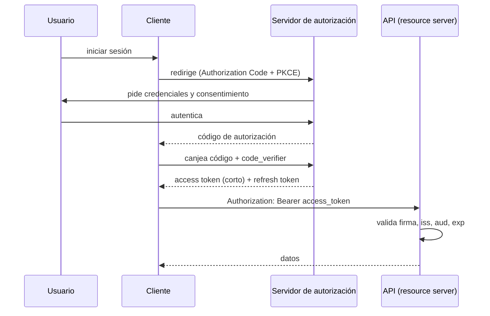

# Seguridad con Spring Security

Una API sin seguridad bien resuelta es una vulnerabilidad esperando a ser explotada. Este bloque separa los conceptos que más se confunden (**autenticación** frente a **autorización**) y cubre cómo se configuran correctamente en Spring Boot 3.

_Revisado: 2026-10-06_

## Autenticación y autorización

| Concepto | Pregunta | Fallo habitual |
|---|---|---|
| **Autenticación** | ¿quién eres? | credenciales débiles, sesiones robables |
| **Autorización** | ¿qué puedes hacer? | comprobar solo en el cliente, IDOR |

```mermaid
flowchart LR
  R["Petición HTTP"] --> F["Cadena de filtros<br/>SecurityFilterChain"]
  F --> A{"¿Autenticado?"}
  A -->|"no"| E1["401 Unauthorized"]
  A -->|"sí"| Z{"¿Autorizado?"}
  Z -->|"no"| E2["403 Forbidden"]
  Z -->|"sí"| C["Controlador"]
  style E1 fill:#2d1a1a,stroke:#ff7b72
  style E2 fill:#2d1a1a,stroke:#ff7b72
  style C fill:#1a2d1a,stroke:#39d353
```



`401` significa "no sé quién eres"; `403` significa "sé quién eres y no puedes". Confundirlos dificulta el diagnóstico.

## Configuración básica

```java
@Configuration
@EnableWebSecurity
@EnableMethodSecurity
public class SeguridadConfig {

  @Bean
  SecurityFilterChain filtros(HttpSecurity http) throws Exception {
    return http
        .csrf(csrf -> csrf.disable())
        .sessionManagement(s -> s.sessionCreationPolicy(SessionCreationPolicy.STATELESS))
        .authorizeHttpRequests(a -> a
            .requestMatchers("/actuator/health", "/api/publico/**").permitAll()
            .requestMatchers(HttpMethod.GET, "/api/productos/**").permitAll()
            .requestMatchers("/api/admin/**").hasRole("ADMIN")
            .anyRequest().authenticated())
        .oauth2ResourceServer(o -> o.jwt(Customizer.withDefaults()))
        .build();
  }

  @Bean
  PasswordEncoder passwordEncoder() {
    return new BCryptPasswordEncoder(12);
  }
}
```

- **`anyRequest().authenticated()` al final**: denegar por defecto; lo público se abre de forma explícita.
- **El orden importa**: las reglas se evalúan de arriba abajo y gana la primera que coincide; las específicas, primero.
- `STATELESS` y sin sesión: cada petición lleva su credencial (token).
- Se desactiva **CSRF** únicamente en APIs sin sesiones ni cookies de autenticación; con sesión basada en cookies debe estar activo.

## Contraseñas

```java
String hash = passwordEncoder.encode("clave-del-usuario");
boolean valida = passwordEncoder.matches("clave-del-usuario", hash);
```

- **Nunca** se guardan contraseñas en claro ni con hash rápido (MD5, SHA-1, SHA-256 sin sal).
- Se usa un algoritmo **lento y con sal**: **bcrypt**, **Argon2** o **scrypt**; el coste hace inviable la fuerza bruta.
- `DelegatingPasswordEncoder` (por defecto) guarda el prefijo del algoritmo (`{bcrypt}...`) y permite migrar a otro más fuerte.
- Políticas útiles: longitud mínima, comprobación contra contraseñas filtradas, **MFA** y bloqueo/ralentización tras intentos fallidos.

## JWT y OAuth2

Un **JWT** (JSON Web Token) es un token firmado con tres partes: cabecera, cuerpo (*claims*) y firma.

```text
eyJhbGciOiJSUzI1NiJ9.eyJzdWIiOiI0MiIsInNjb3BlIjoicmVhZCIsImV4cCI6MTc2MDAwMDAwMH0.firma
```

```json
{
  "sub": "42",
  "iss": "https://auth.ejemplo.com",
  "aud": "api-pedidos",
  "scope": "pedidos:read pedidos:write",
  "exp": 1760000000,
  "iat": 1759996400
}
```



Puntos clave:

- La API **valida** el token (firma con la clave pública del emisor, `exp`, `iss`, `aud`); no necesita consultar al servidor en cada petición.
- **Access token de vida corta** (5-15 min) y **refresh token** rotatorio para renovar.
- Flujo recomendado para aplicaciones web y móviles: **Authorization Code con PKCE**. El flujo *implicit* y *password* están desaconsejados.
- Un servidor de identidad (Keycloak, Auth0, Entra ID) gestiona usuarios, MFA y emisión; **no escribas tu propio** servidor de autorización.

```yaml title="application.yml"
spring:
  security:
    oauth2:
      resourceserver:
        jwt:
          issuer-uri: https://auth.ejemplo.com/realms/tienda
```

```java
@Bean
JwtAuthenticationConverter convertidor() {
  var roles = new JwtGrantedAuthoritiesConverter();
  roles.setAuthoritiesClaimName("roles");
  roles.setAuthorityPrefix("ROLE_");
  var c = new JwtAuthenticationConverter();
  c.setJwtGrantedAuthoritiesConverter(roles);
  return c;
}
```

:::warning Trampas con JWT
Un JWT **no se puede revocar** hasta que expira (por eso son cortos). No guardes información sensible en los *claims*: están codificados en Base64, **no cifrados**. Rechaza el algoritmo `none` y fija los algoritmos permitidos. Guarda el token en una cookie `HttpOnly` y `SameSite`, no en `localStorage`, si el front es una SPA expuesta a XSS.
:::

## Autorización fina

```java
@RestController
@RequestMapping("/api/pedidos")
public class PedidoController {

  @GetMapping("/{id}")
  @PreAuthorize("hasAuthority('SCOPE_pedidos:read')")
  public PedidoDto obtener(@PathVariable long id, @AuthenticationPrincipal Jwt jwt) {
    return servicio.buscarDeUsuario(id, jwt.getSubject());
  }

  @DeleteMapping("/{id}")
  @PreAuthorize("hasRole('ADMIN') or @permisos.esPropietario(#id, authentication)")
  public void cancelar(@PathVariable long id) {
    servicio.cancelar(id);
  }
}

@Component("permisos")
public class Permisos {
  private final PedidoRepository repositorio;

  public Permisos(PedidoRepository repositorio) {
    this.repositorio = repositorio;
  }

  public boolean esPropietario(long pedidoId, Authentication auth) {
    return repositorio.existsByIdAndClienteSubject(pedidoId, auth.getName());
  }
}
```

- **Roles** (`ROLE_ADMIN`) agrupan permisos gruesos; **scopes/authorities** (`pedidos:read`) permisos finos. Diseña con el principio de **mínimo privilegio**.
- La autorización por **método** (`@PreAuthorize`) protege la lógica aunque se llame desde otro punto.
- **IDOR** (referencia directa insegura a objetos): confiar en que `GET /api/pedidos/42` solo lo pedirá su dueño. **Comprueba siempre que el recurso pertenece al usuario autenticado**, en el servidor.

```java
public PedidoDto buscarDeUsuario(long id, String sujeto) {
  return repositorio.findByIdAndClienteSubject(id, sujeto)
      .map(PedidoDto::de)
      .orElseThrow(() -> new PedidoNoEncontrado(id));
}
```

Devolver `404` en lugar de `403` ante un recurso ajeno evita revelar que existe.

## CORS y CSRF

**CORS** controla qué orígenes de navegador pueden llamar a tu API. No es seguridad del servidor (cualquier cliente que no sea un navegador lo ignora): es una **relajación** de la política del mismo origen.

```java
@Bean
CorsConfigurationSource cors() {
  var config = new CorsConfiguration();
  config.setAllowedOrigins(List.of("https://app.ejemplo.com"));
  config.setAllowedMethods(List.of("GET", "POST", "PUT", "DELETE"));
  config.setAllowedHeaders(List.of("Authorization", "Content-Type"));
  config.setAllowCredentials(true);
  config.setMaxAge(Duration.ofHours(1));
  var fuente = new UrlBasedCorsConfigurationSource();
  fuente.registerCorsConfiguration("/api/**", config);
  return fuente;
}
```

`allowedOrigins("*")` junto con credenciales es inválido y, sin ellas, abre la API a cualquier sitio. Enumera los orígenes concretos.

**CSRF**: un sitio malicioso hace que el navegador de la víctima envíe una petición con **su cookie de sesión**. Se evita con tokens CSRF o cookies `SameSite=Lax/Strict` cuando la autenticación va en cookie. Si la autenticación es un `Authorization: Bearer` que el navegador no envía solo, el CSRF no aplica.

## Cabeceras y entrada

```java
http.headers(h -> h
    .contentSecurityPolicy(c -> c.policyDirectives("default-src 'self'"))
    .httpStrictTransportSecurity(s -> s.includeSubDomains(true).maxAgeInSeconds(31536000))
    .frameOptions(f -> f.deny()));
```

- **HSTS**, **CSP** y `X-Content-Type-Options` por defecto en la respuesta.
- **Valida y limita** toda entrada: `@Valid`, tamaños máximos de cuerpo y de subida, listas blancas.
- **Consultas parametrizadas** (JPA/JDBC con parámetros) contra la inyección SQL; **nunca** concatenar.
- **Deserialización**: no aceptes objetos arbitrarios; usa DTOs concretos.
- **Registro**: eventos de autenticación y de acceso denegado, sin registrar contraseñas ni tokens.
- **Limitación de tasa** (rate limiting) en login y endpoints costosos (en el gateway o con Bucket4j).

## OWASP: lo que se prueba y se explota

| Riesgo | Ejemplo en Java | Defensa |
|---|---|---|
| Control de acceso roto | IDOR, falta de comprobación de propietario | autorización en servidor y por recurso |
| Fallos criptográficos | MD5 para contraseñas, secretos en repo | bcrypt/Argon2, gestor de secretos, TLS |
| Inyección | SQL por concatenación, SpEL, comandos | parámetros, validación, sin `Runtime.exec` con entrada |
| Diseño inseguro | sin límites ni modelado de amenazas | revisiones de diseño, límites |
| Configuración incorrecta | `/actuator` expuesto, CORS `*` | endpoints cerrados, perfiles de producción |
| Componentes vulnerables | dependencias con CVE | `mvn dependency-check`, Dependabot |
| Autenticación débil | sin MFA, fuerza bruta | MFA, bloqueo, tokens cortos |
| Registro insuficiente | no se detectan ataques | eventos de seguridad y alertas |
| SSRF | la API descarga una URL del usuario | listas blancas, sin acceso a redes internas |

```bash
mvn org.owasp:dependency-check-maven:check
trivy fs --scanners vuln,secret .
```

:::danger Actuator
Los endpoints de `/actuator` (`env`, `heapdump`, `beans`) filtran configuración y memoria. Expón solo `health` e `info` públicamente y protege el resto con autenticación y una red de gestión separada.
:::

## Secretos y configuración

- Ninguna credencial en `application.yml` del repositorio: variables de entorno, **Vault**, gestores de secretos del proveedor o `Secrets` de Kubernetes.
- Rotación periódica y claves de menor alcance posible.
- Un perfil `prod` que desactive consola H2, `show-sql`, trazas detalladas y Swagger si no es público.
- Respuestas de error **sin stack traces** (`server.error.include-stacktrace=never`).

## Probar la seguridad

```java
@WebMvcTest(PedidoController.class)
@Import(SeguridadConfig.class)
class PedidoSeguridadTest {
  @Autowired MockMvc mvc;
  @MockBean PedidoService servicio;

  @Test
  void sinTokenDevuelve401() throws Exception {
    mvc.perform(get("/api/pedidos/1")).andExpect(status().isUnauthorized());
  }

  @Test
  void sinScopeDevuelve403() throws Exception {
    mvc.perform(get("/api/pedidos/1").with(jwt().authorities(new SimpleGrantedAuthority("SCOPE_otro"))))
        .andExpect(status().isForbidden());
  }

  @Test
  void conScopeDevuelve200() throws Exception {
    when(servicio.buscarDeUsuario(eq(1L), any())).thenReturn(new PedidoDto(1, "pagado", BigDecimal.TEN));
    mvc.perform(get("/api/pedidos/1").with(jwt().authorities(new SimpleGrantedAuthority("SCOPE_pedidos:read"))))
        .andExpect(status().isOk());
  }
}
```

Prueba los tres casos por endpoint sensible: **sin credencial**, **sin permiso** y **con permiso**; y, aparte, que un usuario no accede a datos de otro.

## Trampas frecuentes

- **Autorizar solo en el front**: cualquier cliente puede llamar a la API directamente.
- **IDOR**: no comprobar que el recurso pertenece al usuario.
- **`csrf().disable()` con sesiones en cookie**: abre CSRF.
- **CORS con `*`** o reflejando cualquier origen.
- **Tokens de larga duración** o guardados en `localStorage` en una SPA vulnerable a XSS.
- **Contraseñas con SHA-256** sin sal ni coste.
- **Actuator abierto** o consola de H2 en producción.
- **Stack traces** y mensajes detallados en las respuestas de error.
- **Dependencias sin actualizar**: CVE conocidos.
- **Secretos en el repositorio** o en logs.

## Comprueba que lo entiendes

1. ¿Cuándo devuelve una API `401` y cuándo `403`?
2. Un usuario autenticado cambia `/api/pedidos/42` por `/api/pedidos/43` y ve datos de otro. ¿Cómo se llama y cómo se corrige?
3. ¿Por qué un JWT no es un lugar para datos secretos, y qué consecuencia tiene no poder revocarlo?
4. ¿Por qué CORS no protege la API de un atacante que usa `curl`?

**Mini-ejercicio.** Restringe `GET /api/informes/**` a quienes tengan el scope `informes:read`.

```java
.requestMatchers(HttpMethod.GET, "/api/informes/**").hasAuthority("SCOPE_informes:read")
```

<details>
  <summary>Respuestas</summary>

1. `401` cuando no hay credenciales válidas (no autenticado); `403` cuando está autenticado pero no tiene permiso.
2. **IDOR**. Se corrige comprobando en el servidor que el recurso pertenece al usuario autenticado (consulta filtrada por propietario) y devolviendo `404` si no.
3. Va codificado en Base64, cualquiera puede leerlo. Como es autocontenido y se valida solo con la firma, no se puede invalidar antes de que expire: por eso se usan tokens de vida corta y refresh tokens rotatorios.
4. CORS es una política que aplica el **navegador**; `curl` u otro cliente no la respeta. La seguridad real exige autenticación y autorización en el servidor.

</details>

## Referencias

- [Spring Security — documentación](https://docs.spring.io/spring-security/reference/)
- [OWASP Top 10](https://owasp.org/www-project-top-ten/)
- [OWASP API Security Top 10](https://owasp.org/API-Security/)
- [RFC 9700 — OAuth 2.0 Security Best Current Practice](https://www.rfc-editor.org/rfc/rfc9700.html)
- [Keycloak](https://www.keycloak.org/documentation)
