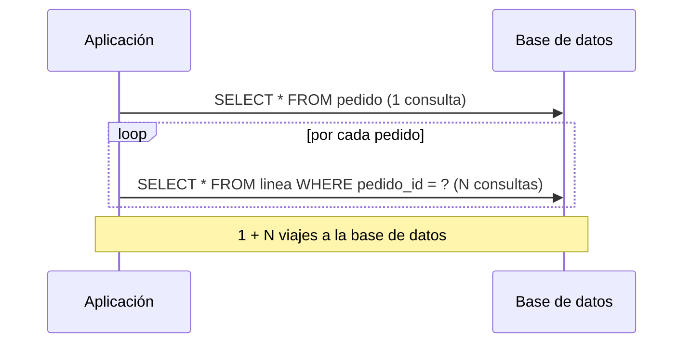

# Spring, persistencia y pruebas

Fuera de los ejemplos de clase, Java se escribe sobre un framework. **Spring Boot** domina el desarrollo de servicios: este bloque cubre su modelo, cómo se accede a datos con JPA (y dónde está la trampa) y cómo se prueba de forma fiable.

_Revisado: 2026-10-06_

## Maven en lo esencial

```text
mi-servicio/
├── pom.xml
└── src/
    ├── main/java/.../Aplicacion.java
    ├── main/resources/application.yml
    └── test/java/...
```

```xml title="pom.xml"
<project>
  <modelVersion>4.0.0</modelVersion>
  <parent>
    <groupId>org.springframework.boot</groupId>
    <artifactId>spring-boot-starter-parent</artifactId>
    <version>3.3.4</version>
  </parent>
  <groupId>com.ejemplo</groupId>
  <artifactId>tienda</artifactId>
  <version>1.0.0</version>
  <properties>
    <java.version>21</java.version>
  </properties>
  <dependencies>
    <dependency>
      <groupId>org.springframework.boot</groupId>
      <artifactId>spring-boot-starter-web</artifactId>
    </dependency>
    <dependency>
      <groupId>org.springframework.boot</groupId>
      <artifactId>spring-boot-starter-data-jpa</artifactId>
    </dependency>
    <dependency>
      <groupId>org.postgresql</groupId>
      <artifactId>postgresql</artifactId>
      <scope>runtime</scope>
    </dependency>
    <dependency>
      <groupId>org.springframework.boot</groupId>
      <artifactId>spring-boot-starter-test</artifactId>
      <scope>test</scope>
    </dependency>
  </dependencies>
</project>
```

```bash
mvn clean verify
mvn -q test -Dtest=PedidoServiceTest
mvn dependency:tree
mvn -DskipTests package
```

- El ciclo de vida es secuencial: `validate → compile → test → package → verify → install`. Ejecutar una fase ejecuta todas las anteriores.
- El **parent/BOM** de Spring Boot fija versiones compatibles: no declares versión de las dependencias que gestiona.
- `mvn dependency:tree` es la herramienta cuando hay **conflictos de versiones** (dos versiones de una misma librería en el classpath).

## Inyección de dependencias

Spring crea y conecta los objetos (**beans**) para que las clases declaren lo que necesitan y no cómo construirlo.

```mermaid
flowchart LR
  C["PedidoController"] --> S["PedidoService"]
  S --> R["PedidoRepository"]
  S --> P["PagoGateway<br/>(interfaz)"]
  P --> PI["PagoStripe<br/>implementación"]
  R --> DB[("Base de datos")]
  style S fill:#1a2233,stroke:#58a6ff
```



```java
@Service
public class PedidoService {
  private final PedidoRepository repositorio;
  private final PagoGateway pago;

  public PedidoService(PedidoRepository repositorio, PagoGateway pago) {
    this.repositorio = repositorio;
    this.pago = pago;
  }
}
```

**Inyección por constructor**: las dependencias son `final`, obligatorias y se sustituyen fácilmente en pruebas. Evita la inyección por campo (`@Autowired` sobre un atributo): oculta dependencias y obliga a usar el contenedor para probar.

Los beans son **singleton por defecto**: una sola instancia compartida por todos los hilos, así que no deben guardar estado mutable de la petición.

## API REST

```java
@RestController
@RequestMapping("/api/pedidos")
public class PedidoController {
  private final PedidoService servicio;

  public PedidoController(PedidoService servicio) {
    this.servicio = servicio;
  }

  @GetMapping("/{id}")
  public PedidoDto obtener(@PathVariable long id) {
    return servicio.buscar(id);
  }

  @PostMapping
  @ResponseStatus(HttpStatus.CREATED)
  public PedidoDto crear(@Valid @RequestBody CrearPedido peticion) {
    return servicio.crear(peticion);
  }
}

public record CrearPedido(
    @NotNull Long clienteId,
    @NotEmpty List<@Valid LineaDto> lineas) {}

public record PedidoDto(long id, String estado, BigDecimal total) {}

@RestControllerAdvice
public class ManejadorErrores {
  @ExceptionHandler(PedidoNoEncontrado.class)
  @ResponseStatus(HttpStatus.NOT_FOUND)
  public Map<String, String> noEncontrado(PedidoNoEncontrado e) {
    return Map.of("error", e.getMessage());
  }
}
```

Buenas prácticas de API:

- Usa **DTOs** (records) en la frontera; no expongas las entidades JPA: acoplas el contrato público al esquema y filtras datos sin querer.
- **Valida** la entrada (`@Valid`, Bean Validation) y devuelve el código HTTP correcto (`201`, `400`, `404`, `409`).
- Un `@RestControllerAdvice` central traduce excepciones a respuestas coherentes.
- **Idempotencia**: `GET`, `PUT` y `DELETE` deben poder repetirse sin efectos adicionales; para `POST` críticos admite una clave de idempotencia.
- **Paginación** en listados (`Pageable`) y límites máximos.

## Configuración y perfiles

```yaml title="application.yml"
spring:
  datasource:
    url: jdbc:postgresql://${DB_HOST:localhost}:5432/tienda
    username: ${DB_USER:app}
    password: ${DB_PASSWORD}
    hikari:
      maximum-pool-size: 10
  jpa:
    open-in-view: false
    hibernate:
      ddl-auto: validate

management:
  endpoints:
    web:
      exposure:
        include: health,info,prometheus

server:
  shutdown: graceful
```

- **Externaliza** la configuración (variables de entorno, perfiles `application-prod.yml`); los secretos nunca van en el repositorio.
- `ddl-auto: validate` (o `none`) en producción; el esquema lo gestionan migraciones con **Flyway** o **Liquibase**, versionadas y revisables.
- `open-in-view: false` evita mantener una sesión de base de datos abierta durante toda la petición HTTP.
- **Actuator** expone `health` y métricas para sondas de orquestadores y monitorización; no expongas endpoints sensibles sin proteger.

## JPA e Hibernate

```mermaid
flowchart LR
  APP["Código Java<br/>entidades"] --> EM["EntityManager<br/>contexto de persistencia"]
  EM --> H["Hibernate<br/>SQL generado"]
  H --> DB[("Base de datos")]
  style EM fill:#1a2233,stroke:#58a6ff
```



```java
@Entity
@Table(name = "pedido")
public class Pedido {
  @Id
  @GeneratedValue(strategy = GenerationType.IDENTITY)
  private Long id;

  @ManyToOne(fetch = FetchType.LAZY, optional = false)
  @JoinColumn(name = "cliente_id")
  private Cliente cliente;

  @OneToMany(mappedBy = "pedido", cascade = CascadeType.ALL, orphanRemoval = true)
  private List<Linea> lineas = new ArrayList<>();

  @Version
  private long version;

  protected Pedido() {}
}

public interface PedidoRepository extends JpaRepository<Pedido, Long> {
  List<Pedido> findByClienteIdAndEstado(Long clienteId, String estado);

  @Query("select p from Pedido p join fetch p.lineas where p.id = :id")
  Optional<Pedido> cargarConLineas(@Param("id") Long id);
}
```

### El problema N+1



Con relaciones `LAZY`, recorrer `pedido.getLineas()` en un bucle dispara una consulta por pedido. 1 000 pedidos son 1 001 consultas. Soluciones:

```java
@Query("select distinct p from Pedido p join fetch p.lineas where p.estado = :estado")
List<Pedido> conLineas(@Param("estado") String estado);

@EntityGraph(attributePaths = "lineas")
List<Pedido> findByEstado(String estado);
```

Detección: activa el log de SQL en desarrollo (`spring.jpa.show-sql` o `org.hibernate.SQL=DEBUG`) y cuenta consultas por petición en las pruebas.

### Otras trampas de JPA

- **`LazyInitializationException`**: acceder a una relación lazy fuera de la transacción. Carga lo necesario dentro del servicio y devuelve un DTO.
- **`FetchType.EAGER` en colecciones**: trae datos que nadie pidió y multiplica el N+1. Mantén todo `LAZY` y carga explícitamente.
- **`equals`/`hashCode` en entidades**: no uses todos los campos ni el `id` autogenerado nulo antes de persistir; basa la igualdad en una clave de negocio o en el `id` con cuidado.
- **`cascade = ALL` sobre `@ManyToOne`**: borrar un hijo puede borrar al padre.
- **Actualizaciones masivas por entidad**: para miles de filas, usa consultas `UPDATE` en bloque o procesamiento por lotes (*batch*).

## Transacciones con @Transactional

```java
@Service
public class PedidoService {
  @Transactional
  public PedidoDto crear(CrearPedido peticion) {
    Pedido pedido = repositorio.save(construir(peticion));
    stock.reservar(pedido);
    return PedidoDto.de(pedido);
  }

  @Transactional(readOnly = true)
  public PedidoDto buscar(long id) {
    return repositorio.findById(id).map(PedidoDto::de).orElseThrow(() -> new PedidoNoEncontrado(id));
  }
}
```

- Si el método lanza una `RuntimeException`, hace **rollback**; las excepciones comprobadas **no** revierten por defecto (`rollbackFor`).
- **Autoinvocación**: llamar a un método `@Transactional` de la misma clase (`this.otro()`) **no** pasa por el proxy y la anotación no tiene efecto.
- Mantén las transacciones **cortas**: no llames a APIs externas lentas dentro de ellas; retienen conexión y bloqueos.
- Para concurrencia en la misma fila, usa `@Version` (bloqueo optimista): ante conflicto lanza `OptimisticLockingFailureException`.

## Pruebas

```mermaid
flowchart TB
  E2E["E2E / sistema<br/>pocos · lentos"] --> INT["Integración<br/>base de datos real · HTTP"]
  INT --> UNI["Unitarias<br/>muchas · rápidas · sin Spring"]
  style UNI fill:#1a2d1a,stroke:#39d353
  style E2E fill:#2d1a1a,stroke:#ff7b72
```



**Unitaria** (sin Spring; rápida, aísla la lógica):

```java
@ExtendWith(MockitoExtension.class)
class PedidoServiceTest {
  @Mock PedidoRepository repositorio;
  @Mock PagoGateway pago;
  @InjectMocks PedidoService servicio;

  @Test
  void rechazaPedidoSinLineas() {
    var peticion = new CrearPedido(1L, List.of());

    assertThatThrownBy(() -> servicio.crear(peticion))
        .isInstanceOf(IllegalArgumentException.class);

    verifyNoInteractions(pago);
  }

  @ParameterizedTest
  @CsvSource({"100.00,10,90.00", "50.00,0,50.00"})
  void aplicaDescuento(BigDecimal base, int pct, BigDecimal esperado) {
    assertThat(servicio.aplicarDescuento(base, pct)).isEqualByComparingTo(esperado);
  }
}
```

**Integración con base de datos real** mediante Testcontainers (mejor que H2, que se comporta distinto a PostgreSQL):

```java
@DataJpaTest
@Testcontainers
@AutoConfigureTestDatabase(replace = AutoConfigureTestDatabase.Replace.NONE)
class PedidoRepositoryTest {
  @Container
  @ServiceConnection
  static PostgreSQLContainer<?> db = new PostgreSQLContainer<>("postgres:16");

  @Autowired PedidoRepository repositorio;

  @Test
  void cargaPedidoConLineasEnUnaConsulta() {
    var pedido = repositorio.cargarConLineas(1L).orElseThrow();
    assertThat(pedido.getLineas()).hasSize(2);
  }
}
```

**API completa** con `MockMvc`:

```java
@WebMvcTest(PedidoController.class)
class PedidoControllerTest {
  @Autowired MockMvc mvc;
  @MockBean PedidoService servicio;

  @Test
  void devuelve404SiNoExiste() throws Exception {
    when(servicio.buscar(9L)).thenThrow(new PedidoNoEncontrado(9L));

    mvc.perform(get("/api/pedidos/9"))
        .andExpect(status().isNotFound());
  }
}
```

Qué hace buenas a las pruebas:

- **Una causa de fallo por prueba**; nombre que describe el comportamiento.
- Se prueba el **comportamiento**, no la implementación: demasiados `verify` rompen al refactorizar.
- **Deterministas**: sin dependencia del reloj, orden o red (inyecta un `Clock`).
- Los mocks sustituyen **fronteras** (APIs externas), no tus propias clases internas.
- Ejecuta todo en CI con `mvn verify` en cada cambio.

## Logging y observabilidad

```java
private static final Logger log = LoggerFactory.getLogger(PedidoService.class);

log.info("pedido creado id={} cliente={}", pedido.getId(), clienteId);
log.error("fallo al cobrar pedido id={}", pedidoId, excepcion);
```

- Usa **SLF4J** con marcadores `{}` (no concatenes cadenas) y pasa la excepción como **último argumento** para conservar el stack trace.
- Niveles: `ERROR` requiere acción, `WARN` algo anómalo recuperable, `INFO` hitos de negocio, `DEBUG` diagnóstico.
- **Nunca** registres contraseñas, tokens ni datos personales completos.
- Un **ID de correlación** por petición (MDC) permite seguir una petición entre servicios.

## Trampas frecuentes

- **N+1** en listados: 1 001 consultas donde bastaba una; detéctalo con logs de SQL.
- **Exponer entidades JPA** como respuesta HTTP: filtración de campos y acoplamiento.
- **`@Transactional` en una llamada interna** (`this.metodo()`): no se aplica.
- **`ddl-auto: update` en producción**: cambios de esquema impredecibles; usa Flyway.
- **Estado mutable en un bean singleton**: condiciones de carrera entre peticiones.
- **H2 en pruebas de integración** contra PostgreSQL real en producción: diferencias de dialecto que aparecen tarde.
- **Pool de conexiones mal dimensionado**: demasiadas conexiones saturan la base de datos; pocas, hilos esperando.
- **Secretos en `application.yml`** subido al repositorio.

## Comprueba que lo entiendes

1. Un listado de 500 pedidos tarda 4 s y el log muestra 501 consultas. ¿Qué ocurre y cómo lo arreglas?
2. ¿Por qué un método `@Transactional` llamado desde otro método de la misma clase no abre transacción?
3. ¿Qué ventajas tiene la inyección por constructor sobre la inyección por campo?
4. ¿Por qué se prefiere Testcontainers a H2 para probar repositorios?

**Mini-ejercicio.** Escribe la consulta de repositorio que cargue un pedido con sus líneas sin provocar N+1.

```java
@EntityGraph(attributePaths = "lineas")
Optional<Pedido> findById(Long id);
```

<details>
  <summary>Respuestas</summary>

1. Un problema N+1: una consulta para los pedidos y una por cada uno para sus líneas lazy. Se resuelve con `join fetch` o `@EntityGraph` para cargarlas en la misma consulta (o con carga por lotes).
2. La transaccionalidad se implementa con un proxy: solo se aplica a las llamadas que **entran** por el proxy desde otro bean. `this.metodo()` salta el proxy. Se mueve el método a otro bean o se reestructura.
3. Dependencias explícitas, obligatorias e inmutables (`final`), clase probable sin Spring (basta `new`) y fallo temprano si falta algo.
4. H2 simula la base de datos pero difiere en dialecto, tipos, índices y bloqueos; Testcontainers usa el mismo PostgreSQL que producción y detecta errores reales.

</details>

## Referencias

- [Spring Boot — documentación de referencia](https://docs.spring.io/spring-boot/reference/)
- [Spring Data JPA](https://docs.spring.io/spring-data/jpa/reference/)
- [Testcontainers para Java](https://java.testcontainers.org/)
- [Vlad Mihalcea — rendimiento de JPA e Hibernate](https://vladmihalcea.com/tutorials/hibernate/)
