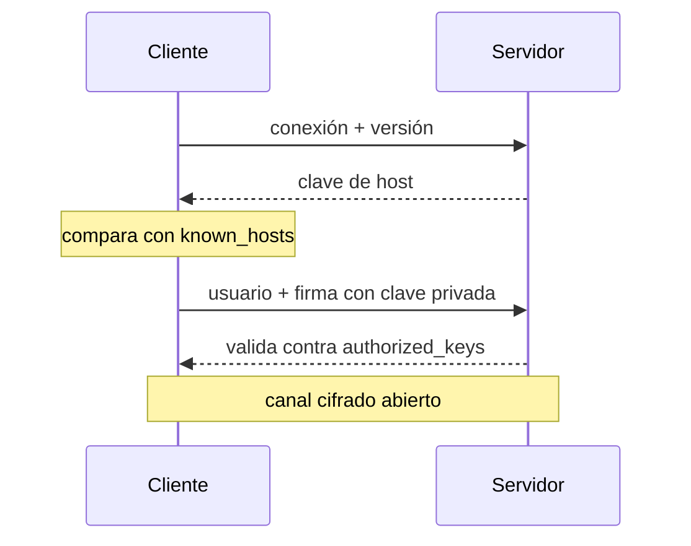

# Linux

Casi todo servidor, contenedor y equipo de red corre Linux. La diferencia entre quien lo conoce y quien copia comandos es saber **qué está pasando debajo**: quién es dueño de un proceso, por qué un disco "lleno" tiene espacio libre, por qué un servicio no arranca tras reiniciar.

_Revisado: 2026-10-06_

## Procesos y señales

Cada proceso tiene un PID, un padre (PPID) y un estado. Los estados que importan al depurar:

| Estado | Código | Significado |
|---|---|---|
| Running / Sleeping | `R` / `S` | normal |
| Uninterruptible | `D` | esperando I/O; no responde ni a `kill -9` |
| Zombie | `Z` | terminó, pero el padre no ha leído su código de salida |
| Stopped | `T` | pausado (`SIGSTOP`, `Ctrl+Z`) |

```bash
ps -eo pid,ppid,stat,%cpu,%mem,etime,cmd --sort=-%cpu | head
pgrep -a nginx
kill -TERM 4321
kill -KILL 4321
```

`SIGTERM` (15) pide al proceso que termine y le deja limpiar; `SIGKILL` (9) lo mata sin avisar y no se puede capturar. El orden correcto es siempre `TERM`, esperar, y solo entonces `KILL`.

:::warning Procesos en D
Un proceso en estado `D` casi siempre espera disco o NFS. Matarlo no funciona: hay que resolver la I/O (montaje caído, disco con errores).
:::

Los **zombies** no consumen CPU ni memoria, solo una entrada en la tabla de procesos. Se arreglan en el **padre** (que debe hacer `wait()`), no con `kill`; si el padre muere, `init` los recoge.

## systemd

`systemd` arranca el sistema y gestiona servicios como **units**. Una unit de servicio describe qué ejecutar, cuándo y cómo reaccionar a fallos.

```ini title="/etc/systemd/system/api.service"
[Unit]
Description=API interna
After=network-online.target
Wants=network-online.target

[Service]
User=api
Group=api
WorkingDirectory=/opt/api
ExecStart=/opt/api/bin/server --port 8080
Restart=on-failure
RestartSec=5
EnvironmentFile=/etc/api/env
NoNewPrivileges=true
ProtectSystem=strict
ReadWritePaths=/var/lib/api

[Install]
WantedBy=multi-user.target
```

```bash
sudo systemctl daemon-reload
sudo systemctl enable --now api
systemctl status api
journalctl -u api -f
journalctl -u api --since "1 hour ago" -p err
systemctl list-units --failed
```

- `After=` solo ordena; `Wants=`/`Requires=` crean la dependencia. Sin `Wants=`, el orden no garantiza que la otra unit exista.
- `Restart=on-failure` reinicia solo si sale con error; `always` también tras una salida limpia.
- Las directivas `ProtectSystem`, `NoNewPrivileges` o `PrivateTmp` son sandboxing gratis: úsalas en servicios propios.
- Tras editar una unit hay que ejecutar `daemon-reload`; olvidarlo es el motivo nº 1 de "he cambiado el fichero y no hace nada".

Para tareas programadas, un **timer** de systemd sustituye a cron con logs en el journal y reintentos:

```ini title="/etc/systemd/system/backup.timer"
[Timer]
OnCalendar=*-*-* 03:00:00
Persistent=true

[Install]
WantedBy=timers.target
```

`Persistent=true` ejecuta la tarea al arrancar si el equipo estaba apagado a la hora prevista.

## Permisos y usuarios

Cada fichero tiene propietario, grupo y tres bloques `rwx` (usuario, grupo, otros). En octal: `r=4`, `w=2`, `x=1`.

```bash
ls -l /etc/shadow
chmod 640 fichero
chmod u+x,g-w script.sh
chown api:api /var/lib/api
umask
```

| Modo | Significado | Uso típico |
|---|---|---|
| `600` | solo el dueño lee/escribe | claves privadas, ficheros de credenciales |
| `644` | dueño escribe, todos leen | configuración pública |
| `755` | dueño todo, resto leen/ejecutan | binarios y directorios |
| `1777` | sticky bit en directorio | `/tmp`: solo el dueño borra lo suyo |

En **directorios**, `x` significa poder entrar (`cd`) y atravesar; `r` listar; `w` crear y borrar entradas. Por eso se puede borrar un fichero ajeno si se tiene `w` en el directorio.

Bits especiales:

- **setuid** (`4000`): el binario se ejecuta con los privilegios de su dueño (`passwd`). Es un vector clásico de escalada: audita con `find / -perm -4000 -type f 2>/dev/null`.
- **setgid** en directorio (`2000`): los ficheros nuevos heredan el grupo del directorio; útil para carpetas compartidas.

**ACL** cuando `ugo` se queda corto:

```bash
setfacl -m u:lucia:rw informe.txt
getfacl informe.txt
```

**sudo**: configura siempre con `visudo`, concede comandos concretos antes que `ALL`, y revisa `/var/log/auth.log` o `journalctl _COMM=sudo` para auditar.

## Almacenamiento

```mermaid
flowchart LR
  D1["/dev/sdb"] --> PV["PV<br/>volumen físico"]
  D2["/dev/sdc"] --> PV2["PV"]
  PV --> VG["VG<br/>grupo de volúmenes"]
  PV2 --> VG
  VG --> LV1["LV datos"]
  VG --> LV2["LV logs"]
  LV1 --> FS1["ext4 · /srv/datos"]
  LV2 --> FS2["xfs · /var/log"]
  style VG fill:#1a2233,stroke:#58a6ff
```



LVM permite ampliar un volumen en caliente sin tocar particiones:

```bash
lsblk -f
sudo lvextend -r -L +10G /dev/vg0/datos
df -hT
df -i
```

`-r` redimensiona también el sistema de ficheros. `df -i` muestra **inodos**: un disco puede estar "lleno" con espacio libre si se agotaron los inodos (millones de ficheros diminutos).

```bash
du -xh --max-depth=1 /var | sort -h | tail
sudo lsof +L1
```

`lsof +L1` lista ficheros **borrados pero aún abiertos**: el espacio no se libera hasta que el proceso los cierra. Es la causa típica de "he borrado el log y el disco sigue lleno".

El montaje persistente va en `/etc/fstab`. Usa **UUID** (`blkid`) en vez de `/dev/sdX`, que cambia de orden, y añade `nofail` en discos no críticos para que un disco ausente no deje el sistema en modo emergencia.

```text
UUID=3f2a9c1e-5b7d-4e1a-9c33-0a1b2c3d4e5f  /srv/datos  ext4  defaults,nofail  0  2
```

## Rendimiento: método USE

Por cada recurso (CPU, memoria, disco, red) mira **Utilización, Saturación y Errores**.

```bash
uptime
vmstat 1 5
iostat -xz 1 3
free -h
ss -s
top -o %MEM
```

- **Load average**: media de procesos ejecutables o en `D`. Compara con el número de núcleos (`nproc`): load 8 en una máquina de 8 núcleos es pleno uso, en una de 2 es saturación.
- **`vmstat`**: `r` alto = CPU saturada; `si/so` distintos de 0 = swap, memoria insuficiente; `wa` alto = esperando disco.
- **`iostat -x`**: `%util` cercano a 100 y `await` alto = disco saturado.
- **`free`**: mira la columna `available`, no `free`; Linux usa la RAM libre como caché y es normal que `free` sea bajo.

:::tip OOM killer
Si un proceso desaparece sin dejar rastro, comprueba `dmesg -T | grep -i "out of memory"` o `journalctl -k`. El kernel mató al proceso por falta de memoria y lo registra ahí.
:::

## Texto y Bash

La mayoría del trabajo es filtrar salida de comandos y logs.

```bash
grep -rn "ERROR" /var/log/api/ --include="*.log"
awk '{print $1}' access.log | sort | uniq -c | sort -rn | head
awk '$9 >= 500 {c++} END {print c}' access.log
sed -i 's/^PermitRootLogin.*/PermitRootLogin no/' /etc/ssh/sshd_config
cut -d: -f1,7 /etc/passwd
find /var/log -name "*.log" -mtime +30 -size +10M
xargs -P4 -I{} gzip {} < lista.txt
```

Un script de operación robusto empieza siempre igual:

```bash
#!/usr/bin/env bash
set -euo pipefail
IFS=$'\n\t'

backup_dir="${1:?uso: backup.sh DIRECTORIO}"
tmp="$(mktemp -d)"
trap 'rm -rf "$tmp"' EXIT

tar -czf "$tmp/backup.tgz" "$backup_dir"
mv "$tmp/backup.tgz" "/srv/backups/$(date +%F).tgz"
```

| Opción | Efecto |
|---|---|
| `set -e` | aborta al primer comando que falla |
| `set -u` | error si se usa una variable sin definir |
| `set -o pipefail` | un pipe falla si **cualquier** tramo falla, no solo el último |
| `trap ... EXIT` | limpieza garantizada, incluso ante error |
| `"${var}"` entre comillas | evita que espacios o `*` rompan el comando |

Comprueba los scripts con `shellcheck`: detecta variables sin comillas, `cd` sin comprobar y decenas de errores comunes.

## SSH



```bash
ssh-keygen -t ed25519 -C "usuario@equipo"
ssh-copy-id -i ~/.ssh/id_ed25519.pub usuario@servidor
ssh -J bastion usuario@interno
ssh -L 5432:db.interna:5432 usuario@bastion
ssh -D 1080 usuario@bastion
```

```text title="~/.ssh/config"
Host interno
  HostName 10.0.4.12
  User admin
  ProxyJump bastion
  IdentityFile ~/.ssh/id_ed25519
  ServerAliveInterval 30

Host *
  AddKeysToAgent yes
```

- **`-L`** reenvía un puerto local a un destino accesible desde el servidor (túnel a una base de datos interna); **`-D`** crea un proxy SOCKS; **`-J`** salta por un host intermedio.
- Los permisos importan: `~/.ssh` en `700`, claves privadas en `600`. Con permisos amplios, SSH las ignora.
- El aviso `REMOTE HOST IDENTIFICATION HAS CHANGED` puede ser un servidor reinstalado, o un ataque de intermediario. Verifica antes de borrar la línea de `known_hosts`.

## Paquetes y red básica

```bash
apt update && apt list --upgradable
dpkg -L openssh-server
dnf history
ip -br a
ip route
resolvectl status
```

Distribuciones basadas en Debian usan `apt`/`dpkg`; las de Red Hat, `dnf`/`rpm`. Fija versiones (`apt-mark hold`) en paquetes críticos y no mezcles repositorios de terceros sin firmarlos.

## Hardening mínimo

```text title="/etc/ssh/sshd_config.d/10-hardening.conf"
PermitRootLogin no
PasswordAuthentication no
PubkeyAuthentication yes
MaxAuthTries 3
AllowUsers admin deploy
```

```bash
sudo sshd -t && sudo systemctl reload ssh
sudo ufw default deny incoming
sudo ufw allow 22/tcp
sudo ufw enable
sudo ss -tulpn
```

1. **Superficie mínima**: `ss -tulpn` lista lo que escucha; desactiva lo que no uses.
2. **Acceso**: solo claves, sin root directo, límites de intentos (`fail2ban`).
3. **Actualizaciones**: parches de seguridad automáticos (`unattended-upgrades`).
4. **Registro**: logs centralizados y `auditd` para ficheros sensibles.
5. **Mínimo privilegio**: cada servicio con su usuario sin shell (`/usr/sbin/nologin`).

:::danger Antes de recargar sshd
Prueba siempre `sshd -t` y mantén una sesión abierta mientras compruebas una nueva. Un error de configuración sin sesión de rescate te deja fuera.
:::

## Troubleshooting: de síntoma a causa

```mermaid
flowchart TD
  P["El servicio no funciona"] --> A{"systemctl status"}
  A -->|failed| B["journalctl -u servicio -xe"]
  A -->|active| C{"ss -tulpn<br/>¿escucha?"}
  C -->|no| B
  C -->|sí| D{"curl localhost<br/>¿responde?"}
  D -->|no| E["permisos · SELinux/AppArmor · config"]
  D -->|sí| F["firewall o red externa"]
  B --> G["disco lleno · OOM · puerto ocupado · permisos"]
  style G fill:#2d1a1a,stroke:#ff7b72
```



```bash
journalctl -xeu servicio
systemctl cat servicio
sudo -u api /opt/api/bin/server --check
getenforce
sudo ausearch -m avc -ts recent
strace -f -e trace=openat,connect -p 4321
```

## Trampas frecuentes

- **`rm -rf $DIR/`** con `DIR` vacío: borra `/`. Usa `set -u` y `"${DIR:?}"`.
- **Redirigir con `sudo`**: `sudo echo x > /etc/fichero` redirige con tu usuario. Usa `echo x | sudo tee /etc/fichero`.
- **Disco "lleno"** sin ficheros grandes: inodos agotados (`df -i`) o ficheros borrados abiertos (`lsof +L1`).
- **Cambiar una unit y no recargar**: falta `systemctl daemon-reload`.
- **`chmod -R 777`** para "arreglar" un permiso: oculta el problema y abre un agujero. Averigua el usuario real del proceso.
- **Cron sin entorno**: cron no carga tu `PATH`; usa rutas absolutas.

## Comprueba que lo entiendes

1. Un servicio deja de arrancar tras editar su unit. ¿Qué dos comandos revisas primero?
2. `df -h` marca 100 % pero `du` solo suma la mitad. Da dos causas y cómo las confirmas.
3. ¿Por qué un proceso en estado `D` no muere con `kill -9`?
4. ¿Qué diferencia hay entre `set -e` y `set -o pipefail`?

**Mini-ejercicio.** Muestra las 5 IPs con más peticiones en un `access.log` con formato común.

```bash
awk '{print $1}' access.log | sort | uniq -c | sort -rn | head -5
```

<details>
  <summary>Respuestas</summary>

1. `systemctl daemon-reload` (por si no recargaste) y `journalctl -xeu servicio` para ver el error exacto. `systemd-analyze verify servicio.service` valida la sintaxis de la unit.
2. Ficheros borrados pero abiertos por un proceso (`sudo lsof +L1`) o un punto de montaje que oculta ficheros bajo él (`du` no ve lo que queda tapado). Se confirman con `lsof +L1` y desmontando temporalmente el punto de montaje.
3. Está en una llamada del kernel esperando I/O (disco, NFS) y no entrega señales hasta que termina. Hay que resolver la causa de la I/O.
4. `set -e` aborta cuando un comando simple falla; en un pipe solo mira el último tramo. `pipefail` hace que el pipe falle si **cualquier** tramo falla, de modo que `set -e` lo detecte.

</details>

## Referencias

- [The Linux Command Line (libro libre)](https://linuxcommand.org/tlcl.php)
- [systemd.service — man page](https://www.freedesktop.org/software/systemd/man/latest/systemd.service.html)
- [Brendan Gregg — Linux Performance](https://www.brendangregg.com/linuxperf.html)
- [ShellCheck](https://www.shellcheck.net/)
