# Automatización con Ansible

Con diez servidores, SSH a mano funciona; con cien, es una fuente de errores y de servidores que ya no son iguales. Ansible describe el **estado deseado** y lo aplica por SSH sin instalar agentes. Este bloque cubre lo que se usa a diario y los fallos típicos.

_Revisado: 2026-10-06_

## Cómo funciona

```mermaid
flowchart LR
  CTL["Nodo de control<br/>ansible-playbook"] -->|"SSH"| H1["web1"]
  CTL -->|"SSH"| H2["web2"]
  CTL -->|"SSH"| H3["db1"]
  INV["Inventario"] --> CTL
  PB["Playbook + roles"] --> CTL
  style CTL fill:#1a2233,stroke:#58a6ff
```



- **Sin agente**: usa SSH y Python en el destino.
- **Declarativo e idempotente**: ejecutar el mismo playbook dos veces deja el mismo resultado; la segunda vez no cambia nada.
- **Módulos** (`apt`, `service`, `copy`, `template`, `user`) hacen el trabajo; `command`/`shell` son el último recurso porque no son idempotentes por sí mismos.

## Inventario

```yaml title="inventario.yml"
all:
  children:
    web:
      hosts:
        web1.ejemplo.com:
        web2.ejemplo.com:
      vars:
        puerto_http: 8080
    db:
      hosts:
        db1.ejemplo.com:
          ansible_user: admin
  vars:
    ansible_python_interpreter: /usr/bin/python3
```

```bash
ansible-inventory -i inventario.yml --graph
ansible all -i inventario.yml -m ping
ansible web -i inventario.yml -b -m apt -a "name=nginx state=present"
ansible db -i inventario.yml -m setup -a "filter=ansible_distribution*"
```

Los comandos *ad hoc* sirven para comprobaciones puntuales; todo lo repetible va a un playbook.

## Playbook

```yaml title="web.yml"
- name: Servidores web
  hosts: web
  become: true
  vars:
    paquete: nginx
  tasks:
    - name: Instalar nginx
      ansible.builtin.apt:
        name: "{{ paquete }}"
        state: present
        update_cache: true
        cache_valid_time: 3600

    - name: Desplegar configuración
      ansible.builtin.template:
        src: sitio.conf.j2
        dest: /etc/nginx/conf.d/sitio.conf
        owner: root
        group: root
        mode: "0644"
        validate: nginx -t -c /etc/nginx/nginx.conf
      notify: Recargar nginx

    - name: Asegurar servicio activo
      ansible.builtin.service:
        name: nginx
        state: started
        enabled: true

  handlers:
    - name: Recargar nginx
      ansible.builtin.service:
        name: nginx
        state: reloaded
```

```text title="templates/sitio.conf.j2"
server {
  listen {{ puerto_http }};
  server_name {{ inventory_hostname }};

  location {{ ruta.path }} {
    proxy_pass {{ ruta.destino }};
  }

}
```

- **Handlers** se ejecutan una sola vez al final y solo si alguna tarea con `notify` cambió algo: así no se recarga el servicio en cada ejecución.
- `validate` comprueba el fichero antes de sustituirlo: una plantilla rota no deja el servicio inservible.
- Plantillas **Jinja2**: variables, bucles y condicionales para generar configuración por servidor.

```bash
ansible-playbook -i inventario.yml web.yml --check --diff
ansible-playbook -i inventario.yml web.yml --limit web1.ejemplo.com
ansible-playbook -i inventario.yml web.yml --tags configuracion
```

`--check --diff` simula y muestra qué cambiaría: úsalo siempre antes de aplicar en producción. `--limit` restringe el alcance (un servidor canario primero).

## Idempotencia y módulos shell

```yaml
- name: Crear directorio de datos
  ansible.builtin.file:
    path: /srv/datos
    state: directory
    owner: api
    mode: "0750"

- name: Inicializar base de datos (solo una vez)
  ansible.builtin.command: /opt/api/bin/init-db
  args:
    creates: /srv/datos/.inicializado

- name: Comprobar versión
  ansible.builtin.command: /opt/api/bin/server --version
  register: version
  changed_when: false
```

- `creates:` / `removes:` hacen idempotente un `command`.
- `changed_when: false` en tareas de solo lectura evita falsos "cambios".
- Prefiere un módulo específico (`user`, `lineinfile`, `sysctl`, `cron`, `ufw`) antes que `shell`.

## Variables y precedencia

```text
group_vars/all.yml        valores comunes
group_vars/web.yml        por grupo
host_vars/web1.yml        por host
--extra-vars / -e          prioridad máxima
```

```yaml
- name: Aplicar según distribución
  ansible.builtin.package:
    name: "{{ 'httpd' if ansible_os_family == 'RedHat' else 'apache2' }}"
    state: present
  when: ansible_facts['os_family'] in ['RedHat', 'Debian']
```

Los **facts** (`ansible_facts`) describen el servidor: distribución, memoria, interfaces. Úsalos en condiciones y plantillas. Mantén la precedencia simple: valores por defecto en el rol, ajustes en `group_vars`, excepciones en `host_vars`.

## Roles

Un **rol** agrupa tareas, plantillas, variables y handlers reutilizables.

```text
roles/
└── nginx/
    ├── defaults/main.yml
    ├── handlers/main.yml
    ├── tasks/main.yml
    ├── templates/sitio.conf.j2
    └── meta/main.yml
```

```yaml title="site.yml"
- hosts: web
  become: true
  roles:
    - role: nginx
      vars:
        puerto_http: 8080
    - role: endurecimiento_ssh
```

```bash
ansible-galaxy role init roles/nginx
ansible-galaxy collection install community.general
ansible-lint site.yml
```

Un rol hace **una cosa** y se parametriza con `defaults`. Fija las versiones de colecciones en `requirements.yml`.

## Secretos con Vault

```bash
ansible-vault create group_vars/db/vault.yml
ansible-vault edit group_vars/db/vault.yml
ansible-playbook site.yml --vault-password-file ~/.vault_pass
```

```yaml title="group_vars/db/vault.yml (cifrado)"
vault_db_password: "VALOR_SECRETO"
```

```yaml title="group_vars/db/vars.yml"
db_password: "{{ vault_db_password }}"
```

Cifra solo el fichero de secretos y referencia las variables desde otro en claro: así las búsquedas con `grep` siguen funcionando. Añade `no_log: true` a las tareas que manejan secretos para que no aparezcan en la salida.

## Orquestación y despliegues graduales

```yaml
- hosts: web
  become: true
  serial: 1
  max_fail_percentage: 0
  pre_tasks:
    - name: Sacar del balanceador
      ansible.builtin.command: /usr/local/bin/lb-drain {{ inventory_hostname }}
  roles:
    - app
  post_tasks:
    - name: Esperar a que responda
      ansible.builtin.uri:
        url: "http://{{ inventory_hostname }}:8080/salud"
        status_code: 200
      register: r
      until: r.status == 200
      retries: 10
      delay: 5
    - name: Reincorporar al balanceador
      ansible.builtin.command: /usr/local/bin/lb-enable {{ inventory_hostname }}
```

`serial: 1` actualiza de uno en uno y `max_fail_percentage: 0` detiene el despliegue ante el primer fallo: el resto de servidores sigue sirviendo con la versión anterior.

## Trampas frecuentes

- **`shell`/`command` sin `creates` ni `changed_when`**: no idempotente, marca cambios siempre.
- **Aplicar sin `--check`** en producción por primera vez.
- **Secretos en claro** en el repositorio o en logs (falta `no_log`).
- **Todo en un playbook gigante**: no se reutiliza ni se prueba; usa roles.
- **YAML y comillas**: `mode: 0644` se interpreta como octal; escribe `"0644"`.
- **Cambiar un servicio sin handler**: reinicios innecesarios o ausentes.
- **Sin `serial`** en servicios con balanceador: se actualizan todos a la vez y se pierde disponibilidad.
- **Servidores "arreglados a mano"** (*drift*): la siguiente ejecución sobrescribe o pelea con el cambio. Todo cambio pasa por el código.

## Comprueba que lo entiendes

1. ¿Qué significa que un playbook sea idempotente y por qué `shell: echo x >> fichero` no lo es?
2. Cambias una plantilla de nginx. ¿Qué mecanismo recarga el servicio solo cuando hay cambios?
3. ¿Cómo despliegas un cambio sin tirar todo el servicio si falla?
4. ¿Cómo guardas una contraseña de base de datos en el repositorio sin exponerla?

**Mini-ejercicio.** Asegura que `fail2ban` está instalado y activo en el grupo `web`, comprobando antes con `--check`.

```yaml
- hosts: web
  become: true
  tasks:
    - ansible.builtin.apt:
        name: fail2ban
        state: present
    - ansible.builtin.service:
        name: fail2ban
        state: started
        enabled: true
```

<details>
  <summary>Respuestas</summary>

1. Idempotente: aplicarlo varias veces produce el mismo estado y las siguientes ejecuciones no cambian nada. `echo x >> fichero` añade una línea en cada ejecución.
2. `notify` en la tarea del `template` y un **handler** de recarga: solo se dispara si la tarea cambió el fichero, y una sola vez al final.
3. Con `serial` (por ejemplo 1) y `max_fail_percentage: 0`, junto a una comprobación de salud posterior; si falla, el despliegue se detiene y el resto sigue en la versión previa.
4. Con **Ansible Vault**: se cifra el fichero de secretos y se usa `no_log: true` en las tareas que lo manejan; la contraseña del vault se guarda fuera del repositorio.

</details>

## Referencias

- [Documentación de Ansible](https://docs.ansible.com/ansible/latest/)
- [Ansible Lint](https://ansible.readthedocs.io/projects/lint/)
- [Jinja2 — plantillas](https://jinja.palletsprojects.com/)
- [Ansible Galaxy](https://galaxy.ansible.com/)
