# Contenedores en Linux

Un contenedor **no es una máquina virtual**: es un proceso de Linux aislado por el kernel. Entender esa diferencia explica por qué arrancan en milisegundos, por qué comparten kernel y por qué la seguridad y los límites de recursos son responsabilidad tuya.

_Revisado: 2026-10-06_

## Qué es realmente un contenedor

```mermaid
flowchart TB
  subgraph VM["Máquina virtual"]
    VA["App"] --> VG["SO invitado completo"] --> VH["Hipervisor"] --> VHW["Hardware"]
  end
  subgraph CT["Contenedor"]
    CA["App + librerías"] --> CR["Runtime<br/>containerd · runc"] --> CK["Kernel del host compartido"] --> CHW["Hardware"]
  end
  style CT fill:#1a2d1a,stroke:#39d353
```



Se construye con dos características del kernel:

| Mecanismo | Qué aísla |
|---|---|
| **Namespaces** | lo que el proceso **ve**: PID, red, montajes, usuarios, hostname, IPC |
| **cgroups** | lo que el proceso **puede consumir**: CPU, memoria, E/S, número de procesos |
| Capacidades y seccomp | qué operaciones privilegiadas y llamadas al sistema puede hacer |

```bash
lsns
ps -eo pid,pidns,netns,comm | head
sudo unshare --pid --fork --mount-proc bash
cat /sys/fs/cgroup/memory.max
systemd-cgls
```

Dentro del contenedor, el proceso tiene PID 1 y su propia red; desde el host, es un proceso normal con otro PID (`ps` lo muestra).

## Docker y Podman

| | Docker | Podman |
|---|---|---|
| Arquitectura | demonio (`dockerd`) como root | sin demonio, un proceso por contenedor |
| Rootless | posible | de serie |
| CLI | `docker` | `podman` (compatible: `alias docker=podman`) |
| Pods | no nativo | sí (grupo de contenedores, como Kubernetes) |
| Integración systemd | con unidades manuales | `podman generate systemd` / Quadlet |

```bash
podman run -d --name web -p 8080:80 -v datos:/usr/share/nginx/html:Z docker.io/library/nginx:1.27
podman ps
podman logs -f web
podman exec -it web sh
podman inspect web --format '{{.State.Status}}'
podman stop web && podman rm web
```

`:Z` reetiqueta el volumen para **SELinux** (ver [Seguridad](/linux/seguridad-selinux)); sin él, el contenedor no puede escribir en un volumen del host en sistemas RHEL.

## Imágenes y Dockerfile

Una imagen es un conjunto de **capas** de solo lectura; el contenedor añade una capa de escritura efímera.

```dockerfile
FROM eclipse-temurin:21-jre-alpine AS runtime
WORKDIR /app
RUN addgroup -S app && adduser -S app -G app
COPY --chown=app:app target/api.jar app.jar
USER app
EXPOSE 8080
HEALTHCHECK --interval=30s --timeout=3s CMD wget -qO- http://localhost:8080/actuator/health || exit 1
ENTRYPOINT ["java", "-XX:MaxRAMPercentage=75", "-jar", "app.jar"]
```

Para imágenes de compilación, **multi-stage**: compilar en una etapa y copiar solo el resultado a una imagen mínima.

```dockerfile
FROM maven:3.9-eclipse-temurin-21 AS build
WORKDIR /src
COPY pom.xml .
RUN mvn -q dependency:go-offline
COPY src ./src
RUN mvn -q package -DskipTests

FROM eclipse-temurin:21-jre-alpine
COPY --from=build /src/target/api.jar /app/app.jar
USER 10001
ENTRYPOINT ["java", "-jar", "/app/app.jar"]
```

- **Orden de capas**: lo que menos cambia primero (dependencias), lo que más, al final (código); así la caché de capas se aprovecha.
- **Imagen mínima** (`alpine`, `distroless`, `slim`): menos tamaño y menos superficie de ataque.
- **Fija etiquetas**: `nginx:1.27`, nunca `latest`; para reproducibilidad total, por digest (`@sha256:...`).
- `.dockerignore` excluye `.git`, `node_modules`, secretos y artefactos de compilación.
- **Un proceso por contenedor**, con los logs a `stdout`/`stderr`.

## Redes y volúmenes

```mermaid
flowchart LR
  EXT["Cliente externo"] -->|"-p 8080:80"| HOST["Host<br/>iptables / nftables"]
  HOST --> BR["Red puente<br/>10.88.0.0/16"]
  BR --> C1["web"]
  BR --> C2["api"]
  C2 --> V[("Volumen<br/>persistente")]
  style BR fill:#1a2233,stroke:#58a6ff
```



- **bridge** (por defecto): red privada del host; los contenedores en la **misma red definida por el usuario** se resuelven por nombre.
- **host**: comparte la red del host (sin aislamiento, sin mapear puertos).
- `-p host:contenedor` publica un puerto; **solo publica lo necesario**, y enlaza a `127.0.0.1` si no debe ser público (`-p 127.0.0.1:5432:5432`).
- Un contenedor **no guarda datos**: al borrarlo se pierde su capa de escritura. Persiste con **volúmenes** o *bind mounts*.

```bash
podman network create apps
podman run -d --network apps --name db -v pgdata:/var/lib/postgresql/data -e POSTGRES_PASSWORD_FILE=/run/secrets/db docker.io/library/postgres:16
podman run -d --network apps --name api -e DB_HOST=db myapi:1.0
podman volume ls
podman volume inspect pgdata
```

:::warning Docker y el firewall
Docker manipula `iptables` para publicar puertos y **se salta** las reglas de `ufw`/`firewalld` en el host. Un `-p 5432:5432` queda abierto al mundo aunque el firewall diga lo contrario. Enlaza a `127.0.0.1` o a la interfaz concreta.
:::

## Compose

```yaml title="compose.yaml"
services:
  db:
    image: postgres:16
    environment:
      POSTGRES_PASSWORD_FILE: /run/secrets/db_pass
    volumes:
      - pgdata:/var/lib/postgresql/data
    secrets:
      - db_pass
    healthcheck:
      test: ["CMD-SHELL", "pg_isready -U postgres"]
      interval: 10s
      retries: 5

  api:
    build: .
    ports:
      - "127.0.0.1:8080:8080"
    environment:
      DB_HOST: db
    depends_on:
      db:
        condition: service_healthy
    deploy:
      resources:
        limits:
          cpus: "1.0"
          memory: 512M
    restart: unless-stopped

volumes:
  pgdata:

secrets:
  db_pass:
    file: ./secretos/db_pass.txt
```

```bash
podman compose up -d
podman compose ps
podman compose logs -f api
podman compose down
```

`depends_on` con `service_healthy` espera a que la base de datos **responda**, no solo a que el contenedor arranque. Compose sirve para desarrollo y para despliegues pequeños; a mayor escala se pasa a Kubernetes.

## Seguridad

1. **No ejecutes como root**: `USER` no privilegiado en la imagen; mejor aún, **rootless** en el host.
2. **Capacidades mínimas**: `--cap-drop=ALL` y añade solo las necesarias.
3. **Sistema de ficheros de solo lectura**: `--read-only` y `--tmpfs /tmp`.
4. **Sin privilegios nuevos**: `--security-opt no-new-privileges`.
5. **Nunca `--privileged`** ni montar `/var/run/docker.sock`: equivale a dar root del host.
6. **Escanea imágenes** (Trivy, Grype) y reconstruye periódicamente para recoger parches.
7. **Secretos** por ficheros o gestores de secretos, no en `ENV` ni en capas de la imagen (`docker history` los revela).
8. **Límites de recursos**: sin ellos, un contenedor puede agotar la memoria del host.

```bash
podman run -d --name api --read-only --tmpfs /tmp --cap-drop=ALL --security-opt no-new-privileges --memory 512m --cpus 1 --pids-limit 200 --user 10001 myapi:1.0
trivy image myapi:1.0
```

## Troubleshooting

```mermaid
flowchart TD
  P["El contenedor falla"] --> A{"podman ps -a<br/>¿estado?"}
  A -->|"Exited"| B["podman logs · código de salida"]
  A -->|"Restarting"| C["bucle de fallos: logs + healthcheck"]
  A -->|"Running pero no responde"| D["podman exec: puerto, DNS, conectividad"]
  B --> E{"Código"}
  E -->|"137"| F["OOMKilled o SIGKILL"]
  E -->|"143"| G["SIGTERM: parada normal"]
  E -->|"1 · 127"| H["error de aplicación o comando no encontrado"]
  style F fill:#2d1a1a,stroke:#ff7b72
```



```bash
podman ps -a
podman logs --tail 100 api
podman inspect api --format '{{.State.ExitCode}} {{.State.OOMKilled}}'
podman exec -it api sh
podman stats --no-stream
podman events --since 10m
podman system df
```

- **137**: señal 9. Casi siempre falta de memoria (`OOMKilled=true`): sube el límite o corrige la fuga.
- **El contenedor sale al instante**: el proceso principal terminó; un contenedor vive mientras viva su PID 1.
- **No resuelve nombres**: está en otra red; comprueba que ambos comparten una red definida por el usuario.
- **Disco lleno**: imágenes y volúmenes huérfanos; `podman system prune` con cuidado.

## Trampas frecuentes

- **`latest` como etiqueta**: la imagen cambia sin avisar y el despliegue no es reproducible.
- **Datos dentro del contenedor**: se pierden al recrearlo.
- **Publicar la base de datos** a todas las interfaces.
- **Secretos en `ENV` o en la imagen**: visibles en `inspect` e historial.
- **Ejecutar como root** y con `--privileged` "para que funcione".
- **Sin límites de memoria**: un contenedor tumba el host.
- **Un contenedor con varios procesos** gestionados con scripts: señales mal propagadas y apagados incorrectos.
- **Olvidar `:Z` en SELinux**: permisos denegados sin motivo aparente.

## Comprueba que lo entiendes

1. ¿Qué diferencia técnica hay entre un contenedor y una máquina virtual, y qué implica para la seguridad?
2. Un contenedor termina con código 137. ¿Qué compruebas?
3. ¿Por qué `docker run -p 5432:5432 postgres` puede quedar expuesto aunque `ufw` bloquee el puerto?
4. ¿Qué ventaja tiene una construcción multi-stage?

**Mini-ejercicio.** Ejecuta un contenedor Nginx accesible solo desde la propia máquina, de solo lectura y con 128 MB de memoria.

```bash
podman run -d --name web -p 127.0.0.1:8080:80 --read-only --tmpfs /var/cache/nginx --tmpfs /var/run --memory 128m docker.io/library/nginx:1.27
```

<details>
  <summary>Respuestas</summary>

1. La VM virtualiza hardware y arranca un SO completo con su kernel; el contenedor es un proceso del host aislado con namespaces y cgroups y **comparte el kernel**. Una vulnerabilidad del kernel o una mala configuración (privilegiado) puede comprometer el host.
2. `podman inspect` para ver `OOMKilled`; si es cierto, revisar el límite de memoria y el consumo real (`podman stats`, logs, heap). Si no, otra señal 9 externa.
3. Docker inserta sus reglas de publicación en `iptables` antes de las del firewall del host, así que las salta. Se evita enlazando a `127.0.0.1` o gestionando la cadena `DOCKER-USER`.
4. La imagen final solo contiene el resultado y el runtime, no las herramientas de compilación: es más pequeña, rápida de descargar y con menor superficie de ataque.

</details>

## Referencias

- [Podman — documentación](https://docs.podman.io/)
- [Docker — buenas prácticas de Dockerfile](https://docs.docker.com/build/building/best-practices/)
- [man 7 namespaces](https://man7.org/linux/man-pages/man7/namespaces.7.html)
- [Trivy — escáner de vulnerabilidades](https://trivy.dev/)
