# Monitorización y logs

Un servicio sin monitorización falla en silencio hasta que un usuario avisa. La monitorización responde tres preguntas: **¿está funcionando?**, **¿por qué ha fallado?** y **¿va a fallar pronto?**. Se apoya en dos fuentes: **métricas** (números en el tiempo) y **logs** (eventos).

_Revisado: 2026-10-06_

## Métricas, logs y trazas

| Señal | Qué es | Pregunta que contesta | Herramienta |
|---|---|---|---|
| Métricas | series numéricas por tiempo | ¿cuánto? ¿cuándo empeoró? | Prometheus |
| Logs | eventos con detalle | ¿qué pasó exactamente? | journald, Loki, ELK |
| Trazas | recorrido de una petición entre servicios | ¿dónde se pierde el tiempo? | OpenTelemetry, Jaeger |

Se complementan: la **alerta** salta por una métrica, el **panel** localiza el momento y el **log** da la causa.

## Prometheus y Grafana

```mermaid
flowchart LR
  NE["node_exporter<br/>:9100"] --> PR["Prometheus<br/>scrape + TSDB"]
  AP["Aplicación<br/>/metrics"] --> PR
  PR --> GR["Grafana<br/>paneles"]
  PR --> AM["Alertmanager"]
  AM --> N["Correo · chat · guardia"]
  style PR fill:#1a2233,stroke:#58a6ff
  style AM fill:#2d1a1a,stroke:#ff7b72
```



Prometheus **extrae** (*pull*) métricas de endpoints HTTP en intervalos regulares.

```yaml title="prometheus.yml"
global:
  scrape_interval: 15s
  evaluation_interval: 15s

rule_files:
  - /etc/prometheus/alertas.yml

alerting:
  alertmanagers:
    - static_configs:
        - targets: ["localhost:9093"]

scrape_configs:
  - job_name: nodos
    static_configs:
      - targets: ["web1:9100", "web2:9100", "db1:9100"]
  - job_name: api
    metrics_path: /actuator/prometheus
    static_configs:
      - targets: ["web1:8080", "web2:8080"]
```

```bash
sudo systemctl enable --now node_exporter
curl -s localhost:9100/metrics | head
promtool check config /etc/prometheus/prometheus.yml
```

### Tipos de métrica

| Tipo | Comportamiento | Ejemplo |
|---|---|---|
| Counter | solo crece (se reinicia a 0) | peticiones totales |
| Gauge | sube y baja | memoria usada |
| Histogram | distribución en cubos | latencia por rango |

### PromQL esencial

```text
rate(http_requests_total[5m])
sum by (instance) (rate(http_requests_total{status=~"5.."}[5m]))
100 - (avg by (instance) (rate(node_cpu_seconds_total{mode="idle"}[5m])) * 100)
(node_memory_MemAvailable_bytes / node_memory_MemTotal_bytes) * 100
histogram_quantile(0.95, sum by (le) (rate(http_request_duration_seconds_bucket[5m])))
predict_linear(node_filesystem_avail_bytes{mountpoint="/"}[6h], 24*3600) < 0
```

- `rate()` convierte un contador en una tasa por segundo: **nunca grafiques un counter sin `rate`**.
- `histogram_quantile(0.95, ...)` da el percentil 95 de latencia. La **media oculta** los casos lentos; mira p95 y p99.
- `predict_linear` avisa **antes** de que se llene el disco.

## Qué medir: los cuatro señales de oro

```mermaid
flowchart TB
  S["Servicio"] --> L["Latencia<br/>tiempo de respuesta, éxito y error"]
  S --> T["Tráfico<br/>peticiones por segundo"]
  S --> E["Errores<br/>tasa de fallos"]
  S --> SA["Saturación<br/>qué tan lleno está"]
  style S fill:#1a2233,stroke:#58a6ff
```



Para infraestructura, el método **USE** (Utilización, Saturación, Errores) por recurso; para servicios, **RED** (Rate, Errors, Duration). Empieza por estas señales antes de añadir métricas exóticas.

## Alertas que sirven

```yaml title="alertas.yml"
groups:
  - name: basicas
    rules:
      - alert: InstanciaCaida
        expr: up == 0
        for: 2m
        labels:
          severity: critical
        annotations:
          summary: "{{ $labels.instance }} no responde"

      - alert: DiscoLlenoEn24h
        expr: predict_linear(node_filesystem_avail_bytes{fstype!~"tmpfs"}[6h], 24*3600) < 0
        for: 30m
        labels:
          severity: warning
        annotations:
          summary: "{{ $labels.instance }} {{ $labels.mountpoint }} se llena en menos de 24 h"

      - alert: ErroresAltos
        expr: sum(rate(http_requests_total{status=~"5.."}[5m])) / sum(rate(http_requests_total[5m])) > 0.05
        for: 5m
        labels:
          severity: critical
        annotations:
          summary: "Más del 5 % de peticiones fallan"
```

Principios:

1. **Alerta por síntomas** que afectan al usuario (errores, latencia), no por causas posibles (CPU al 80 %).
2. Toda alerta debe ser **accionable**: si nadie hace nada al recibirla, bórrala.
3. `for:` evita alertas por picos de segundos.
4. Distingue **crítica** (despierta a alguien) de **aviso** (se mira en horario laboral).
5. Cada alerta enlaza a un **runbook**: qué comprobar y cómo resolver.

:::warning Fatiga de alertas
Con demasiadas alertas ruidosas el equipo empieza a ignorarlas, y la que importa se pierde. Revisa periódicamente cuáles no condujeron a ninguna acción.
:::

## SLI, SLO y presupuesto de error

- **SLI**: indicador medido (porcentaje de peticiones con éxito en menos de 300 ms).
- **SLO**: objetivo sobre el SLI (99,9 % mensual).
- **Presupuesto de error**: lo que puedes fallar sin incumplir. Un 99,9 % mensual permite unos 43 minutos de indisponibilidad.

| Disponibilidad | Caída permitida al mes |
|---|---|
| 99 % | ~7 h 18 min |
| 99,9 % | ~43 min |
| 99,99 % | ~4 min 23 s |

Cuando se agota el presupuesto, se frenan los cambios de riesgo y se prioriza la fiabilidad.

## Logs en Linux

```mermaid
flowchart LR
  APP["Aplicaciones<br/>stdout · syslog"] --> JD["journald"]
  KRN["Kernel"] --> JD
  JD --> RS["rsyslog<br/>/var/log/*"]
  JD --> AG["Agente<br/>Promtail · Filebeat"]
  AG --> CE[("Almacén central<br/>Loki · Elasticsearch")]
  style CE fill:#1a2233,stroke:#58a6ff
```



```bash
journalctl -u nginx --since "2026-10-06 10:00" --until "2026-10-06 10:30"
journalctl -u api -p warning -n 100 --no-pager
journalctl -b -1 -p err
journalctl -k
journalctl --disk-usage
sudo journalctl --vacuum-time=14d
journalctl -u api -o json-pretty -n 1
```

- `-b -1` muestra el arranque anterior: imprescindible tras un reinicio inesperado.
- El journal es volátil por defecto en algunas distribuciones: crea `/var/log/journal` y pon `Storage=persistent` en `/etc/systemd/journald.conf` para conservarlo.
- Limita su tamaño (`SystemMaxUse=1G`).

### Rotación

```text title="/etc/logrotate.d/api"
/var/log/api/*.log {
  daily
  rotate 14
  compress
  delaycompress
  missingok
  notifempty
  copytruncate
}
```

Sin rotación, un log crece hasta llenar el disco. `copytruncate` evita reiniciar la aplicación, a costa de perder algunas líneas durante el truncado; si la aplicación reabre ficheros con una señal (`postrotate`), es mejor.

```bash
sudo logrotate -d /etc/logrotate.d/api
sudo logrotate -f /etc/logrotate.d/api
```

### Logs estructurados

```json
{"ts":"2026-10-06T10:31:02Z","nivel":"error","servicio":"api","traza":"a1b2c3","msg":"fallo al cobrar","pedido":1042,"error":"timeout"}
```

El formato JSON permite filtrar por campo. Incluye un **ID de correlación** para seguir una petición entre servicios. No registres contraseñas, tokens ni datos personales completos.

```bash
jq -r 'select(.nivel=="error") | [.ts, .servicio, .msg] | @tsv' api.log
```

## Centralización

Cada servidor con sus logs locales no escala y se pierde al borrarlo o ser comprometido. Un agente envía a un almacén central con búsqueda y retención.

| Pila | Características |
|---|---|
| Loki + Grafana | indexa solo etiquetas, barato, ideal junto a Prometheus |
| Elasticsearch + Kibana | búsqueda de texto completo, más recursos |
| Servicios gestionados | menos mantenimiento, coste por volumen |

Define **retención** según el tipo de dato (30 días operación, más para auditoría) y controla el volumen: un `DEBUG` olvidado en producción dispara el coste.

## Respuesta ante un incidente

```mermaid
flowchart LR
  A["Detectar<br/>alerta"] --> B["Triage<br/>impacto · alcance"]
  B --> C["Mitigar<br/>revertir · escalar · desviar"]
  C --> D["Resolver<br/>causa raíz"]
  D --> E["Postmortem<br/>sin culpables"]
  style C fill:#1a2d1a,stroke:#39d353
```



1. **Mitiga primero**: revertir el último cambio suele ser más rápido que encontrar el fallo.
2. **Comunica**: estado a los afectados y al equipo, con hora y siguiente actualización.
3. **Una sola persona coordina**; el resto investiga.
4. Anota la **línea temporal** durante el incidente, no después.
5. **Postmortem sin culpables**: qué falló en el sistema, qué lo detectó tarde y qué acciones concretas evitan la repetición.

Preguntas rápidas de diagnóstico: ¿qué cambió justo antes? ¿afecta a todos o a un subconjunto? ¿es nuevo o recurrente? ¿hay algún recurso saturado?

## Trampas frecuentes

- **Alertar por CPU alta** en vez de por impacto al usuario.
- **Medias en lugar de percentiles**: ocultan la cola lenta.
- **`rate()` olvidado sobre un counter**: la gráfica solo sube.
- **Logs sin rotación ni límite**: disco lleno.
- **Journal volátil**: tras un reinicio no hay evidencia del fallo.
- **Monitorizar solo desde dentro**: añade una comprobación externa del servicio.
- **Dashboards sin dueño** ni alertas sin runbook.
- **Cardinalidad explosiva**: etiquetas como `user_id` o `url` completas multiplican las series y hunden Prometheus.

## Comprueba que lo entiendes

1. ¿Por qué se grafica `rate(contador[5m])` y no el contador directamente?
2. Una alerta de CPU al 85 % salta cada noche durante el backup y nadie hace nada. ¿Qué haces?
3. ¿Qué te permite un SLO de 99,9 % mensual que no te da "intentar que no falle"?
4. Tras un reinicio inesperado no hay logs del arranque anterior. ¿Qué configuración faltó?

**Mini-ejercicio.** Escribe la consulta que da el porcentaje de memoria disponible por instancia y una alerta si baja del 10 % durante 10 minutos.

```text
(node_memory_MemAvailable_bytes / node_memory_MemTotal_bytes) * 100 < 10
```

<details>
  <summary>Respuestas</summary>

1. Un contador solo crece y se reinicia a 0; lo útil es su **velocidad de cambio**. `rate` la calcula y muestra caídas y picos reales.
2. Es ruido: o se elimina, o se ajusta (excluir la ventana del backup), o se sustituye por una alerta basada en impacto (latencia, errores). Una alerta sin acción no debe existir.
3. Convierte la fiabilidad en un objetivo medible con **presupuesto de error**: decide cuándo frenar cambios y prioriza trabajo de forma objetiva.
4. El almacenamiento persistente del journal: crear `/var/log/journal` o `Storage=persistent` en `journald.conf`.

</details>

## Referencias

- [Prometheus — documentación](https://prometheus.io/docs/introduction/overview/)
- [Google SRE Book — Monitoring Distributed Systems](https://sre.google/sre-book/monitoring-distributed-systems/)
- [Grafana Loki](https://grafana.com/docs/loki/latest/)
- [systemd-journald](https://www.freedesktop.org/software/systemd/man/latest/systemd-journald.service.html)
