# Seguridad y control de acceso

Los permisos clásicos (usuario, grupo, otros) son **control de acceso discrecional**: el dueño decide. Un servicio comprometido que corre como `apache` puede hacer todo lo que `apache` pueda. Los sistemas **MAC** (SELinux, AppArmor) limitan además lo que cada **proceso** puede hacer, aunque sea root.

_Revisado: 2026-10-06_

## DAC frente a MAC

```mermaid
flowchart LR
  P["Proceso httpd_t"] --> D{"Permisos Unix<br/>DAC"}
  D -->|"permitido"| M{"Política SELinux<br/>MAC"}
  M -->|"permitido"| R["Acceso al recurso"]
  D -->|"denegado"| X["Denegado"]
  M -->|"denegado"| X2["Denegado + registro AVC"]
  style M fill:#1a2233,stroke:#58a6ff
  style X2 fill:#2d1a1a,stroke:#ff7b72
```



Ambos controles deben permitir el acceso. Un servidor web comprometido con permisos suficientes sigue sin poder leer `/home` o abrir conexiones arbitrarias si la política no lo contempla.

## SELinux

Cada proceso y fichero lleva una **etiqueta** (`usuario:rol:tipo:nivel`). La política dice qué **tipos** pueden hacer qué sobre otros tipos. El que importa a diario es el **tipo**.

```bash
getenforce
sestatus
ls -Z /var/www/html
ps -eZ | grep httpd
id -Z
```

| Modo | Efecto |
|---|---|
| `Enforcing` | aplica la política y bloquea |
| `Permissive` | no bloquea, solo registra (para depurar) |
| `Disabled` | apagado (no recomendable) |

```bash
sudo setenforce 0
sudo setenforce 1
```

:::danger No desactives SELinux
`setenforce 0` es para **diagnosticar** un momento, no para dejarlo así. Si el problema desaparece, era SELinux: arréglalo con la etiqueta o el booleano correcto.
:::

### Diagnosticar un bloqueo

```mermaid
flowchart TD
  A["El servicio falla<br/>permisos Unix correctos"] --> B["ausearch -m avc -ts recent"]
  B --> C["sealert -a /var/log/audit/audit.log"]
  C --> D{"Causa"}
  D -->|"etiqueta incorrecta"| E["semanage fcontext + restorecon"]
  D -->|"funcionalidad opcional"| F["setsebool -P"]
  D -->|"puerto no estándar"| G["semanage port"]
  D -->|"política ausente"| H["audit2allow (último recurso)"]
  style E fill:#1a2d1a,stroke:#39d353
```



```bash
sudo ausearch -m avc -ts recent
sudo journalctl -t setroubleshoot
sudo sealert -a /var/log/audit/audit.log
```

Las tres causas más habituales y su arreglo:

**1. Fichero con etiqueta incorrecta** (copiado con `cp` o movido con `mv` desde otra ruta):

```bash
sudo semanage fcontext -a -t httpd_sys_content_t "/srv/web(/.*)?"
sudo restorecon -Rv /srv/web
```

**2. Función opcional apagada** (booleanos):

```bash
getsebool -a | grep httpd
sudo setsebool -P httpd_can_network_connect on
sudo setsebool -P httpd_can_network_connect_db on
```

**3. Servicio en un puerto no estándar:**

```bash
sudo semanage port -l | grep http_port_t
sudo semanage port -a -t http_port_t -p tcp 8081
```

`audit2allow` genera una política a medida desde los rechazos, pero **permite lo que el proceso intentó hacer**, incluido lo malicioso: revisa siempre el módulo generado antes de cargarlo.

```bash
sudo ausearch -m avc -ts recent | audit2allow -M miservicio
sudo semodule -i miservicio.pp
```

## AppArmor

Alternativa en Ubuntu y SUSE, basada en **rutas** en lugar de etiquetas y de perfil por programa.

```bash
sudo aa-status
sudo aa-complain /usr/sbin/nginx
sudo aa-enforce /usr/sbin/nginx
sudo aa-logprof
```

```text title="/etc/apparmor.d/usr.local.bin.api"
#include <tunables/global>

/usr/local/bin/api {
  #include <abstractions/base>

  /etc/api/** r,
  /var/lib/api/** rw,
  /var/log/api/*.log w,
  network inet stream,
}
```

| | SELinux | AppArmor |
|---|---|---|
| Modelo | etiquetas en ficheros y procesos | rutas por programa |
| Granularidad | muy alta | media |
| Complejidad | alta | menor |
| Habitual en | RHEL, Fedora, Rocky | Ubuntu, Debian, SUSE |

## Cortafuegos

```bash
sudo firewall-cmd --state
sudo firewall-cmd --zone=public --add-service=https --permanent
sudo firewall-cmd --zone=internal --add-source=10.0.0.0/24 --permanent
sudo firewall-cmd --permanent --zone=internal --add-port=5432/tcp
sudo firewall-cmd --reload
sudo firewall-cmd --list-all
```

`firewalld` agrupa interfaces y orígenes en **zonas** con distinto nivel de confianza; `ufw` hace lo mismo con una sintaxis más simple en Debian y Ubuntu. Ambos usan `nftables` por debajo (ver [seguridad de red](/redes/seguridad-operacion)). Las reglas sin `--permanent` se pierden al recargar.

## auditd: registro de seguridad

```bash
sudo auditctl -w /etc/passwd -p wa -k identidad
sudo auditctl -w /etc/ssh/sshd_config -p wa -k ssh
sudo auditctl -a always,exit -F arch=b64 -S execve -F euid=0 -k root_exec
sudo ausearch -k identidad -ts today
sudo aureport --auth --summary
```

```text title="/etc/audit/rules.d/identidad.rules"
-w /etc/passwd -p wa -k identidad
-w /etc/shadow -p wa -k identidad
-w /etc/sudoers -p wa -k sudo
-w /etc/sudoers.d/ -p wa -k sudo
```

`-w` vigila un fichero; `-p wa` registra escrituras y cambios de atributos; `-k` pone una etiqueta para buscar. Envía los registros a un sistema central: un atacante con root puede borrar los locales.

## PAM y autenticación

**PAM** son los módulos que intervienen al autenticar (login, `sudo`, `ssh`).

```text title="/etc/pam.d/common-auth (extracto)"
auth required pam_faillock.so preauth deny=5 unlock_time=900
auth sufficient pam_unix.so
auth required pam_faillock.so authfail deny=5 unlock_time=900
```

- `pam_faillock` bloquea la cuenta tras N intentos fallidos.
- `pam_pwquality` impone complejidad de contraseña.
- Para acceso interactivo, **MFA** con `pam_google_authenticator` o una llave FIDO2.
- Cuidado al editar PAM: un error puede dejarte sin acceso. Mantén una sesión root abierta mientras pruebas.

## Actualizaciones y parches

```bash
sudo apt install unattended-upgrades
sudo dpkg-reconfigure -plow unattended-upgrades
sudo dnf install dnf-automatic
sudo systemctl enable --now dnf-automatic-install.timer
sudo dnf updateinfo list security
needs-restarting -r
```

Aplica automáticamente solo los parches de **seguridad**, escalona los reinicios y comprueba tras cada ventana si hace falta reiniciar (`needs-restarting -r`, `/var/run/reboot-required`). Un kernel parcheado no protege hasta que se arranca.

## fail2ban

```text title="/etc/fail2ban/jail.d/sshd.local"
[sshd]
enabled = true
maxretry = 4
findtime = 10m
bantime = 1h
```

```bash
sudo fail2ban-client status sshd
sudo fail2ban-client set sshd unbanip 203.0.113.9
```

Reduce el ruido de fuerza bruta, pero **no sustituye** a desactivar contraseñas SSH y restringir el origen.

## Bastionado: línea base

| Área | Medida |
|---|---|
| Acceso | claves SSH, sin root remoto, `AllowUsers`, MFA |
| Cuentas | sin contraseñas vacías, cuentas de servicio con `nologin` |
| Red | denegar por defecto, abrir solo lo necesario |
| Sistema | `noexec,nosuid,nodev` en `/tmp` y `/var/tmp`, particiones separadas |
| Kernel | `sysctl`: `rp_filter`, `accept_redirects=0`, `tcp_syncookies=1` |
| Registro | auditd + logs centralizados + sincronización NTP |
| Parches | automáticos de seguridad con reinicios controlados |

```bash
sudo sysctl -w net.ipv4.conf.all.rp_filter=1
sudo sysctl -w net.ipv4.conf.all.accept_redirects=0
sudo sysctl -w net.ipv4.tcp_syncookies=1
sudo oscap xccdf eval --profile xccdf_org.ssgproject.content_profile_cis --report informe.html /usr/share/xml/scap/ssg/content/ssg-rhel9-ds.xml
lynis audit system
```

Los **benchmarks CIS** definen una línea base verificable; OpenSCAP y Lynis auditan contra ella y dan un informe. Automatiza la aplicación con [Ansible](/linux/automatizacion-ansible) para que cada servidor nazca bastionado y no se desvíe.

## Trampas frecuentes

- **Desactivar SELinux** ante el primer error en vez de corregir etiqueta o booleano.
- **`cp` o `mv` a una ruta de otro tipo**: el fichero conserva su etiqueta antigua; usa `restorecon`.
- **`audit2allow` sin revisar**: se conceden permisos excesivos.
- **Reglas de firewall sin `--permanent`**: desaparecen al reiniciar.
- **Parches aplicados sin reiniciar**: el kernel o la librería vulnerable sigue cargada.
- **Editar PAM sin sesión de rescate**: te quedas fuera.
- **Logs de auditoría solo locales**: un atacante con root los borra.
- **Bastionado manual y puntual**: se degrada; que sea código y se compruebe.

## Comprueba que lo entiendes

1. Nginx no puede leer `/srv/web` aunque los permisos son `755`. Describe tus pasos con SELinux activo.
2. ¿Qué diferencia hay entre DAC y MAC y por qué MAC limita incluso a root?
3. Tu servicio escucha en el puerto 8081 y SELinux lo bloquea. ¿Cómo lo permites sin desactivarlo?
4. ¿Por qué `unattended-upgrades` no basta si no reinicias?

**Mini-ejercicio.** Registra con `auditd` cualquier modificación de `/etc/sudoers` y búscala.

```bash
sudo auditctl -w /etc/sudoers -p wa -k sudo
sudo ausearch -k sudo -ts today
```

<details>
  <summary>Respuestas</summary>

1. Miro `ls -Z /srv/web` (¿tipo `httpd_sys_content_t`?), busco rechazos con `ausearch -m avc -ts recent`, corrijo con `semanage fcontext` y `restorecon -Rv /srv/web`, y compruebo booleanos si hace falta.
2. DAC: el dueño del recurso decide con permisos Unix. MAC: una política central define qué puede hacer cada tipo de proceso y no puede saltarla ni el propietario ni root; un proceso comprometido queda confinado.
3. `semanage port -a -t http_port_t -p tcp 8081` para asociar el puerto al tipo permitido.
4. Un kernel o una librería parcheados en disco siguen sin cargarse hasta reiniciar el sistema o el servicio afectado; la vulnerabilidad continúa activa en memoria.

</details>

## Referencias

- [Red Hat — Using SELinux](https://docs.redhat.com/en/documentation/red_hat_enterprise_linux/9/html/using_selinux/index)
- [CIS Benchmarks](https://www.cisecurity.org/cis-benchmarks)
- [Ubuntu — AppArmor](https://ubuntu.com/server/docs/apparmor)
- [Linux Audit](https://github.com/linux-audit/audit-documentation/wiki)
