# HTML y CSS

HTML describe **qué es** cada contenido y CSS **cómo se ve**. Escribir marcado correcto no es estética: determina la accesibilidad, el SEO, la mantenibilidad y que la página funcione en cualquier dispositivo. Este bloque va a lo que separa un maquetado frágil de uno profesional.

_Revisado: 2026-10-06_

## Cómo el navegador construye la página

```mermaid
flowchart LR
  H["HTML"] --> DOM["DOM<br/>árbol de elementos"]
  C["CSS"] --> CSSOM["CSSOM<br/>árbol de estilos"]
  DOM --> RT["Árbol de render"]
  CSSOM --> RT
  RT --> L["Layout<br/>tamaños y posiciones"]
  L --> P["Pintado"]
  P --> CO["Composición"]
  style RT fill:#1a2233,stroke:#58a6ff
```



- El **DOM** es la representación en memoria del HTML; JavaScript lo modifica.
- El CSS **bloquea el renderizado**: el navegador no pinta hasta tener los estilos. El `script` sin `defer` bloquea además el análisis del HTML.
- Cambiar propiedades que afectan al *layout* (`width`, `margin`) es más caro que cambiar `transform` u `opacity`, que solo recomponen.

## Estructura de un documento

```html
<!doctype html>
<html lang="es">
  <head>
    <meta charset="utf-8">
    <meta name="viewport" content="width=device-width, initial-scale=1">
    <title>Catálogo de productos | Tienda</title>
    <meta name="description" content="Todos los productos disponibles con precios y envío.">
    <link rel="stylesheet" href="/css/estilos.css">
    <script src="/js/app.js" defer></script>
  </head>
  <body>
    <header>
      <nav aria-label="Principal">
        <ul>
          <li><a href="/">Inicio</a></li>
          <li><a href="/catalogo" aria-current="page">Catálogo</a></li>
        </ul>
      </nav>
    </header>
    <main>
      <h1>Catálogo</h1>
      <section aria-labelledby="ofertas">
        <h2 id="ofertas">Ofertas</h2>
        <article>
          <h3>Teclado mecánico</h3>
          <p>Interruptores silenciosos.</p>
        </article>
      </section>
    </main>
    <footer><p>© 2026 Tienda</p></footer>
  </body>
</html>
```

- `<!doctype html>` activa el modo estándar; sin él, el navegador entra en *quirks mode* con comportamientos antiguos.
- `lang` en `html` lo usan lectores de pantalla, traductores y buscadores.
- `meta viewport` es imprescindible para que el diseño responsive funcione en móviles.
- `defer` descarga el script en paralelo y lo ejecuta tras analizar el HTML y respetando el orden.

## HTML semántico

Elegir la etiqueta por su **significado**, no por su aspecto. Un `div` no dice nada; `nav`, `main`, `article` o `button` sí.

| Etiqueta | Para |
|---|---|
| `header`, `footer` | cabecera y pie de página o de sección |
| `nav` | bloque de navegación |
| `main` | contenido principal (uno por página) |
| `article` | contenido autónomo (entrada, tarjeta de producto) |
| `section` | agrupación temática con encabezado |
| `aside` | contenido complementario |
| `button` | acciones (no `a` ni `div` con clic) |
| `a` | navegación a otra URL |
| `figure` + `figcaption` | imagen o diagrama con leyenda |

Un único `h1` por página y una jerarquía de encabezados sin saltos (`h1 → h2 → h3`): los lectores de pantalla navegan por ella.

:::warning div y span para todo
Un `div onclick` no se puede enfocar con el teclado, no se anuncia como botón y no responde a `Enter` o `Espacio`. Usa `button`: obtienes todo eso gratis.
:::

## Formularios

```html
<form action="/registro" method="post" novalidate>
  <div>
    <label for="email">Correo electrónico</label>
    <input id="email" name="email" type="email" required autocomplete="email">
  </div>
  <div>
    <label for="edad">Edad</label>
    <input id="edad" name="edad" type="number" min="18" max="120" inputmode="numeric">
  </div>
  <fieldset>
    <legend>Plan</legend>
    <label><input type="radio" name="plan" value="basico" checked> Básico</label>
    <label><input type="radio" name="plan" value="pro"> Pro</label>
  </fieldset>
  <label for="pais">País</label>
  <select id="pais" name="pais">
    <option value="es">España</option>
    <option value="pt">Portugal</option>
  </select>
  <label><input type="checkbox" name="acepto" required> Acepto las condiciones</label>
  <button type="submit">Crear cuenta</button>
</form>
```

- Cada campo necesita un `label` asociado (`for`/`id`): mejora la accesibilidad y agranda el área de clic.
- El `type` correcto (`email`, `tel`, `number`, `date`, `url`) activa el teclado adecuado en móvil y la validación nativa.
- Atributos de validación: `required`, `min`, `max`, `minlength`, `pattern`.
- `autocomplete` permite al navegador rellenar datos; usa los valores estándar (`email`, `given-name`, `postal-code`).
- **La validación del cliente es comodidad, no seguridad**: el servidor debe validar siempre.

## Accesibilidad

La accesibilidad (**a11y**) no es opcional: afecta a personas con discapacidad, uso con teclado, baja visión y a la legislación.

1. **Texto alternativo**: ``; para imágenes decorativas, `alt=""`.
2. **Teclado**: todo accionable se alcanza con `Tab` y se activa con `Enter`/`Espacio`; el foco debe ser visible (no hagas `outline: none` sin sustituto).
3. **Contraste**: mínimo 4,5:1 para texto normal (WCAG AA).
4. **No dependas solo del color** para transmitir información (errores, estados).
5. **ARIA** solo cuando no existe etiqueta nativa: la primera regla de ARIA es no usar ARIA si un elemento HTML lo resuelve.

```html
<button type="button" aria-expanded="false" aria-controls="menu">Menú</button>
<ul id="menu" hidden>
  <li><a href="/cuenta">Mi cuenta</a></li>
</ul>

<div role="alert">No se pudo guardar el pedido.</div>
```

Herramientas: Lighthouse, axe DevTools, y probar a navegar la página **solo con el teclado** y con un lector de pantalla.

## CSS: cascada, herencia y especificidad

Cuando varias reglas afectan al mismo elemento, gana por este orden: **importancia** (`!important`), **especificidad**, y al final el **orden** (la última).

| Selector | Peso (id, clase, etiqueta) |
|---|---|
| `p` | 0, 0, 1 |
| `.tarjeta` | 0, 1, 0 |
| `nav a:hover` | 0, 1, 2 |
| `#cabecera .logo` | 1, 1, 0 |
| estilos en línea (`style=""`) | supera a los anteriores |

```css
:root {
  --color-primario: #1d4ed8;
  --espacio: 1rem;
}

.boton {
  background: var(--color-primario);
  padding: var(--espacio) calc(var(--espacio) * 2);
  border-radius: 0.5rem;
}

.boton:hover,
.boton:focus-visible {
  filter: brightness(1.1);
}
```

- Prefiere **selectores de clase** de baja especificidad (metodologías como BEM: `.tarjeta__titulo--destacado`); evita `id` y `!important`, que obligan a escalar la guerra de especificidad.
- Las **variables CSS** (`--nombre`) permiten temas y mantenimiento centralizado.
- Usa `rem` para tipografía y espacios (respeta la preferencia de tamaño del usuario); `px` para bordes finos.

## Modelo de caja

```mermaid
flowchart TB
  subgraph M["margin · espacio exterior"]
    subgraph B["border · borde"]
      subgraph P["padding · espacio interior"]
        C["content · contenido"]
      end
    end
  end
  style C fill:#1a2233,stroke:#58a6ff
```



```css
*, *::before, *::after {
  box-sizing: border-box;
}
```

Con `box-sizing: border-box`, `width: 300px` incluye padding y borde; con el valor por defecto (`content-box`) se **suman** y el elemento acaba más ancho de lo esperado. Es la primera línea de casi cualquier hoja de estilos.

Los márgenes verticales adyacentes **colapsan** (se queda el mayor, no la suma); no ocurre dentro de contenedores `flex` o `grid`.

## Flexbox: una dimensión

```css
.barra {
  display: flex;
  justify-content: space-between;
  align-items: center;
  gap: 1rem;
  flex-wrap: wrap;
}

.barra .crece {
  flex: 1 1 0;
}
```

| Propiedad | Controla |
|---|---|
| `flex-direction` | eje principal (`row` o `column`) |
| `justify-content` | alineación en el **eje principal** |
| `align-items` | alineación en el **eje cruzado** |
| `gap` | separación entre elementos |
| `flex: grow shrink basis` | cómo crece, se encoge y su tamaño base |

Úsalo para filas o columnas de elementos: barras de navegación, centrado, grupos de botones.

## Grid: dos dimensiones

```css
.galeria {
  display: grid;
  grid-template-columns: repeat(auto-fill, minmax(220px, 1fr));
  gap: 1.5rem;
}

.pagina {
  display: grid;
  grid-template-areas:
    "cabecera cabecera"
    "menu     contenido"
    "pie      pie";
  grid-template-columns: 240px 1fr;
}

.pagina > header { grid-area: cabecera; }
.pagina > nav    { grid-area: menu; }
.pagina > main   { grid-area: contenido; }
.pagina > footer { grid-area: pie; }
```

`repeat(auto-fill, minmax(220px, 1fr))` crea una galería **responsive sin media queries**: tantas columnas como quepan. Regla práctica: **Flexbox para alinear en una línea, Grid para maquetar la página**.

## Diseño responsive

```css
.contenedor {
  width: min(100% - 2rem, 70rem);
  margin-inline: auto;
}

.titulo {
  font-size: clamp(1.5rem, 1rem + 2vw, 2.5rem);
}

.tarjetas {
  display: grid;
  grid-template-columns: 1fr;
  gap: 1rem;
}

@media (min-width: 48rem) {
  .tarjetas {
    grid-template-columns: repeat(3, 1fr);
  }
}

img {
  max-width: 100%;
  height: auto;
}
```

- Enfoque **mobile-first**: estilos base para móvil y `min-width` para ampliar.
- Los *breakpoints* se eligen cuando el contenido se rompe, no por dispositivos concretos.
- `clamp()` hace la tipografía fluida; `min()` limita el ancho sin media queries.
- Para imágenes: `srcset` y `sizes` sirven el tamaño adecuado.

```html

```

Indicar `width` y `height` evita el **salto de diseño** (CLS) al cargar la imagen; `loading="lazy"` aplaza las que quedan fuera de pantalla.

## Rendimiento y SEO básico

| Aspecto | Práctica |
|---|---|
| Carga | CSS crítico en el `head`, JavaScript con `defer`, fuentes con `font-display: swap` |
| Imágenes | formatos modernos (WebP, AVIF), tamaños adecuados, `lazy` |
| Layout | `width`/`height` en imágenes, evitar insertar contenido sobre lo ya visible |
| SEO | `title` y `description` únicos, jerarquía de `h1`-`h3`, URLs legibles, enlaces con texto descriptivo |
| Compartir | metadatos Open Graph (`og:title`, `og:image`) |

Las métricas **Core Web Vitals** miden la experiencia: LCP (carga del contenido principal), INP (respuesta a la interacción) y CLS (estabilidad visual).

## Trampas frecuentes

- **`div` con clic en lugar de `button`**: inaccesible por teclado.
- **Imágenes sin `alt`** o con texto de relleno (`alt="imagen"`).
- **Olvidar `meta viewport`**: la página se ve como escritorio reducido en móvil.
- **Sin `box-sizing: border-box`**: elementos que desbordan su contenedor.
- **`!important` y selectores con `id`**: la especificidad se vuelve ingobernable.
- **`outline: none`** sin alternativa visible de foco.
- **Anchos en `px` fijos** que provocan scroll horizontal en móvil.
- **Validar solo en el cliente**: se salta con una petición manual.
- **Imágenes sin dimensiones**: la página "salta" al cargar.

## Comprueba que lo entiendes

1. ¿Por qué un `div` con evento de clic no es equivalente a un `button`?
2. Un elemento con `width: 300px` y `padding: 20px` mide 340 px. ¿Por qué y cómo lo corriges?
3. ¿Cuándo eliges Flexbox y cuándo Grid?
4. Dos reglas apuntan al mismo elemento: `.menu a` y `nav a:hover`. ¿Cuál gana al pasar el ratón?

**Mini-ejercicio.** Crea una galería de tarjetas que pase de 1 a 3 columnas sin usar `@media`.

```css
.galeria {
  display: grid;
  grid-template-columns: repeat(auto-fit, minmax(16rem, 1fr));
  gap: 1rem;
}
```

<details>
  <summary>Respuestas</summary>

1. El `button` es enfocable con teclado, se activa con `Enter`/`Espacio`, se anuncia como botón en los lectores de pantalla y soporta `disabled` y formularios. Un `div` exige reimplementar todo eso con ARIA y JavaScript.
2. Con `content-box` el padding y el borde se suman al ancho (300 + 2×20 = 340). Se corrige con `box-sizing: border-box`.
3. Flexbox para distribuir elementos en **una** dimensión (barra, centrado, filas que envuelven). Grid para estructuras en **dos** dimensiones (maquetación de página, rejillas).
4. `nav a:hover` tiene especificidad (0,1,2) frente a `.menu a` (0,1,1): gana la segunda. Si empatasen, ganaría la última declarada.

</details>

## Referencias

- [MDN Web Docs](https://developer.mozilla.org/es/)
- [WCAG 2.2 — Pautas de accesibilidad](https://www.w3.org/TR/WCAG22/)
- [web.dev — Aprende CSS y rendimiento](https://web.dev/learn/css)
- [HTML Living Standard](https://html.spec.whatwg.org/)
