# JavaScript, DOM y TypeScript

HTML y CSS describen y decoran; **JavaScript** hace la página interactiva. Es el lenguaje con más rarezas de los que se usan a diario, y la mayoría de errores vienen de unas pocas ideas mal entendidas: `this`, la igualdad, el *event loop* y la asincronía.

_Revisado: 2026-10-06_

## Valores, tipos e igualdad

```javascript
const nombre = "Lucía";
let intentos = 0;
const ids = [1, 2, 3];
const usuario = { id: 7, rol: "admin", activo: true };

typeof "x";
typeof 42;
typeof null;
typeof undefined;
typeof [];
Array.isArray([]);
```

- `const` para lo que no se reasigna (la mayoría), `let` si cambia; **evita `var`** (alcance de función y *hoisting* confuso).
- `typeof null` es `"object"` (un error histórico); comprueba `null` con `=== null`.
- **Usa siempre `===` y `!==`**: `==` convierte tipos con reglas sorprendentes.

```javascript
0 == "";
"1" == 1;
null == undefined;
[] + [];
0 === "";
Number.isNaN(NaN);
0.1 + 0.2 === 0.3;
```

| Falsy (se evalúan como falso) | Truthy (sorprendentes) |
|---|---|
| `false`, `0`, `""`, `null`, `undefined`, `NaN`, `0n` | `"0"`, `"false"`, `[]`, `{}` |

```javascript
const puerto = config.puerto ?? 8080;
const ciudad = usuario?.direccion?.ciudad;
const total = (precio * cantidad).toFixed(2);
```

`??` solo sustituye `null` o `undefined`; `||` sustituye cualquier falsy y rompe con `0` o `""` válidos. `?.` evita errores al acceder a propiedades de algo inexistente. Los números son *floats* de 64 bits: para dinero, trabaja en **céntimos enteros**.

## Funciones, alcance y `this`

```javascript
function sumar(a, b = 0) {
  return a + b;
}

const doble = (x) => x * 2;

function contador() {
  let cuenta = 0;
  return () => ++cuenta;
}
const siguiente = contador();
siguiente();
siguiente();
```

Una **clausura** (*closure*) es una función que recuerda las variables de donde se creó: el patrón detrás de los contadores, los manejadores de eventos y gran parte del código asíncrono.

`this` depende de **cómo se llama** la función, no de dónde se define; las **funciones flecha** lo heredan del contexto que las rodea.

```javascript
class Carrito {
  items = [];

  añadir(producto) {
    this.items.push(producto);
  }

  total() {
    return this.items.reduce((suma, p) => suma + p.precio, 0);
  }
}

const c = new Carrito();
const f = c.añadir;
f({ precio: 5 });
```

La última llamada falla (`this` es `undefined`): un método suelto **pierde su contexto**. Se arregla con `c.añadir.bind(c)`, con una flecha `(p) => c.añadir(p)` o definiendo el método como propiedad flecha.

## Arrays y objetos modernos

```javascript
const pedidos = [
  { id: 1, estado: "pagado", total: 49.9 },
  { id: 2, estado: "nuevo", total: 19.5 },
  { id: 3, estado: "pagado", total: 80 },
];

const pagados = pedidos.filter((p) => p.estado === "pagado");
const importes = pagados.map((p) => p.total);
const suma = importes.reduce((a, b) => a + b, 0);
const primero = pedidos.find((p) => p.id === 2);
const hayNuevos = pedidos.some((p) => p.estado === "nuevo");
const porEstado = Object.groupBy(pedidos, (p) => p.estado);

const { id, estado, ...resto } = pedidos[0];
const copia = { ...pedidos[0], estado: "enviado" };
const [a, b] = [10, 20];
const unidos = [...pagados, ...pedidos.filter((p) => p.estado === "nuevo")];
```

- `map`, `filter` y `reduce` **no mutan** el array original; `push`, `sort`, `splice` y `reverse` **sí**: para ordenar sin mutar, `toSorted()` o `[...arr].sort()`.
- `sort()` sin comparador ordena **como texto**: `[10, 9, 1].sort()` da `[1, 10, 9]`. Usa `(a, b) => a - b`.
- La copia con `...` es **superficial**: los objetos anidados se comparten. Para copias profundas, `structuredClone(obj)`.
- Iterar objetos: `Object.entries(obj)`, `Object.keys(obj)`; `for...of` para valores de iterables.

## El DOM

El DOM es el árbol de elementos de la página que JavaScript puede leer y modificar.

```javascript
const titulo = document.querySelector("h1");
const botones = document.querySelectorAll(".boton");
const lista = document.getElementById("lista");

titulo.textContent = "Catálogo";
lista.classList.add("cargando");
lista.dataset.estado = "vacio";
lista.setAttribute("aria-busy", "true");

const item = document.createElement("li");
item.textContent = "Teclado";
lista.append(item);
```

:::danger innerHTML y XSS
`elemento.innerHTML = textoDelUsuario` interpreta etiquetas: un `` ejecuta código del atacante (**XSS**). Usa **`textContent`** para texto, o crea nodos con `createElement`. Si debes insertar HTML, sanea con una librería como DOMPurify.
:::

### Eventos

```javascript
const formulario = document.querySelector("#registro");

formulario.addEventListener("submit", (evento) => {
  evento.preventDefault();
  const datos = new FormData(formulario);
  console.log(Object.fromEntries(datos));
});

document.querySelector("#lista").addEventListener("click", (evento) => {
  const boton = evento.target.closest("button[data-id]");
  if (!boton) return;
  eliminar(boton.dataset.id);
});
```



```mermaid
flowchart TB
  W["window"] --> D["document"] --> B["body"] --> UL["ul#lista"] --> LI["li"] --> BT["button"]
  BT -.->|"1 · captura (baja)"| BT
  BT ==>|"2 · objetivo"| BT
  BT -.->|"3 · burbujeo (sube)"| UL
  style BT fill:#1a2233,stroke:#58a6ff
```

El evento **burbujea**: un clic en el botón también llega a `li`, `ul`, `body`... Con la **delegación de eventos** (un solo listener en el contenedor, como arriba) se atienden elementos creados dinámicamente y se reduce el número de listeners.

## Asincronía: el event loop

JavaScript ejecuta en **un solo hilo**: una operación larga bloquea toda la página. Las operaciones lentas (red, temporizadores) se delegan y su resultado vuelve por colas.

```mermaid
flowchart LR
  CS["Pila de llamadas"] --> API["Web APIs<br/>fetch · timers · DOM"]
  API --> MQ["Cola de microtareas<br/>Promises"]
  API --> TQ["Cola de tareas<br/>setTimeout · eventos"]
  MQ -->|"primero"| EL(("Event loop"))
  TQ -->|"después"| EL
  EL --> CS
  style EL fill:#1a2233,stroke:#58a6ff
```



```javascript
console.log("1");
setTimeout(() => console.log("2"), 0);
Promise.resolve().then(() => console.log("3"));
console.log("4");
```

La salida es `1, 4, 3, 2`: el código síncrono termina primero, luego las **microtareas** (Promises) y después las tareas (`setTimeout`), aunque el retardo sea 0.

### Promises y async/await

```javascript
async function cargarPedidos(clienteId, { señal } = {}) {
  const respuesta = await fetch(`/api/clientes/${clienteId}/pedidos`, {
    headers: { Accept: "application/json" },
    signal: señal,
  });

  if (!respuesta.ok) {
    throw new Error(`HTTP ${respuesta.status}`);
  }

  return respuesta.json();
}

async function mostrar() {
  const control = new AbortController();
  const temporizador = setTimeout(() => control.abort(), 5000);

  try {
    const pedidos = await cargarPedidos(7, { señal: control.signal });
    pintar(pedidos);
  } catch (error) {
    if (error.name === "AbortError") {
      avisar("La petición tardó demasiado");
    } else {
      avisar("No se pudieron cargar los pedidos");
    }
  } finally {
    clearTimeout(temporizador);
  }
}
```

- **`fetch` no rechaza en errores HTTP** (`404`, `500`): solo falla por errores de red. Comprueba **siempre `respuesta.ok`**.
- Añade **timeout o cancelación** con `AbortController`; sin ello, una petición puede quedar colgada.
- Un `async` siempre devuelve una Promise; los errores se capturan con `try/catch` o `.catch()`. Una Promise **rechazada sin capturar** termina en un `unhandledrejection`.

```javascript
const [cliente, productos] = await Promise.all([
  fetch("/api/cliente/7").then((r) => r.json()),
  fetch("/api/productos").then((r) => r.json()),
]);

const resultados = await Promise.allSettled([a(), b(), c()]);
const primeraRespuesta = await Promise.race([lenta(), rapida()]);
```

`await` en secuencia **serializa** operaciones independientes: usa `Promise.all` para lanzarlas en paralelo. `allSettled` espera a todas aunque alguna falle.

```javascript
for (const id of ids) {
  await procesar(id);
}
await Promise.all(ids.map((id) => procesar(id)));
```

El primero procesa de uno en uno (útil para respetar límites del servidor); el segundo, todos a la vez. `forEach(async ...)` **no espera**: no uses `forEach` con `await`.

## Módulos y herramientas

```javascript title="src/precio.js"
export function conIva(base, tipo = 0.21) {
  return Math.round(base * (1 + tipo) * 100) / 100;
}

export const TIPO_REDUCIDO = 0.1;
export default class Carrito {}
```

```javascript title="src/main.js"
import Carrito, { conIva, TIPO_REDUCIDO } from "./precio.js";
const modulo = await import("./informe.js");
```

```html
<script type="module" src="/src/main.js"></script>
```

- Los **módulos ES** tienen ámbito propio y se cargan diferidos; ya no se contaminan variables globales.
- **npm** gestiona dependencias (`package.json`, `package-lock.json`): versiona el *lockfile* y audita (`npm audit`).
- Un empaquetador (**Vite**, esbuild) combina módulos, minimiza, divide el código (`import()` dinámico) y ofrece servidor de desarrollo.
- **ESLint** y **Prettier**: calidad y formato automáticos en el editor y en el CI.

## TypeScript

TypeScript añade **tipos estáticos** que se comprueban al compilar y desaparecen en la ejecución. Detecta en el editor la mayoría de errores de "propiedad inexistente" o "puede ser undefined".

```typescript
interface Pedido {
  id: number;
  estado: "nuevo" | "pagado" | "enviado";
  total: number;
  notas?: string;
}

type Resultado<T> = { ok: true; datos: T } | { ok: false; error: string };

async function obtener(id: number): Promise<Resultado<Pedido>> {
  const r = await fetch(`/api/pedidos/${id}`);
  if (!r.ok) return { ok: false, error: `HTTP ${r.status}` };
  return { ok: true, datos: (await r.json()) as Pedido };
}

function describir(r: Resultado<Pedido>): string {
  if (!r.ok) return `Error: ${r.error}`;
  return `Pedido ${r.datos.id} (${r.datos.estado})`;
}

function total<T extends { total: number }>(items: T[]): number {
  return items.reduce((s, i) => s + i.total, 0);
}
```

- **Uniones discriminadas** (`ok: true | false`): el compilador estrecha el tipo tras comprobar la bandera.
- Activa `"strict": true` en `tsconfig.json`: es donde está el valor real (`strictNullChecks` obliga a tratar `null`/`undefined`).
- **Evita `any`**: apaga la comprobación. Usa `unknown` y estrecha antes de usar.
- `as Pedido` es una **promesa al compilador, no una comprobación**: los datos de una API pueden no coincidir. Valida en el borde con un esquema (**Zod**) para tener tipos fiables en tiempo de ejecución.
- `type` frente a `interface`: para objetos son casi intercambiables; `type` permite uniones e intersecciones.

## Almacenamiento y APIs del navegador

| API | Uso | Precaución |
|---|---|---|
| `localStorage` | pequeñas preferencias | síncrono, legible por cualquier script (no guardes tokens sensibles) |
| `sessionStorage` | datos de la pestaña | se pierde al cerrar |
| Cookies (`HttpOnly`, `Secure`, `SameSite`) | sesión | las `HttpOnly` no son accesibles desde JS |
| IndexedDB | datos grandes sin conexión | API compleja, usa un envoltorio |
| `IntersectionObserver` | carga diferida, scroll infinito | mejor que escuchar `scroll` |
| `URL` y `URLSearchParams` | construir y analizar URLs | evita concatenar cadenas |

```javascript
const url = new URL("/api/buscar", location.origin);
url.searchParams.set("q", "teclado mecánico");
url.searchParams.set("pagina", 2);
const respuesta = await fetch(url);
```

## Pruebas

```javascript
import { describe, it, expect, vi } from "vitest";
import { conIva } from "./precio.js";

describe("conIva", () => {
  it("aplica el 21 % por defecto", () => {
    expect(conIva(100)).toBe(121);
  });

  it("redondea a céntimos", () => {
    expect(conIva(9.99)).toBe(12.09);
  });
});
```

**Vitest** (o Jest) para unidad, **Testing Library** para componentes (probar lo que ve el usuario) y **Playwright** para flujos completos en un navegador real. Prueba el **comportamiento**, no los detalles internos.

## Trampas frecuentes

- **`==` en vez de `===`**: conversiones que dan resultados absurdos.
- **`sort()` sin comparador** en números: ordena como texto.
- **`fetch` sin comprobar `ok`**: un `500` se trata como éxito.
- **`await` en bucle** de tareas independientes: lento sin motivo; `Promise.all`.
- **`forEach(async ...)`**: no espera a las Promises.
- **`innerHTML` con datos del usuario**: XSS.
- **Pérdida de `this`** al pasar un método como callback.
- **Mutar el estado** (`arr.push` sobre datos compartidos) y esperar que la interfaz se actualice.
- **Números decimales** para dinero: usa enteros en céntimos.
- **Promesas sin `catch`**: errores silenciosos.
- **`any` y `as` por todas partes** en TypeScript: sin seguridad real.
- **Listeners que no se eliminan** (`removeEventListener`): fugas de memoria en aplicaciones de larga vida.

## Comprueba que lo entiendes

1. ¿En qué orden se imprimen `setTimeout(..., 0)`, una `Promise.resolve().then(...)` y un `console.log` síncrono?
2. ¿Por qué `fetch("/api/x")` a un endpoint que devuelve `404` no entra en el `catch`?
3. ¿Qué diferencia hay entre `||` y `??` y cuándo falla `||`?
4. ¿Por qué `as Pedido` sobre el JSON de una API no garantiza nada y cómo lo resuelves?

**Mini-ejercicio.** Agrupa los pedidos pagados por cliente y suma sus totales.

```javascript
const totalesPorCliente = pedidos
  .filter((p) => p.estado === "pagado")
  .reduce((acc, p) => {
    acc[p.clienteId] = (acc[p.clienteId] ?? 0) + p.total;
    return acc;
  }, {});
```

<details>
  <summary>Respuestas</summary>

1. Primero el `console.log` síncrono, luego la microtarea (`Promise.then`) y al final el `setTimeout`, aunque su retardo sea 0.
2. `fetch` solo rechaza ante fallos de red; un `404` o `500` resuelve la Promise con `ok === false`. Hay que comprobar `respuesta.ok` y lanzar el error manualmente.
3. `||` devuelve el valor por defecto con **cualquier** falsy (`0`, `""`, `false`); si `0` es un valor válido, lo sustituye por error. `??` solo actúa con `null` o `undefined`.
4. `as` solo silencia al compilador; el JSON real puede ser distinto. Se valida en tiempo de ejecución con un esquema (por ejemplo Zod) y se derivan los tipos de él.

</details>

## Referencias

- [MDN — JavaScript](https://developer.mozilla.org/es/docs/Web/JavaScript)
- [javascript.info](https://es.javascript.info/)
- [TypeScript Handbook](https://www.typescriptlang.org/docs/handbook/intro.html)
- [Vitest](https://vitest.dev/)
- [Playwright](https://playwright.dev/)
