# Rendimiento y accesibilidad

Una página lenta pierde usuarios; una página inaccesible **excluye** a una parte de ellos y, en muchos países, incumple la ley. Ambas se miden, se prueban en el CI y se corrigen con técnicas concretas. Este bloque amplía lo visto en [HTML y CSS](/marcas/html-css).

_Revisado: 2026-10-06_

## Core Web Vitals

| Métrica | Mide | Bueno | Causas típicas |
|---|---|---|---|
| **LCP** (Largest Contentful Paint) | cuándo se pinta el elemento principal | 2,5 s o menos | imagen hero pesada, servidor lento, CSS/JS bloqueante |
| **INP** (Interaction to Next Paint) | respuesta a clics y teclas | 200 ms o menos | JavaScript largo en el hilo principal |
| **CLS** (Cumulative Layout Shift) | saltos de diseño inesperados | 0,1 o menos | imágenes sin dimensiones, anuncios, fuentes tardías |

Se miden con datos **de campo** (usuarios reales: CrUX, `web-vitals`) y de **laboratorio** (Lighthouse). Los de campo mandan: el laboratorio sirve para depurar.

```javascript
import { onLCP, onINP, onCLS } from "web-vitals";

function enviar(metrica) {
  navigator.sendBeacon("/api/metricas", JSON.stringify(metrica));
}

onLCP(enviar);
onINP(enviar);
onCLS(enviar);
```

## El camino crítico de renderizado

```mermaid
flowchart LR
  R["Petición"] --> TTFB["Respuesta del servidor<br/>TTFB"]
  TTFB --> H["HTML"]
  H --> CSS["CSS<br/>bloquea el pintado"]
  H --> JS["JS síncrono<br/>bloquea el análisis"]
  CSS --> RN["Árbol de render"]
  JS --> RN
  RN --> PA["Primer pintado"]
  PA --> LC["LCP"]
  style CSS fill:#2d1a1a,stroke:#ff7b72
  style JS fill:#2d1a1a,stroke:#ff7b72
  style LC fill:#1a2d1a,stroke:#39d353
```



```html
<head>
  <link rel="preconnect" href="https://fonts.gstatic.com" crossorigin>
  <link rel="preload" href="/fuentes/inter-var.woff2" as="font" type="font/woff2" crossorigin>
  <link rel="preload" as="image" href="/img/hero-800.avif" imagesrcset="/img/hero-400.avif 400w, /img/hero-800.avif 800w" imagesizes="100vw" fetchpriority="high">
  <style>/* CSS crítico en línea */</style>
  <link rel="stylesheet" href="/css/resto.css" media="print" onload="this.media='all'">
  <script src="/js/app.js" defer></script>
</head>
```

Reglas:

1. **Reduce lo que bloquea**: CSS mínimo para lo visible primero, el resto diferido; scripts con `defer` o `type="module"`.
2. **Precarga lo crítico** (la imagen LCP, la fuente principal) con `preload` y `fetchpriority="high"`; no abuses: cada precarga compite por ancho de banda.
3. **`preconnect`** a orígenes de terceros que sí se usarán.
4. El **servidor** importa: un TTFB alto no se arregla en el front (caché, CDN, base de datos).

## Imágenes y fuentes

```html
<picture>
  <source type="image/avif" srcset="/img/p-400.avif 400w, /img/p-800.avif 800w" sizes="(min-width: 48rem) 33vw, 100vw">
  <source type="image/webp" srcset="/img/p-400.webp 400w, /img/p-800.webp 800w" sizes="(min-width: 48rem) 33vw, 100vw">
  
</picture>
```

- **Formatos modernos** (AVIF, WebP) con *fallback* JPEG; suelen pesar un 30-50 % menos.
- **Tamaño adecuado** con `srcset`/`sizes`: no sirvas 3000 px a un móvil.
- `width` y `height` reservan el hueco y evitan CLS.
- `loading="lazy"` para lo que está bajo el pliegue; **nunca** en la imagen LCP.
- **Fuentes**: `font-display: swap` (muestra texto con una alternativa mientras carga), formato **WOFF2**, subconjunto de caracteres y pocas variantes.

```css
@font-face {
  font-family: "Inter";
  src: url("/fuentes/inter-var.woff2") format("woff2");
  font-weight: 100 900;
  font-display: swap;
}
```

## JavaScript: no bloquear el hilo principal

Una tarea de más de **50 ms** bloquea la interfaz y empeora INP.

```javascript
async function procesarGrande(elementos) {
  const bloque = 200;
  for (let i = 0; i < elementos.length; i += bloque) {
    elementos.slice(i, i + bloque).forEach(procesar);
    await new Promise((resolver) => setTimeout(resolver, 0));
  }
}

const worker = new Worker("/js/calculo.js", { type: "module" });
worker.postMessage(datos);
worker.onmessage = (e) => pintar(e.data);
```

- **Divide** trabajo largo en trozos que devuelvan el control; mueve cálculo pesado a un **Web Worker**.
- **División de código** (`import()` dinámico, rutas diferidas): el usuario descarga solo lo que usa.
- **Menos JavaScript**: cada kilobyte se descarga, analiza y ejecuta; en móviles gama baja pesa mucho más que en tu portátil. Audita el paquete (`source-map-explorer`, `vite-bundle-visualizer`) y elimina dependencias grandes (`moment`, `lodash` entero).
- **Debounce** en entradas que disparan trabajo (búsqueda al teclear) y `requestAnimationFrame` para animaciones.
- Anima con `transform` y `opacity` (componen en la GPU), no con `top/left/width`.

```javascript
function debounce(fn, ms = 250) {
  let t;
  return (...args) => {
    clearTimeout(t);
    t = setTimeout(() => fn(...args), ms);
  };
}

buscador.addEventListener("input", debounce((e) => buscar(e.target.value)));
```

## Caché y red

```text
/assets/app.4f3a9c.js     Cache-Control: public, max-age=31536000, immutable
/index.html               Cache-Control: no-cache
/api/productos            Cache-Control: private, max-age=60, stale-while-revalidate=300
                          ETag: "v42"
```

| Recurso | Estrategia |
|---|---|
| Ficheros con **hash en el nombre** (`app.4f3a9c.js`) | caché de un año, `immutable`; un cambio genera otro nombre |
| HTML | `no-cache` (revalida siempre con `ETag`) |
| Respuestas de API públicas | corta duración + `stale-while-revalidate` |
| Datos de usuario | `private` o `no-store` |

- **CDN** cerca del usuario para estáticos.
- **Compresión**: Brotli (mejor) o gzip en texto (HTML, CSS, JS, JSON, SVG).
- **HTTP/2 y HTTP/3** multiplexan: ya no hace falta concatenar todo en un fichero gigante.
- **Service Worker** para uso sin conexión y caché avanzada, con estrategia de actualización clara (una caché obsoleta que nadie invalida es una trampa).

## Medir y vigilar

```bash
npx lighthouse https://ejemplo.com --only-categories=performance,accessibility --output=html --output-path=./informe.html
npx lhci autorun
```

- **Lighthouse CI** en el pipeline con **presupuestos** (`LCP < 2,5 s`, JavaScript menor de 200 KB): el PR falla si empeora.
- **DevTools → Performance** para ver tareas largas y *Layout shifts*; **Network** con *throttling* ("3G rápida", CPU 4× más lenta) para probar condiciones reales.
- Monitoriza **datos de campo** (RUM) por país, dispositivo y página.

## Accesibilidad: WCAG en la práctica

Los criterios **WCAG 2.2** se organizan en cuatro principios (**POUR**): **P**erceptible, **O**perable, **C**omprensible y **R**obusto. El nivel habitual a cumplir es **AA**.

| Principio | Ejemplos concretos |
|---|---|
| Perceptible | `alt` en imágenes, subtítulos, contraste 4,5:1, texto redimensionable hasta el 200 % |
| Operable | todo con teclado, foco visible, sin trampas de teclado, objetivos táctiles de al menos 24×24 px |
| Comprensible | idioma declarado, etiquetas claras, errores explicados y con ayuda para corregirlos |
| Robusto | HTML válido, nombre/rol/valor correctos en componentes personalizados |

### Teclado y foco

```css
:focus-visible {
  outline: 3px solid #1d4ed8;
  outline-offset: 2px;
}

.saltar {
  position: absolute;
  left: -999px;
}
.saltar:focus {
  left: 1rem;
  top: 1rem;
}
```

```html
<a class="saltar" href="#contenido">Saltar al contenido</a>
<main id="contenido" tabindex="-1">...</main>
```

- El orden de tabulación sigue el **orden del DOM**: no lo contradigas con CSS.
- `tabindex="0"` hace enfocable un elemento no interactivo (solo si de verdad lo es); `tabindex="-1"` permite enfocarlo por código; **evita valores positivos**.
- En diálogos modales: mueve el foco al abrir, **atrapa el foco** dentro, cierra con `Esc` y devuelve el foco al disparador. El elemento nativo `<dialog>` con `showModal()` lo resuelve.

```html
<dialog id="confirmar" aria-labelledby="titulo-dialogo">
  <h2 id="titulo-dialogo">¿Eliminar el pedido?</h2>
  <form method="dialog">
    <button value="cancelar">Cancelar</button>
    <button value="eliminar">Eliminar</button>
  </form>
</dialog>
```

### ARIA bien usado

Primera regla: **si existe un elemento HTML nativo, úsalo**. ARIA añade roles y estados a lo que HTML no cubre, pero **no añade comportamiento**: tú implementas teclado y foco.

```html
<button type="button" aria-expanded="false" aria-controls="filtros" id="boton-filtros">Filtros</button>
<section id="filtros" hidden aria-labelledby="boton-filtros">...</section>

<div role="status" aria-live="polite" id="estado"></div>

<input id="email" type="email" aria-describedby="email-error" aria-invalid="true">
<p id="email-error">Introduce un correo con formato válido.</p>

<nav aria-label="Migas de pan">
  <ol>
    <li><a href="/">Inicio</a></li>
    <li><a href="/catalogo" aria-current="page">Catálogo</a></li>
  </ol>
</nav>
```

| Atributo | Para qué |
|---|---|
| `aria-label` / `aria-labelledby` | nombre accesible cuando no hay texto visible |
| `aria-describedby` | descripción adicional (ayuda, error) |
| `aria-expanded` | estado de un desplegable |
| `aria-live` (`polite`/`assertive`) | anuncia cambios dinámicos |
| `aria-current` | elemento actual en una navegación |
| `aria-hidden="true"` | oculta a lectores (no uses en elementos enfocables) |

```javascript
function avisar(mensaje) {
  const region = document.getElementById("estado");
  region.textContent = "";
  setTimeout(() => (region.textContent = mensaje), 50);
}
```

:::warning Mal ARIA es peor que ninguno
Un `role="button"` sobre un `div` sin teclado ni foco miente al lector de pantalla: promete un botón que no funciona. Estudios del sector muestran que las páginas con ARIA incorrecto tienen **más** errores de accesibilidad que las que no lo usan.
:::

### Formularios y errores

- Cada campo con `label` asociado; los marcadores de obligatorio, también en texto (no solo con color ni asterisco).
- Mensajes de error **junto al campo**, vinculados con `aria-describedby`, y un resumen al enviar que mueva el foco al primer error.
- No dependas del color: añade icono y texto.
- Permite **autocompletar** (`autocomplete`) y evita límites de tiempo sin aviso.
- **Contraste**: comprueba parejas de colores (texto y fondo, bordes de controles 3:1).

### Contenido multimedia y movimiento

- Vídeo con **subtítulos** y transcripción; audio con transcripción.
- Respeta `prefers-reduced-motion`:

```css
@media (prefers-reduced-motion: reduce) {
  * {
    animation-duration: 0.01ms !important;
    transition-duration: 0.01ms !important;
    scroll-behavior: auto !important;
  }
}
```

- Respeta también `prefers-color-scheme` y permite zoom (no desactives `user-scalable`).
- Nada que parpadee más de tres veces por segundo.

## Probar la accesibilidad

```mermaid
flowchart LR
  A["Automática<br/>axe · Lighthouse · eslint-jsx-a11y"] --> B["Teclado<br/>solo Tab · Enter · Esc"]
  B --> C["Lector de pantalla<br/>NVDA · VoiceOver"]
  C --> D["Zoom 200 % · contraste · modo oscuro"]
  D --> E["Usuarios reales"]
  style A fill:#1a2233,stroke:#58a6ff
  style E fill:#1a2d1a,stroke:#39d353
```



Las herramientas automáticas detectan solo **alrededor de un tercio** de los problemas; el resto requiere pruebas manuales.

```bash
npx @axe-core/cli https://ejemplo.com
npx pa11y https://ejemplo.com --standard WCAG2AA
```

```javascript
import { test, expect } from "@playwright/test";
import AxeBuilder from "@axe-core/playwright";

test("la página principal no tiene violaciones de accesibilidad", async ({ page }) => {
  await page.goto("/");
  const resultado = await new AxeBuilder({ page }).withTags(["wcag2a", "wcag2aa", "wcag22aa"]).analyze();
  expect(resultado.violations).toEqual([]);
});
```

Incluye esta prueba en el CI para que una regresión de accesibilidad **rompa el build**, y haz una pasada manual con teclado y lector de pantalla en cada flujo importante.

## Trampas frecuentes

- **Imagen LCP con `loading="lazy"`**: retrasa justo lo que se mide.
- **Imágenes sin `width`/`height`**: saltos de diseño.
- **Paquete de JavaScript de megabytes** probado solo en una máquina potente.
- **Fuentes sin `font-display`**: texto invisible mientras cargan.
- **Caché larga sin hash en el nombre**: los usuarios ven versiones antiguas.
- **`outline: none`** sin alternativa visible.
- **`div` clicables** sin rol, foco ni teclado.
- **ARIA redundante o incorrecto** sobre elementos nativos.
- **Solo color** para indicar errores o estados.
- **Modales sin gestión del foco**: el foco se escapa tras el diálogo.
- **Confiar solo en Lighthouse**: no encuentra la mayoría de problemas reales de accesibilidad.
- **Optimizar sin medir** con datos de campo.

## Comprueba que lo entiendes

1. ¿Por qué `loading="lazy"` en la imagen principal empeora el LCP?
2. Un clic en un botón tarda 600 ms en reflejarse. ¿Qué métrica es y qué buscas en DevTools?
3. ¿Por qué se pone hash en el nombre de los ficheros estáticos y `no-cache` en el HTML?
4. ¿Qué es mejor, un `div role="button"` o un `button`, y por qué?

**Mini-ejercicio.** Añade una prueba automática de accesibilidad con axe al CI.

```bash
npx @axe-core/cli https://ejemplo.com --exit
```

<details>
  <summary>Respuestas</summary>

1. Retrasa la descarga de la imagen hasta que el navegador decide que está cerca del viewport, justo cuando es el elemento más importante para el LCP. Debe cargarse con prioridad alta (`fetchpriority="high"`, `preload`).
2. **INP**. Se busca en *Performance* una **tarea larga** (más de 50 ms) en el hilo principal tras la interacción; se divide el trabajo, se mueve a un Worker o se reduce el JavaScript.
3. El nombre con hash cambia cuando cambia el contenido, así que se puede cachear un año sin riesgo; el HTML referencia los nombres actuales y debe revalidarse siempre para que los usuarios vean la versión nueva.
4. El `button`: trae foco, teclado (`Enter`/`Espacio`), rol y estado `disabled` de serie. El `div` exige reimplementarlo todo y es fácil dejarlo roto.

</details>

## Referencias

- [web.dev — Core Web Vitals](https://web.dev/articles/vitals)
- [WCAG 2.2 — W3C](https://www.w3.org/TR/WCAG22/)
- [WAI-ARIA Authoring Practices](https://www.w3.org/WAI/ARIA/apg/)
- [axe-core — Deque](https://github.com/dequelabs/axe-core)
- [Lighthouse CI](https://github.com/GoogleChrome/lighthouse-ci)
