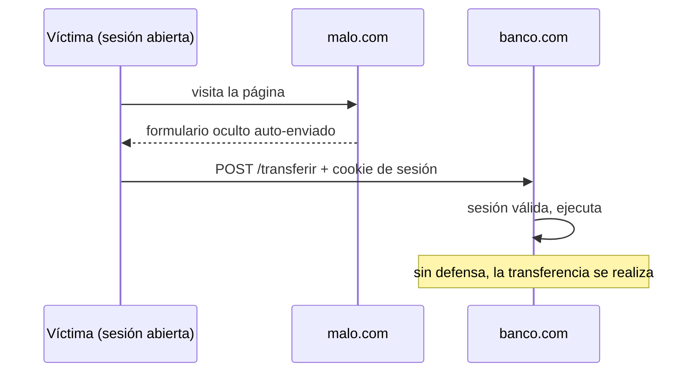
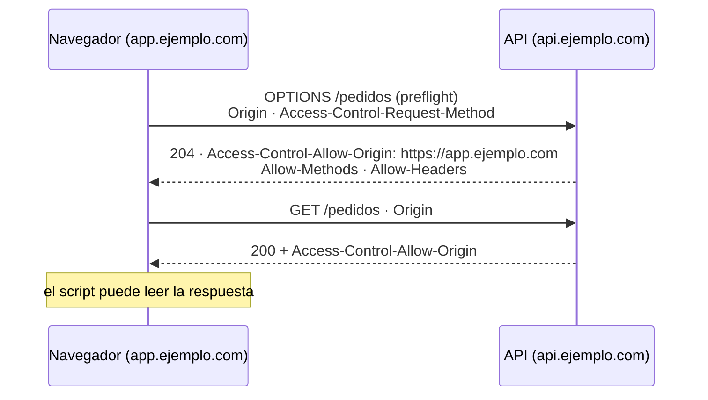

# Seguridad web

El navegador ejecuta código de **cualquier sitio** que visites, con tus cookies y sesiones abiertas. La seguridad web es el conjunto de reglas (y de errores) que determinan qué puede hacer un script o una petición de un origen sobre otro.

_Revisado: 2026-10-06_

## Origen y política del mismo origen

Un **origen** es la combinación de **esquema + host + puerto**.

| URL | ¿Mismo origen que `https://app.ejemplo.com`? |
|---|---|
| `https://app.ejemplo.com/otra` | sí |
| `http://app.ejemplo.com` | no (esquema) |
| `https://api.ejemplo.com` | no (host) |
| `https://app.ejemplo.com:8443` | no (puerto) |

La **política del mismo origen** (SOP) impide que un script de `https://malo.com` lea las respuestas de `https://banco.com`. **No impide enviar** peticiones: el navegador las envía (con cookies) pero el sitio malicioso no puede leer la respuesta. Ese matiz explica CSRF.

```mermaid
flowchart LR
  M["malo.com<br/>script"] -->|"petición con cookies"| B["banco.com"]
  B -->|"respuesta"| X["Bloqueada para el script<br/>SOP"]
  M -.->|"pero la acción ya se ejecutó"| B
  style X fill:#1a2d1a,stroke:#39d353
  style M fill:#2d1a1a,stroke:#ff7b72
```



## XSS: inyección de scripts

El atacante consigue que **su JavaScript se ejecute en tu página**, con los privilegios de tu sitio: roba tokens, actúa en nombre del usuario, altera lo que ve.

| Tipo | Cómo ocurre |
|---|---|
| **Reflejado** | la URL incluye un parámetro que se imprime sin escapar |
| **Almacenado** | el dato malicioso se guarda (comentario, perfil) y se muestra a otros |
| **Basado en DOM** | el JavaScript del cliente escribe datos no confiables con `innerHTML` o `eval` |

```html
<p>Resultados para: <span id="q"></span></p>
<script>
  document.getElementById("q").innerHTML = new URLSearchParams(location.search).get("q");
</script>
```

Con `?q=` se ejecuta código del atacante.

**Defensas**, en orden de importancia:

1. **Escapar según el contexto** de salida (HTML, atributo, JavaScript, URL). Los motores de plantillas modernos escapan HTML por defecto: no lo desactives (`th:utext`, `|safe`, `dangerouslySetInnerHTML`).
2. **`textContent` en lugar de `innerHTML`** para texto.
3. **Sanear** el HTML que debas permitir (DOMPurify).
4. **CSP** como red de seguridad.
5. Cookies **`HttpOnly`**: aunque haya XSS, el script no lee la sesión.
6. Validar la entrada es útil pero **no sustituye al escapado de salida**.

```javascript
const nodo = document.createElement("span");
nodo.textContent = new URLSearchParams(location.search).get("q");
document.getElementById("q").replaceChildren(nodo);
```

## CSP: política de seguridad de contenido

Una cabecera que dice al navegador **de dónde puede cargar** scripts, estilos e imágenes. Aunque exista un XSS, el navegador se niega a ejecutar un script no autorizado.

```text
Content-Security-Policy:
  default-src 'self';
  script-src 'self' 'nonce-r4nd0m123';
  style-src 'self' 'unsafe-inline';
  img-src 'self' data: https://cdn.ejemplo.com;
  connect-src 'self' https://api.ejemplo.com;
  frame-ancestors 'none';
  base-uri 'self';
  form-action 'self';
  object-src 'none'
```

| Directiva | Controla |
|---|---|
| `default-src` | valor por defecto de las demás |
| `script-src` | de dónde se ejecuta JavaScript |
| `connect-src` | destinos de `fetch`, WebSocket, XHR |
| `frame-ancestors` | quién puede incrustarte (anti-*clickjacking*) |
| `form-action` | adónde pueden enviarse formularios |
| `base-uri` | evita cambiar la base de URLs relativas |

- **Evita `'unsafe-inline'` y `'unsafe-eval'`** en `script-src`: anulan casi toda la protección. Usa **nonces** o *hashes* para los scripts en línea imprescindibles.
- Despliega primero en modo informe (`Content-Security-Policy-Report-Only` con `report-to`) para ver qué rompería.
- Los scripts de terceros (analítica, anuncios) son una de las principales fuentes de riesgo: cada uno ejecuta código con todos tus privilegios. **SRI** (*Subresource Integrity*) comprueba que un recurso externo no ha cambiado:

```html
<script src="https://cdn.ejemplo.com/lib.js"
        integrity="sha384-HASH_DEL_FICHERO"
        crossorigin="anonymous"></script>
```

## CSRF: peticiones falsificadas

Un sitio malicioso logra que el navegador del usuario envíe una petición a tu sitio **con su cookie de sesión**.

```html
<form action="https://banco.com/transferir" method="post" id="f">
  <input name="destino" value="CUENTA_ATACANTE">
  <input name="importe" value="1000">
</form>
<script>document.getElementById("f").submit();</script>
```



**Defensas:**

- Cookies **`SameSite=Lax`** (valor por defecto en navegadores modernos) o `Strict`: no se envían en peticiones entre sitios que cambian estado.
- **Token anti-CSRF** impredecible, ligado a la sesión, que el formulario debe devolver.
- Comprobar `Origin`/`Referer` en peticiones que cambian estado.
- **No cambiar estado con `GET`**.
- Si la autenticación usa `Authorization: Bearer` (no cookie), el navegador no la envía solo y CSRF no aplica.

## CORS

Por defecto, un script de `app.ejemplo.com` **no puede leer** respuestas de `api.ejemplo.com`. **CORS** es el mecanismo con el que el servidor de la API **permite** ciertos orígenes.



```text
Access-Control-Allow-Origin: https://app.ejemplo.com
Access-Control-Allow-Methods: GET, POST, PUT, DELETE
Access-Control-Allow-Headers: Authorization, Content-Type
Access-Control-Allow-Credentials: true
Access-Control-Max-Age: 3600
Vary: Origin
```

- CORS **relaja** el SOP; no es un control de acceso. Un cliente que no es un navegador (`curl`) lo ignora: la API debe autenticar y autorizar igualmente.
- **Nunca** `Access-Control-Allow-Origin: *` con credenciales (el navegador lo rechaza), y **no reflejes** el `Origin` recibido sin una lista blanca: abre la API a cualquier sitio.
- Un *preflight* `OPTIONS` se dispara con métodos distintos de `GET/POST` simples o con cabeceras personalizadas.
- Un error CORS en consola suele ser en realidad un **fallo del servidor** (`500`, sin cabeceras CORS): revisa primero la respuesta real.

## Cookies y sesiones

```text
Set-Cookie: sid=9f8e7d6c...; Path=/; Secure; HttpOnly; SameSite=Lax; Max-Age=3600
```

| Atributo | Efecto |
|---|---|
| `Secure` | solo se envía por HTTPS |
| `HttpOnly` | invisible para JavaScript (mitiga robo por XSS) |
| `SameSite` | limita el envío entre sitios (CSRF) |
| `Max-Age` / `Expires` | duración |
| `Domain` / `Path` | alcance; no ampliar el dominio sin necesidad |
| Prefijo `__Host-` | exige `Secure`, `Path=/` y sin `Domain`: ata la cookie al host |

Buenas prácticas de sesión: identificador **aleatorio y largo**, regenerado tras el inicio de sesión (evita la **fijación de sesión**), con caducidad por inactividad y por tiempo absoluto, invalidado en el servidor al cerrar sesión.

## Cabeceras de seguridad

| Cabecera | Valor recomendado | Protege de |
|---|---|---|
| `Strict-Transport-Security` | `max-age=31536000; includeSubDomains` | degradar a HTTP |
| `Content-Security-Policy` | política estricta | XSS, inyección de recursos |
| `X-Content-Type-Options` | `nosniff` | que el navegador "adivine" el tipo y ejecute ficheros |
| `Referrer-Policy` | `strict-origin-when-cross-origin` | fuga de URLs privadas |
| `Permissions-Policy` | `camera=(), microphone=(), geolocation=()` | uso no deseado de APIs |
| `Cross-Origin-Opener-Policy` | `same-origin` | ataques entre ventanas |
| `X-Frame-Options` / `frame-ancestors` | `DENY` / `'none'` | *clickjacking* |

```bash
curl -sI https://ejemplo.com | grep -i -E "strict-transport|content-security|x-content-type|referrer|permissions"
```

Evalúa con herramientas como Mozilla Observatory o securityheaders.com.

## HTTPS y HSTS

- **TLS en todo**: contenido mixto (recursos `http://` en una página `https://`) se bloquea.
- **Redirige** HTTP a HTTPS y activa **HSTS**: el navegador usará HTTPS directamente durante el tiempo indicado. Con `preload` se incluye en la lista de los navegadores.
- Certificados automáticos con **ACME/Let's Encrypt**; vigila la caducidad.
- Cookies `Secure`; nada sensible en la URL (queda en historiales, registros y cabeceras `Referer`).

## Autenticación en aplicaciones web

- **Contraseñas**: se guardan con bcrypt/Argon2; mensajes de error iguales para "usuario" y "contraseña" incorrectos; límite de intentos y MFA.
- **Recuperación de cuenta**: tokens de un solo uso, aleatorios y de corta duración.
- **Sesión por cookie** (aplicaciones clásicas) o **tokens** (SPA/API); si usas JWT, vida corta y renovación segura ([Spring Security](/java/seguridad-spring)).
- **OAuth2/OIDC** con **PKCE** para inicio de sesión de terceros; no implementes tu propio protocolo.
- **Passkeys / WebAuthn**: autenticación sin contraseña resistente al *phishing*.
- Autoriza **siempre en el servidor** y por recurso (IDOR).

## Otras vulnerabilidades habituales

| Vulnerabilidad | Descripción | Defensa |
|---|---|---|
| **Clickjacking** | tu página se incrusta en un iframe invisible | `frame-ancestors 'none'` |
| **Open redirect** | `?next=https://malo.com` redirige sin validar | lista blanca de destinos |
| **SSRF** | el servidor descarga una URL elegida por el atacante | validar destino, bloquear redes internas |
| **Subida de ficheros** | ejecutables disfrazados, rutas manipuladas | tipo y tamaño estrictos, almacenar fuera del *webroot*, renombrar |
| **Path traversal** | `../../etc/passwd` | normalizar y restringir rutas |
| **Inyección SQL** | entrada concatenada en consultas | sentencias parametrizadas |
| **Dependencias vulnerables** | librerías con CVE | `npm audit`, Dependabot, *lockfiles* |
| **Secretos en el cliente** | claves de API en JavaScript | las claves viven en el servidor |

:::warning Todo lo que llega al navegador es público
Cualquier clave, endpoint "oculto" o lógica de autorización que esté en el JavaScript del cliente se puede ver y manipular. El cliente es **entorno hostil**: solo el servidor puede imponer reglas.
:::

## Cadena de suministro del front

```bash
npm audit --omit=dev
npm ci
npm ls --all | grep -i "paquete-sospechoso"
npx --yes lockfile-lint --path package-lock.json --type npm --allowed-hosts npm
```

- Usa `npm ci` en CI (instala exactamente el *lockfile*).
- **Pocas dependencias**: cada paquete es código ajeno con tus privilegios; vigila *typosquatting*.
- Fija versiones, activa Dependabot/Renovate y revisa los *post-install scripts*.
- Los scripts de terceros en la página (analítica, chats): CSP, SRI y carga controlada.

## Comprobar la seguridad

1. **DevTools**: pestaña *Network* (cabeceras de respuesta), *Application* (cookies, almacenamiento) y *Console* (violaciones de CSP y CORS).
2. **OWASP ZAP** o Burp Suite para análisis dinámico en entornos de prueba **propios o autorizados**.
3. **SAST** en el CI (Semgrep, CodeQL) y escaneo de dependencias y de secretos.
4. **Pruebas de autorización**: ¿puede el usuario A acceder a los recursos del usuario B?
5. Modelado de amenazas ligero en cada funcionalidad nueva: qué entra, qué se confía, qué puede salir mal.

## Trampas frecuentes

- **`innerHTML` con datos externos**: XSS.
- **Desactivar el escapado** del motor de plantillas "porque rompe el formato".
- **CORS con `*`** o reflejando el origen; confundir CORS con autenticación.
- **Token de sesión en `localStorage`** con riesgo de XSS: mejor cookie `HttpOnly`.
- **CSP con `unsafe-inline`**: protección casi nula.
- **Cookies sin `Secure`/`HttpOnly`/`SameSite`**.
- **Cambiar estado con `GET`**: CSRF trivial.
- **Confiar en validación del cliente**: se salta con una petición manual.
- **Secretos en el JavaScript** o en el repositorio.
- **Mensajes de error con trazas** que revelan tecnología y rutas.
- **Sin actualizar dependencias**.

## Comprueba que lo entiendes

1. ¿Qué impide y qué no impide la política del mismo origen?
2. ¿Por qué `HttpOnly` no evita un XSS pero reduce su daño?
3. Una SPA en `app.ejemplo.com` llama a `api.ejemplo.com` y falla con error CORS. ¿Qué compruebas en la respuesta de la API?
4. ¿Por qué una API puede ser atacada por un script en `curl` aunque tenga CORS bien configurado?

**Mini-ejercicio.** Comprueba qué cabeceras de seguridad envía un sitio.

```bash
curl -sI https://ejemplo.com | grep -i -E "strict-transport-security|content-security-policy|x-content-type-options"
```

<details>
  <summary>Respuestas</summary>

1. Impide que un script de otro origen **lea** respuestas o acceda al DOM de otro origen; **no impide enviar** peticiones entre orígenes (las cookies viajan), por eso existe CSRF.
2. El XSS sigue ejecutando código en la página (puede actuar en nombre del usuario), pero ese código no puede **leer** la cookie de sesión para exfiltrarla y usarla desde fuera.
3. Que la respuesta (incluida la del `OPTIONS` de preflight) lleve `Access-Control-Allow-Origin` con el origen exacto, los métodos y cabeceras necesarios, y que el servidor no devuelva antes un `4xx`/`5xx` sin esas cabeceras.
4. CORS lo aplica el navegador; `curl` no lo respeta. La protección real es la autenticación y autorización del servidor.

</details>

## Referencias

- [OWASP Cheat Sheet Series](https://cheatsheetseries.owasp.org/)
- [MDN — Seguridad web](https://developer.mozilla.org/es/docs/Web/Security)
- [OWASP Top 10](https://owasp.org/www-project-top-ten/)
- [web.dev — Seguridad](https://web.dev/secure)
- [Mozilla Observatory](https://developer.mozilla.org/en-US/observatory)
