# XML, JSON y YAML

Los sistemas se hablan con formatos de intercambio y configuración: XML en integraciones empresariales, JSON en APIs, YAML en configuración. Este bloque cubre cómo se escribe cada uno **correctamente**, cómo se **valida** y cómo se **consulta**.

_Revisado: 2026-10-06_

## Elegir formato

| | XML | JSON | YAML |
|---|---|---|---|
| Uso típico | SOAP, documentos, feeds, SVG, Office | APIs REST, mensajería | configuración, CI, infraestructura |
| Comentarios | sí | no | sí |
| Tipos nativos | solo texto (los tipos vienen del esquema) | cadena, número, booleano, nulo, objeto, array | los de JSON + fechas y más |
| Validación | XSD, DTD, Schematron | JSON Schema | JSON Schema (sobre su equivalente JSON) |
| Consulta | XPath, XQuery | JSONPath, `jq` | `yq` |
| Atributos / mixto | sí | no | no |
| Verbosidad | alta | media | baja |

YAML es un superconjunto práctico de JSON pensado para personas; JSON para máquinas; XML cuando importan los **documentos con estructura mixta**, los espacios de nombres y la validación formal madura.

## XML: bien formado y válido

Dos niveles distintos:

- **Bien formado**: cumple la sintaxis. Un parser **debe rechazar** lo que no lo esté.
- **Válido**: además cumple un esquema (DTD o XSD).

```xml
<?xml version="1.0" encoding="UTF-8"?>
<pedidos xmlns="https://ejemplo.com/pedidos" xmlns:fac="https://ejemplo.com/facturacion">
  <pedido id="1042" estado="pagado">
    <cliente>
      <nombre>Lucía Pérez</nombre>
      <email>lucia@ejemplo.com</email>
    </cliente>
    <lineas>
      <linea sku="TEC-01" cantidad="2" precio="49.90"/>
      <linea sku="RAT-07" cantidad="1" precio="19.50"/>
    </lineas>
    <nota><![CDATA[Entregar antes de las 18:00 & llamar al timbre]]></nota>
    <fac:factura numero="F-2026-118"/>
  </pedido>
</pedidos>
```

Reglas de un documento **bien formado**:

1. Un único elemento raíz.
2. Toda etiqueta abierta se cierra (`<a>...</a>` o `<a/>`) y se anidan correctamente.
3. Sensible a mayúsculas: `<Pedido>` ≠ `<pedido>`.
4. Los valores de atributo van **entre comillas**.
5. Los caracteres especiales se escapan: `&lt;` `&gt;` `&amp;` `&quot;` `&apos;`; o se usa una sección `CDATA`.
6. Los nombres no empiezan por dígito ni contienen espacios.

```bash
xmllint --noout pedidos.xml
xmllint --noout --schema pedidos.xsd pedidos.xml
```

### Atributos o elementos

Regla práctica: los **atributos** para metadatos y identificadores (`id`, `estado`); los **elementos** para contenido y datos que pueden repetirse o tener estructura. Un atributo no puede repetirse ni contener hijos.

### Espacios de nombres

Evitan colisiones entre vocabularios: `fac:factura` pertenece al espacio `https://ejemplo.com/facturacion`. La URI es un **identificador**, no tiene que ser accesible. Es el origen del error más típico en XPath: los elementos con un espacio de nombres por defecto **no** coinciden con un nombre sin prefijo.

## Esquemas: XSD

Un **XSD** describe qué estructura, tipos y restricciones es válida.

```xml
<?xml version="1.0" encoding="UTF-8"?>
<xs:schema xmlns:xs="http://www.w3.org/2001/XMLSchema"
           targetNamespace="https://ejemplo.com/pedidos"
           xmlns="https://ejemplo.com/pedidos"
           elementFormDefault="qualified">

  <xs:element name="pedidos">
    <xs:complexType>
      <xs:sequence>
        <xs:element name="pedido" type="TipoPedido" minOccurs="1" maxOccurs="unbounded"/>
      </xs:sequence>
    </xs:complexType>
  </xs:element>

  <xs:complexType name="TipoPedido">
    <xs:sequence>
      <xs:element name="cliente" type="TipoCliente"/>
      <xs:element name="lineas">
        <xs:complexType>
          <xs:sequence>
            <xs:element name="linea" type="TipoLinea" maxOccurs="unbounded"/>
          </xs:sequence>
        </xs:complexType>
      </xs:element>
    </xs:sequence>
    <xs:attribute name="id" type="xs:positiveInteger" use="required"/>
    <xs:attribute name="estado" type="Estado" use="required"/>
  </xs:complexType>

  <xs:complexType name="TipoCliente">
    <xs:sequence>
      <xs:element name="nombre" type="xs:string"/>
      <xs:element name="email" type="Email"/>
    </xs:sequence>
  </xs:complexType>

  <xs:complexType name="TipoLinea">
    <xs:attribute name="sku" type="xs:string" use="required"/>
    <xs:attribute name="cantidad" type="xs:positiveInteger" use="required"/>
    <xs:attribute name="precio" type="xs:decimal" use="required"/>
  </xs:complexType>

  <xs:simpleType name="Estado">
    <xs:restriction base="xs:string">
      <xs:enumeration value="nuevo"/>
      <xs:enumeration value="pagado"/>
      <xs:enumeration value="enviado"/>
    </xs:restriction>
  </xs:simpleType>

  <xs:simpleType name="Email">
    <xs:restriction base="xs:string">
      <xs:pattern value="[^@]+@[^@]+\.[a-z]{2,}"/>
    </xs:restriction>
  </xs:simpleType>
</xs:schema>
```



```mermaid
flowchart LR
  X["documento.xml"] --> P["Parser validador"]
  S["esquema.xsd"] --> P
  P -->|"cumple"| OK["Válido"]
  P -->|"viola"| ER["Error con línea y regla"]
  style OK fill:#1a2d1a,stroke:#39d353
  style ER fill:#2d1a1a,stroke:#ff7b72
```

Un **DTD** es el mecanismo antiguo: no soporta espacios de nombres ni tipos de datos reales. En código nuevo, XSD.

:::danger XXE: entidades externas
Un parser XML que procesa **DTD con entidades externas** puede leer ficheros locales o hacer peticiones internas (`<!ENTITY x SYSTEM "file:///etc/passwd">`). Al procesar XML de terceros, **desactiva DTD y entidades externas** en el parser (`disallow-doctype-decl`).
:::

## XPath

Lenguaje para **seleccionar nodos** de un XML.

| Expresión | Selecciona |
|---|---|
| `/pedidos/pedido` | pedidos hijos de la raíz (ruta absoluta) |
| `//linea` | todas las líneas, a cualquier profundidad |
| `//pedido[@estado='pagado']` | pedidos con el atributo `estado` igual a `pagado` |
| `//linea[@cantidad > 1]` | líneas con cantidad mayor que 1 |
| `//pedido[1]` / `//pedido[last()]` | el primero / el último (índices desde 1) |
| `//pedido/@id` | los valores del atributo `id` |
| `//cliente/nombre/text()` | el texto del nombre |
| `//pedido[count(lineas/linea) > 2]` | pedidos con más de dos líneas |
| `//linea[contains(@sku, 'TEC')]` | líneas cuyo sku contiene `TEC` |
| `//cliente/..` | el padre |

```bash
xmllint --xpath '//pedido[@estado="pagado"]/@id' pedidos.xml
xmllint --xpath 'sum(//linea/@precio)' pedidos.xml
xmllint --xpath '//*[local-name()="pedido"]/@id' pedidos.xml
```

El tercer ejemplo usa `local-name()` para ignorar el espacio de nombres por defecto; en código se registra el prefijo en el evaluador XPath.

## XSLT

Transforma un XML en otro XML, HTML o texto mediante **plantillas**.

```xml
<?xml version="1.0" encoding="UTF-8"?>
<xsl:stylesheet version="1.0"
    xmlns:xsl="http://www.w3.org/1999/XSL/Transform"
    xmlns:p="https://ejemplo.com/pedidos">
  <xsl:output method="html" indent="yes"/>

  <xsl:template match="/p:pedidos">
    <html>
      <body>
        <h1>Pedidos pagados</h1>
        <table>
          <xsl:for-each select="p:pedido[@estado='pagado']">
            <xsl:sort select="@id" data-type="number"/>
            <tr>
              <td><xsl:value-of select="@id"/></td>
              <td><xsl:value-of select="p:cliente/p:nombre"/></td>
              <td><xsl:value-of select="sum(p:lineas/p:linea/@precio)"/></td>
            </tr>
          </xsl:for-each>
        </table>
      </body>
    </html>
  </xsl:template>
</xsl:stylesheet>
```

```bash
xsltproc transformacion.xsl pedidos.xml > informe.html
```

Es declarativo: describes cómo tratar cada patrón de nodo y el procesador recorre el árbol. Se usa en generación de informes, conversión entre formatos de integración y publicación de documentación.

## JSON

```json
{
  "id": 1042,
  "estado": "pagado",
  "cliente": { "nombre": "Lucía Pérez", "email": "lucia@ejemplo.com" },
  "lineas": [
    { "sku": "TEC-01", "cantidad": 2, "precio": 49.90 },
    { "sku": "RAT-07", "cantidad": 1, "precio": 19.50 }
  ],
  "nota": null,
  "urgente": false
}
```

Reglas estrictas, distintas de JavaScript:

1. Las claves van **entre comillas dobles** (no simples).
2. **Sin comas finales** ni comentarios.
3. Tipos: cadena, número, booleano (`true`/`false`), `null`, objeto, array.
4. Los números no distinguen enteros de decimales y los de más de 53 bits pierden precisión en JavaScript: los identificadores grandes y los importes se envían como **cadenas**.
5. Las fechas no existen como tipo: usa **ISO 8601** (`"2026-10-06T10:30:00Z"`).

### jq

```bash
jq '.' respuesta.json
jq '.lineas[].sku' pedido.json
jq '[.lineas[] | .cantidad * .precio] | add' pedido.json
jq '.pedidos[] | select(.estado == "pagado") | {id, cliente: .cliente.nombre}' pedidos.json
jq -r '.pedidos[] | [.id, .estado] | @csv' pedidos.json
curl -s https://api.ejemplo.com/pedidos | jq '.data | length'
```

### JSON Schema

Valida estructura y restricciones, el equivalente a XSD:

```json
{
  "$schema": "https://json-schema.org/draft/2020-12/schema",
  "type": "object",
  "required": ["id", "estado", "lineas"],
  "properties": {
    "id": { "type": "integer", "minimum": 1 },
    "estado": { "enum": ["nuevo", "pagado", "enviado"] },
    "cliente": {
      "type": "object",
      "required": ["email"],
      "properties": {
        "email": { "type": "string", "format": "email" }
      }
    },
    "lineas": {
      "type": "array",
      "minItems": 1,
      "items": {
        "type": "object",
        "required": ["sku", "cantidad"],
        "properties": {
          "sku": { "type": "string", "pattern": "^[A-Z]{3}-[0-9]{2}$" },
          "cantidad": { "type": "integer", "minimum": 1 }
        },
        "additionalProperties": false
      }
    }
  },
  "additionalProperties": false
}
```

```bash
npx ajv-cli validate -s pedido.schema.json -d pedido.json
```

`additionalProperties: false` rechaza campos desconocidos y detecta erratas; úsalo en contratos estrictos. La validación del esquema es la **primera línea de defensa** de una API: rechaza entradas malformadas antes de tocar la lógica de negocio.

## YAML

```yaml
servicio:
  nombre: api-pedidos
  puerto: 8080
  activo: true
  etiquetas: [web, interna]
  entorno:
    LOG_NIVEL: info
    REGION: eu-west-1
  limites: &limites
    cpu: "500m"
    memoria: 512Mi

replica:
  nombre: api-pedidos-r1
  limites: *limites

descripcion: |
  Texto en varias líneas
  que conserva los saltos.

resumen: >
  Texto largo que se pliega
  en una sola línea.

pasos:
  - nombre: compilar
    comando: mvn verify
  - nombre: desplegar
    comando: ./deploy.sh
```

- La **indentación** con espacios define la estructura; **nunca tabuladores**. Dos espacios es el estándar.
- Listas con `-`; mapas con `clave: valor`; comentarios con `#`.
- `|` conserva los saltos de línea; `>` los pliega.
- Las **anclas** (`&nombre`) y los **alias** (`*nombre`) evitan repetir bloques.
- Varios documentos en un fichero se separan con `---`.

:::warning El problema de los tipos implícitos
YAML interpreta valores sin comillas: `no`, `yes`, `on`, `off` pueden ser booleanos; `3.10` es un número (`3.1`); `0123` puede ser octal; `~` es nulo. Una versión `1.10` se convierte en `1.1`. **Pon comillas** a versiones, códigos, países (`"NO"` de Noruega) y todo lo que deba ser texto.
:::

```bash
yq '.servicio.puerto' config.yaml
yq -i '.servicio.entorno.LOG_NIVEL = "debug"' config.yaml
yq -o=json '.' config.yaml
yamllint config.yaml
```

## Markdown

El formato de la documentación técnica: texto plano legible que se convierte a HTML.

````markdown
# Título

Párrafo con **negrita**, *cursiva* y `código en línea`.

- Elemento
- Otro elemento
  1. Anidado numerado

| Columna | Valor |
|---|---|
| a | 1 |

[Enlace](https://ejemplo.com) · 

> Cita o aviso

```bash
echo "bloque de código con lenguaje"
```
````

Variantes y extensiones: **CommonMark** es la especificación estándar; **GFM** (GitHub) añade tablas, listas de tareas y tachado; **MDX** permite componentes dentro de Markdown.

## Convertir y validar en una cadena de herramientas

```mermaid
flowchart LR
  FUE["Fuente"] --> L["Lint<br/>yamllint · jq empty · xmllint --noout"]
  L --> V["Validación de esquema<br/>XSD · JSON Schema"]
  V --> T["Transformación<br/>XSLT · jq · yq"]
  T --> D["Destino"]
  style V fill:#1a2233,stroke:#58a6ff
  style L fill:#1a2d1a,stroke:#39d353
```



```bash
jq empty datos.json && echo "JSON válido"
xmllint --noout datos.xml && echo "XML bien formado"
yamllint -d relaxed config.yaml
yq -o=json '.' config.yaml | npx ajv-cli validate -s config.schema.json -d /dev/stdin
```

Integra estas comprobaciones en el **CI** y en un *pre-commit*: un YAML mal indentado o un JSON con coma final se detectan antes de llegar a producción.

## Trampas frecuentes

- **XML "casi" bien formado**: una `&` sin escapar rompe todo el documento.
- **XPath sin espacio de nombres**: no encuentra nada; registra el prefijo o usa `local-name()`.
- **XXE** al parsear XML de terceros con las entidades activadas.
- **Coma final o comillas simples en JSON**: no es JSON válido.
- **Números grandes e importes en JSON** perdiendo precisión: envíalos como cadena.
- **Tabuladores en YAML** o indentación inconsistente.
- **Tipos implícitos de YAML**: `NO`, `1.10`, `0123` se interpretan como booleano, número u octal.
- **Cadenas con `:` sin comillas** en YAML: se leen como mapa.
- **Sin esquema**: cada consumidor interpreta el formato a su manera.

## Comprueba que lo entiendes

1. ¿Qué diferencia hay entre un XML bien formado y uno válido? Pon un ejemplo de uno bien formado que no sea válido.
2. Tu XPath `//pedido` no devuelve nada aunque el XML tiene pedidos. ¿Cuál es la causa más probable?
3. ¿Por qué `version: 3.10` en YAML puede provocar un fallo y cómo se evita?
4. ¿Qué ventaja tiene validar con JSON Schema en el borde de una API?

**Mini-ejercicio.** Extrae con `jq` los emails de los clientes con pedidos en estado `pagado`.

```bash
jq -r '.pedidos[] | select(.estado == "pagado") | .cliente.email' pedidos.json | sort -u
```

<details>
  <summary>Respuestas</summary>

1. Bien formado: cumple la sintaxis XML. Válido: además cumple un esquema (XSD/DTD). Un `<pedido estado="roto"/>` está bien formado pero no es válido si el XSD solo admite `nuevo`, `pagado` o `enviado`.
2. El documento declara un **espacio de nombres por defecto** (`xmlns="..."`) y el XPath sin prefijo no coincide. Hay que registrar el prefijo en el evaluador o usar `*[local-name()='pedido']`.
3. YAML lo lee como número `3.1`, perdiendo el cero. Se evita con comillas: `version: "3.10"`.
4. Rechaza entradas malformadas o fuera de contrato antes de ejecutar lógica de negocio, devuelve errores claros y documenta el contrato de forma verificable.

</details>

## Referencias

- [W3C — XML 1.0](https://www.w3.org/TR/xml/)
- [W3C — XPath 3.1](https://www.w3.org/TR/xpath-31/)
- [JSON Schema — documentación](https://json-schema.org/understanding-json-schema/)
- [YAML 1.2 — especificación](https://yaml.org/spec/1.2.2/)
- [CommonMark](https://commonmark.org/)
- [jq — manual](https://jqlang.github.io/jq/manual/)
