# Automatización de red

Configurar cincuenta switches por CLI significa cincuenta oportunidades de un error de tecleo y ninguna garantía de que sean idénticos. La automatización de red trata la configuración como **código**: versionada, revisada, probada y aplicada de forma repetible.

_Revisado: 2026-10-06_

## Del CLI manual al flujo declarativo

```mermaid
flowchart LR
  G["Git<br/>intención + plantillas"] --> CI["CI<br/>lint · validación"]
  CI --> PR["Revisión<br/>pull request"]
  PR --> D["Despliegue<br/>Ansible · Nornir"]
  D --> N["Dispositivos"]
  N --> V["Verificación<br/>estado real vs esperado"]
  V -.->|"drift"| G
  style CI fill:#1a2233,stroke:#58a6ff
  style V fill:#1a2d1a,stroke:#39d353
```



Principios:

1. **Fuente de verdad**: un inventario (NetBox, YAML en Git) define qué debe existir; los dispositivos no.
2. **Idempotencia**: aplicar dos veces no cambia nada la segunda.
3. **Pequeño y reversible**: cambios por lotes, con copia previa de la configuración y plan de vuelta atrás.
4. **Verificar**: comprobar el estado operativo tras el cambio (vecinos OSPF, rutas, interfaces), no solo que el comando se aceptó.

## Python con Netmiko

Netmiko automatiza sesiones SSH contra dispositivos de múltiples fabricantes.

```python
from netmiko import ConnectHandler

dispositivo = {
    "device_type": "cisco_ios",
    "host": "10.0.0.11",
    "username": "automatizacion",
    "use_keys": True,
    "key_file": "~/.ssh/id_ed25519",
}

with ConnectHandler(**dispositivo) as conexion:
    salida = conexion.send_command("show ip interface brief", use_textfsm=True)
    for interfaz in salida:
        if interfaz["status"] != "up":
            print(interfaz["interface"], interfaz["status"])

    conexion.send_config_set([
        "interface Gi0/5",
        "description enlace-servidor-db",
        "switchport access vlan 20",
    ])
    conexion.save_config()
```

- `use_textfsm=True` convierte la salida de texto en **datos estructurados** (lista de diccionarios) con plantillas; así se programa sobre datos, no sobre cadenas.
- Usa **claves SSH** o un gestor de secretos; nunca contraseñas en el código.
- `with` cierra la sesión incluso si hay un error.

### Varios dispositivos a la vez

```python
from concurrent.futures import ThreadPoolExecutor
from netmiko import ConnectHandler

def version(ip):
    with ConnectHandler(device_type="cisco_ios", host=ip, username="automatizacion", use_keys=True) as c:
        return ip, c.send_command("show version | include uptime")

with ThreadPoolExecutor(max_workers=10) as pool:
    for ip, salida in pool.map(version, ["10.0.0.11", "10.0.0.12", "10.0.0.13"]):
        print(ip, salida)
```

Limita los hilos: un lote demasiado grande satura el plano de gestión de los equipos o el servidor TACACS+.

## Nornir

Nornir es un marco de automatización **en Python puro**: inventario, ejecución en paralelo y resultados por tarea.

```yaml title="inventario/hosts.yaml"
sw-core-1:
  hostname: 10.0.0.11
  platform: ios
  groups: [core]
  data:
    vlans: [10, 20, 30]
```

```python
from nornir import InitNornir
from nornir_netmiko.tasks import netmiko_send_command
from nornir_utils.plugins.functions import print_result

nr = InitNornir(config_file="config.yaml")
core = nr.filter(groups__contains="core")

resultado = core.run(task=netmiko_send_command, command_string="show vlan brief")
print_result(resultado)
```

Frente a Ansible, Nornir da control total con Python (condiciones, bucles complejos, integración con APIs); Ansible es más declarativo y accesible para equipos sin programación.

## Ansible para red

```yaml title="vlans.yml"
- name: Configurar VLAN
  hosts: switches
  gather_facts: false
  connection: ansible.netcommon.network_cli
  vars:
    ansible_network_os: cisco.ios.ios
  tasks:
    - name: Declarar VLAN
      cisco.ios.ios_vlans:
        config:
          - vlan_id: 10
            name: usuarios
          - vlan_id: 20
            name: servidores
        state: merged

    - name: Copia de seguridad de la configuración
      cisco.ios.ios_config:
        backup: true
        backup_options:
          dir_path: ./copias
```

```bash
ansible-playbook -i inventario.yml vlans.yml --check --diff
ansible switches -i inventario.yml -m cisco.ios.ios_facts -a "gather_subset=interfaces"
```

Los **módulos de recursos** (`ios_vlans`, `ios_interfaces`, `ios_l3_interfaces`) son idempotentes y declarativos. Con `state`: `merged` (añade), `replaced` (sustituye un recurso), `overridden` (sustituye todo, el más peligroso) y `deleted`. Más detalle de Ansible en [Linux: automatización](/linux/automatizacion-ansible).

## APIs modernas: NETCONF, RESTCONF y YANG

| Mecanismo | Transporte | Formato | Ventaja |
|---|---|---|---|
| CLI/SSH | SSH | texto | universal, frágil de analizar |
| NETCONF | SSH (830) | XML | transaccional: validar, aplicar, *commit* y *rollback* |
| RESTCONF | HTTPS | JSON o XML | REST sobre modelos YANG |
| gNMI | gRPC | protobuf | telemetría en streaming |

**YANG** define el **modelo de datos** de la configuración y el estado (qué hay en una interfaz, qué campos admite), de modo que la API es consistente y verificable.

```bash
curl -sk -u automatizacion:CLAVE -H "Accept: application/yang-data+json" \
  https://10.0.0.11/restconf/data/ietf-interfaces:interfaces/interface=GigabitEthernet1
```

```python
from ncclient import manager

with manager.connect(host="10.0.0.11", port=830, username="automatizacion",
                     key_filename="/home/neo/.ssh/id_ed25519", hostkey_verify=True) as m:
    configuracion = m.get_config(source="running").data_xml
    print(configuracion[:500])
```

NETCONF permite **candidate datastore** y `commit` con confirmación: si el cambio corta tu acceso y no confirmas, el equipo revierte solo.

## Telemetría y estado

El sondeo SNMP cada minuto pierde lo que ocurre entre lecturas. La **telemetría en streaming** (gNMI) envía contadores cada pocos segundos.

```mermaid
flowchart LR
  D["Dispositivos"] -->|"gNMI · SNMP · syslog"| C["Colector<br/>Telegraf · gnmic"]
  C --> TS[("Base de series<br/>Prometheus · InfluxDB")]
  TS --> G["Grafana"]
  TS --> A["Alertas"]
  style TS fill:#1a2233,stroke:#58a6ff
```



Coincide con la monitorización de [Linux](/linux/monitorizacion-logs): las mismas herramientas sirven para red y servidores.

## Plantillas e inventario

```text title="plantillas/acceso.j2"
interface {{ puerto }}
 description {{ descripcion }}
 switchport mode access
 switchport access vlan {{ vlan }}
 spanning-tree portfast
 spanning-tree bpduguard enable
```

```python
from jinja2 import Environment, FileSystemLoader

env = Environment(loader=FileSystemLoader("plantillas"), trim_blocks=True, lstrip_blocks=True)
print(env.get_template("acceso.j2").render(puerto="Gi0/7", descripcion="usuario-fernandez", vlan=10))
```

Una **plantilla** garantiza que todos los puertos de acceso tienen las mismas protecciones. Con **NetBox** como fuente de verdad (dispositivos, IPs, VLAN, cables), las plantillas se rellenan desde su API.

## Pruebas y validación

```python
def test_vecinos_ospf(conexion):
    vecinos = conexion.send_command("show ip ospf neighbor", use_textfsm=True)
    estados = {v["neighbor_id"]: v["state"] for v in vecinos}
    assert estados, "no hay vecinos OSPF"
    assert all(e.startswith("FULL") for e in estados.values()), estados
```

| Fase | Qué se comprueba |
|---|---|
| Antes (CI) | sintaxis de plantillas y YAML, lint, que el diff solo toca lo previsto |
| Entorno de pruebas | contenedores o emuladores (Containerlab, GNS3, EVE-NG) con la topología |
| Despliegue | canario en un dispositivo, luego por lotes |
| Después | vecinos de enrutamiento, rutas esperadas, conectividad extremo a extremo |

Un **diff** de configuración (antes y después) es la revisión más útil de un cambio de red.

## Seguridad en la automatización

- Cuenta de servicio con **mínimo privilegio** y comandos autorizados (TACACS+ con autorización por comando).
- **Claves o secretos** en un gestor (Vault) y no en repositorios.
- Registro de **quién** cambió **qué** (CI + TACACS+ accounting).
- Plano de gestión en una red separada, accesible solo desde el servidor de automatización.
- Los repositorios de configuración contienen información sensible: acceso restringido y sin secretos en claro.

## Trampas frecuentes

- **`state: overridden`** sin revisar: borra configuración que no estaba en el código.
- **Aplicar a todo el parque a la vez**: un error afecta a toda la red. Canario primero.
- **Analizar texto con expresiones regulares** frágiles cuando hay API o plantillas TextFSM.
- **Sin copia previa** ni plan de vuelta atrás.
- **Automatizar un diseño inconsistente**: la automatización amplifica; estandariza primero.
- **Credenciales en el script** o en el historial de Git.
- **Verificar que el comando se aceptó**, no que la red funciona.
- **Cambios manuales de emergencia** que nunca se llevan al código: aparece *drift*.

## Comprueba que lo entiendes

1. ¿Por qué se prefiere una salida estructurada (TextFSM, NETCONF/JSON) a analizar texto con regex?
2. ¿Qué hace `state: overridden` y por qué es peligroso?
3. ¿Qué te da NETCONF con `candidate` y `commit` confirmado frente a CLI por SSH?
4. Diseña los pasos para desplegar un cambio de VLAN en 40 switches de forma segura.

**Mini-ejercicio.** Con Netmiko, lista las interfaces que no estén en estado `up`.

```python
for i in conexion.send_command("show ip interface brief", use_textfsm=True):
    if i["status"] != "up":
        print(i["interface"], i["status"])
```

<details>
  <summary>Respuestas</summary>

1. Los datos estructurados no se rompen al cambiar el formato de salida o la versión, se pueden filtrar y comparar de forma fiable, y el código es más corto y probable.
2. Reemplaza toda la configuración del recurso por lo declarado, eliminando lo no incluido. Si el inventario está incompleto, borra VLAN o interfaces que sí se usaban.
3. Cambios transaccionales: se prepara en un datastore candidato, se valida y se confirma con temporizador; si se pierde conectividad y no se confirma, el equipo revierte solo.
4. Copia de seguridad, validar plantillas en CI, probar en el laboratorio, canario en 1 switch, verificar (vecinos, rutas, ping), lotes pequeños con parada ante fallo y registro de cada cambio.

</details>

## Referencias

- [Netmiko](https://github.com/ktbyers/netmiko)
- [Nornir — documentación](https://nornir.readthedocs.io/)
- [NetBox — documentación](https://netboxlabs.com/docs/netbox/)
- [Network Automation con Ansible](https://docs.ansible.com/ansible/latest/network/index.html)
- [Containerlab](https://containerlab.dev/)
