# Conmutación y enrutamiento

Una red de empresa son dos problemas distintos: **mover tramas dentro de un segmento** (switching) y **mover paquetes entre segmentos** (routing). Este bloque cubre cómo se diseñan, qué falla y cómo se diagnostica.

_Revisado: 2026-10-06_

## Switching y tabla MAC

Un switch aprende la MAC de origen de cada trama y la asocia al puerto por el que llegó. Si el destino es desconocido, **inunda** (flooding) todos los puertos del segmento.

```mermaid
flowchart LR
  PC1["PC1<br/>MAC A"] --- SW["Switch"]
  PC2["PC2<br/>MAC B"] --- SW
  SRV["Servidor<br/>MAC C"] --- SW
  SW --- RT["Router<br/>gateway"]
  style SW fill:#1a2233,stroke:#58a6ff
```



```text
Switch# show mac address-table
Vlan  Mac Address       Type     Ports
  10  0050.7966.6801    DYNAMIC  Gi0/1
  10  0050.7966.6802    DYNAMIC  Gi0/2
```

Un puerto con muchas MAC en un segmento esperado de una sola indica un switch conectado detrás, un bucle o un ataque de **MAC flooding** (para forzar al switch a comportarse como un hub). Mitiga con `port-security`.

## VLAN y trunks

Una **VLAN** divide un switch físico en redes lógicas separadas (dominios de broadcast distintos). Cada VLAN es una subred IP distinta y necesita un router para comunicarse con las demás.

| Tipo de puerto | Transporta | Uso |
|---|---|---|
| Acceso | una VLAN, sin etiqueta | equipos finales |
| Trunk | varias VLAN, etiquetadas 802.1Q | enlaces entre switches y hacia el router |

```text
interface Gi0/1
 switchport mode access
 switchport access vlan 10

interface Gi0/24
 switchport mode trunk
 switchport trunk allowed vlan 10,20,30
 switchport trunk native vlan 999
```

- Limita las VLAN permitidas en el trunk: transportar todas aumenta la superficie y el broadcast.
- **VLAN nativa** distinta de la 1 y sin uso: evita ataques de VLAN hopping por doble etiqueta.
- Para comunicar VLAN: **router-on-a-stick** (subinterfaces `.10`, `.20` en un trunk) o un switch L3 con interfaces SVI.

```text
interface Vlan10
 ip address 10.10.10.1 255.255.255.0

interface Vlan20
 ip address 10.10.20.1 255.255.255.0

ip routing
```

## Spanning Tree (STP)

Los bucles de capa 2 son letales: las tramas broadcast circulan indefinidamente (tormenta) y la red cae. **STP** bloquea enlaces redundantes lógicamente y los reactiva si falla el principal.

```mermaid
flowchart TB
  ROOT["Switch raíz<br/>prioridad más baja"] --- A["Switch A"]
  ROOT --- B["Switch B"]
  A -. "puerto bloqueado" .- B
  style ROOT fill:#1a2d1a,stroke:#39d353
  style B fill:#1a2233,stroke:#58a6ff
```



- Se elige un **puente raíz** por menor prioridad (y menor MAC en empate). Hay que fijarlo a mano en el switch de core, no dejarlo al azar.
- **Rapid PVST+** (802.1w) converge en segundos; el STP clásico tarda hasta 50 s.
- **PortFast** en puertos de acceso salta los estados de espera; con **BPDU Guard** apaga el puerto si recibe un BPDU (alguien conectó un switch).

```text
spanning-tree mode rapid-pvst
spanning-tree vlan 10,20 root primary
interface Gi0/5
 spanning-tree portfast
 spanning-tree bpduguard enable
```

## Agregación de enlaces

**LACP** (802.3ad) une varios enlaces físicos en uno lógico: más ancho de banda y redundancia. El reparto se hace por **hash** de flujo (IP/puerto), así que una sola conexión nunca supera la velocidad de un enlace.

```text
interface range Gi0/1 - 2
 channel-group 1 mode active
interface Port-channel1
 switchport mode trunk
```

## Enrutamiento estático

Un router decide por **coincidencia más específica**: la ruta con el prefijo más largo que contiene el destino.

```text
ip route 10.50.0.0 255.255.0.0 192.168.1.2
ip route 0.0.0.0 0.0.0.0 203.0.113.1
```

En Linux:

```bash
ip route add 10.50.0.0/16 via 192.168.1.2
ip route add default via 203.0.113.1
ip route get 10.50.3.7
sysctl net.ipv4.ip_forward
```

Reglas de decisión:

1. Prefijo más largo gana (`/24` antes que `/16`).
2. A igualdad, menor **distancia administrativa** (estática 1, OSPF 110, RIP 120).
3. A igualdad, menor métrica.

Estático es previsible y simple para redes pequeñas o rutas por defecto; no escala ni se adapta a fallos.

## OSPF: enrutamiento dinámico interno

OSPF es un protocolo de **estado de enlace**: cada router conoce la topología completa de su área y calcula el camino más corto (Dijkstra) con un coste basado en el ancho de banda.

```mermaid
flowchart TB
  subgraph A0["Área 0 · backbone"]
    R1["R1"] --- R2["R2"]
    R2 --- R3["R3 · ABR"]
  end
  subgraph A1["Área 1"]
    R3 --- R4["R4"]
    R4 --- R5["R5"]
  end
  style A0 fill:#1a2233,stroke:#58a6ff
```



```text
router ospf 1
 router-id 1.1.1.1
 network 10.0.0.0 0.0.255.255 area 0
 passive-interface default
 no passive-interface Gi0/1
```

- Todas las áreas deben conectar con el **área 0**. El **ABR** une áreas.
- Los vecinos solo se forman si coinciden área, temporizadores (`hello`/`dead`), tipo de red y autenticación.
- `passive-interface` en puertos de usuario: no hay vecinos allí y evita que un equipo malicioso se anuncie.

```text
show ip ospf neighbor
show ip route ospf
show ip ospf interface brief
```

Un vecino atascado en `EXSTART`/`EXCHANGE` casi siempre es un **MTU distinto** entre ambos extremos.

## BGP: Internet y multi-sede

BGP intercambia rutas entre **sistemas autónomos** (AS). No busca el camino más corto sino el que dictan las **políticas**.

| Atributo | Efecto |
|---|---|
| Local Preference | preferencia de salida dentro del AS (mayor gana) |
| AS-Path | cuántos AS atraviesa (menor gana) |
| MED | sugiere al vecino por qué enlace entrar |
| Communities | etiquetas para aplicar políticas |

- **eBGP** entre AS distintos; **iBGP** dentro del mismo AS (no reanuncia lo aprendido de otro iBGP: hace falta malla completa o *route reflectors*).
- Anuncia solo tus prefijos y filtra lo que aceptas (prefix-lists): un filtro ausente provoca *route leaks* que desvían tráfico ajeno.

```text
show ip bgp summary
show ip bgp 198.51.100.0/24
```

## NAT

Traduce direcciones para que una red privada salga con pocas IP públicas o para publicar servicios.

| Tipo | Qué traduce | Uso |
|---|---|---|
| SNAT / PAT | origen privado a IP pública + puerto | salida a Internet |
| DNAT | destino público a interno | publicar un servicio |
| NAT 1:1 | una IP a otra fija | servidores con IP pública dedicada |

```bash
sudo iptables -t nat -A POSTROUTING -s 10.0.0.0/24 -o eth0 -j MASQUERADE
sudo iptables -t nat -A PREROUTING -p tcp --dport 443 -j DNAT --to-destination 10.0.0.20:443
sudo conntrack -L | head
```

El router recuerda cada traducción en su tabla de conexiones: agotarla (muchas conexiones cortas) produce fallos intermitentes de salida.

## VPN

```mermaid
flowchart LR
  subgraph SEDE["Sede A · 10.1.0.0/16"]
    PCA["Equipos"] --- GWA["Gateway A"]
  end
  subgraph REMOTA["Sede B · 10.2.0.0/16"]
    PCB["Equipos"] --- GWB["Gateway B"]
  end
  GWA <-->|"túnel cifrado<br/>sobre Internet"| GWB
  style GWA fill:#1a2d1a,stroke:#39d353
  style GWB fill:#1a2d1a,stroke:#39d353
```



- **Site-to-site** (IPsec o WireGuard): une dos redes; los equipos no saben que hay un túnel.
- **Acceso remoto**: un cliente individual se conecta a la red corporativa.
- **IPsec**: fase 1 (autentica y crea el canal de control, IKE) y fase 2 (crea los túneles de datos, ESP). Un fallo se localiza viendo en qué fase se queda.
- **WireGuard**: cada par tiene una clave y una lista de `AllowedIPs`; poco código y muy rápido.

```text title="/etc/wireguard/wg0.conf"
[Interface]
Address = 10.99.0.1/24
PrivateKey = CLAVE_PRIVADA
ListenPort = 51820

[Peer]
PublicKey = CLAVE_PUBLICA_DEL_PAR
AllowedIPs = 10.99.0.2/32, 10.2.0.0/16
```

:::warning Subredes solapadas
Si ambas sedes usan `192.168.1.0/24`, el túnel no puede enrutar entre ellas sin NAT. Reserva rangos distintos desde el diseño.
:::

## Alta disponibilidad del gateway

Si el router por defecto cae, todos los equipos quedan sin salida. **VRRP** (o HSRP) presenta una **IP virtual** compartida por dos routers: uno activo, otro en espera.

```text
interface Gi0/0
 ip address 10.10.10.2 255.255.255.0
 vrrp 10 ip 10.10.10.1
 vrrp 10 priority 110
 vrrp 10 preempt
```

Los equipos usan `10.10.10.1` como gateway; si el activo falla, el secundario toma la IP virtual y la MAC virtual en segundos.

## Trampas frecuentes

- **Trunk con todas las VLAN permitidas** y VLAN nativa 1: abre la puerta a VLAN hopping y a tormentas amplias.
- **Sin STP ni BPDU Guard** en puertos de acceso: un cable en bucle tumba toda la red.
- **Vecino OSPF atascado en `EXSTART`**: MTU distinta entre extremos.
- **Ruta por defecto olvidada** o `ip_forward` a 0 en un Linux que hace de router.
- **Asimetría de rutas** con firewalls con estado: la ida pasa por un firewall y la vuelta por otro; el segundo descarta una respuesta sin conexión conocida.
- **Redistribuir BGP en OSPF** sin filtros: miles de rutas de Internet en el IGP.

## Comprueba que lo entiendes

1. Un host en VLAN 10 no alcanza a otro en VLAN 20 del mismo switch. ¿Qué falta?
2. Tienes `10.0.0.0/16` por una ruta y `10.0.5.0/24` por otra. ¿Qué camino toma `10.0.5.9`?
3. ¿Por qué se fija manualmente el puente raíz en STP?
4. Un vecino OSPF se queda en `EXSTART`. ¿Qué compruebas primero?

**Mini-ejercicio.** En un Linux, averigua por qué interfaz y gateway sale el tráfico hacia `8.8.8.8`.

```bash
ip route get 8.8.8.8
```

<details>
  <summary>Respuestas</summary>

1. Un dispositivo de capa 3 que enrute entre VLAN: SVI en un switch L3 o router-on-a-stick, y gateways configurados en los hosts.
2. Por la ruta `/24`: prefijo más largo gana, aunque la `/16` tenga mejor métrica.
3. Si se deja al azar, puede elegirse un switch periférico antiguo como raíz y el tráfico tomaría caminos subóptimos. Se fija con prioridad en el core.
4. El **MTU** de ambas interfaces: debe coincidir. También revisa que no haya ACL bloqueando paquetes grandes.

</details>

## Referencias

- [Cisco — Spanning Tree Protocol](https://www.cisco.com/c/en/us/support/docs/lan-switching/spanning-tree-protocol/5234-5.html)
- [RFC 2328 — OSPFv2](https://www.rfc-editor.org/rfc/rfc2328.html)
- [RFC 4271 — BGP-4](https://www.rfc-editor.org/rfc/rfc4271.html)
- [WireGuard — documentación](https://www.wireguard.com/quickstart/)
