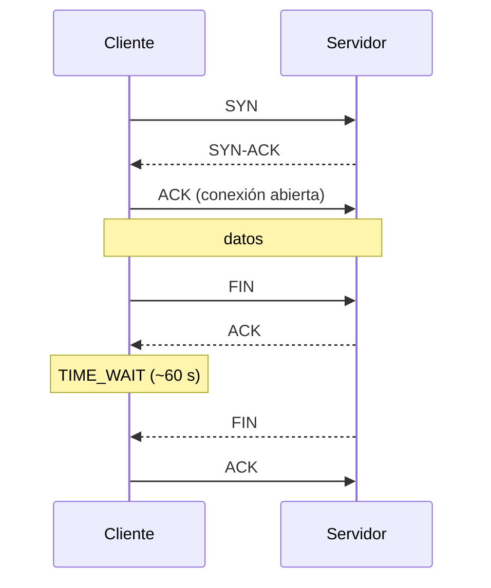
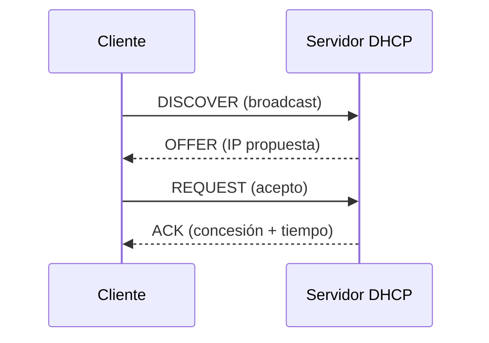

# Fundamentos de red

La red es donde más tiempo se pierde depurando: un `connection refused`, un DNS que cachea de más, un `TIME_WAIT` que agota puertos. Este bloque va al comportamiento que importa en operación, no a la definición de IP o puerto.

_Revisado: 2026-10-06_

## Modelo en capas

Cada capa resuelve un problema y delega el resto. Saber en qué capa está un síntoma reduce la búsqueda a una fracción.

```mermaid
flowchart TB
  A["Aplicación<br/>HTTP · DNS · SSH"] --> T["Transporte<br/>TCP · UDP · puertos"]
  T --> N["Red<br/>IP · ICMP · enrutamiento"]
  N --> E["Enlace<br/>Ethernet · MAC · VLAN · ARP"]
  E --> F["Física<br/>cable · fibra · Wi-Fi"]
  style T fill:#1a2233,stroke:#58a6ff
  style N fill:#1a2233,stroke:#58a6ff
```



| Capa (OSI) | Unidad | Dirección | Dispositivo típico |
|---|---|---|---|
| 2 · Enlace | trama | MAC | switch |
| 3 · Red | paquete | IP | router |
| 4 · Transporte | segmento / datagrama | puerto | firewall, balanceador L4 |
| 7 · Aplicación | mensaje | URL, nombre DNS | proxy, balanceador L7 |

Una trama Ethernet cambia de MAC en cada salto; el paquete IP conserva origen y destino extremo a extremo (salvo NAT).

## IPv4, CIDR y subnetting práctico

Lo que de verdad se usa: contar hosts y partir rangos rápido. El prefijo `/n` fija los primeros `n` bits como red; los `32-n` restantes son hosts.

```text
/24  → 256 direcciones  → 254 usables (.0 = red, .255 = broadcast)
/26  → 64  direcciones  → 62 usables, cuatro /26 caben en un /24
/30  → 4   direcciones  → 2 usables, enlaces punto a punto
/32  → 1 dirección      → un host exacto
```

Fórmula: hosts usables = `2^(32-n) - 2`. Para partir una red, se toman bits del campo de host.

```text
10.20.0.0/24 dividida en cuatro subredes (/26):
  10.20.0.0/26    hosts .1   - .62
  10.20.0.64/26   hosts .65  - .126
  10.20.0.128/26  hosts .129 - .190
  10.20.0.192/26  hosts .193 - .254
```

Rangos privados (RFC 1918), no enrutables en Internet: `10.0.0.0/8`, `172.16.0.0/12`, `192.168.0.0/16`. Además `169.254.0.0/16` es link-local (autoasignación cuando falla DHCP) y `127.0.0.0/8` es loopback.

```bash
ipcalc 10.20.0.0/26
ip -br a
ip route
```

:::tip Resumir rutas
Cuatro redes contiguas `/24` (`10.20.0.0` a `10.20.3.0`) se anuncian como un solo `10.20.0.0/22`. Menos entradas en la tabla de rutas = menos memoria y convergencia más rápida.
:::

## IPv6 en lo esencial

Direcciones de 128 bits en hexadecimal: `2001:db8:10::1`. Se abrevian los ceros consecutivos con `::` (una sola vez por dirección).

- Un `/64` es la subred estándar; no se subdivide más.
- No hay broadcast: se usa multicast y **NDP** (Neighbor Discovery) en lugar de ARP.
- `fe80::/10` es link-local: toda interfaz IPv6 tiene una.
- Las direcciones se asignan por **SLAAC** (autoconfiguración) o DHCPv6.

```bash
ip -6 a
ping -6 ipv6.google.com
```

## ARP y resolución en la red local

Para enviar a una IP de la misma subred hace falta su MAC. **ARP** pregunta por broadcast "¿quién tiene 10.20.0.5?" y cachea la respuesta.

```bash
ip neigh
arping -I eth0 10.20.0.5
```

Si el destino está fuera de la subred, el host envía la trama a la MAC del **gateway** por defecto y el router se encarga del resto. Un gateway mal configurado o duplicado de IP produce síntomas intermitentes: `ip neigh` mostrando la MAC equivocada lo delata.

## TCP, UDP y estados de conexión

El handshake y el cierre no son trivia: los estados `TIME_WAIT` y `CLOSE_WAIT` dicen **quién tiene la culpa** de una fuga de conexiones.



- **`TIME_WAIT`** (lado que cierra primero): normal y sano, dura ~60 s para absorber paquetes rezagados. Miles de `TIME_WAIT` indican muchas conexiones cortas; se mitiga con keep-alive o pooling.
- **`CLOSE_WAIT`** (lado que recibió el FIN y no cerró su extremo): es un **bug de la aplicación**, que no hace `close()` del socket. Acumuladas, agotan descriptores.

```bash
ss -tan state time-wait | wc -l
ss -tanp state close-wait
```

TCP aporta fiabilidad y orden con números de secuencia, confirmaciones (ACK), retransmisión y control de flujo (ventana). Una pérdida de paquetes se traduce en **retransmisiones y latencia**, no en errores visibles.

**Puertos efímeros**: el cliente usa un puerto del rango `32768–60999` por conexión saliente. Muchas conexiones concurrentes al mismo destino pueden agotar el rango y producir `cannot assign requested address`. Es un límite real en proxies con mucho tráfico saliente.

UDP no tiene estados ni handshake. Lo usan DNS, QUIC/HTTP3, VoIP y VPN. Sin entrega garantizada: la aplicación o el protocolo superior pone la fiabilidad.

| | TCP | UDP |
|---|---|---|
| Conexión | sí, handshake | no |
| Entrega y orden | garantizados | no |
| Sobrecarga | mayor | mínima |
| Casos | web, bases de datos, SSH | DNS, streaming, QUIC |

## DNS

Lo que rompe en producción casi nunca es "no resuelve" sino **la caché**: bajas un TTL para una migración y los resolvers siguen sirviendo el valor viejo hasta que expira el TTL **anterior**.

```mermaid
flowchart LR
  APP["Aplicación"] --> STUB["Resolver local<br/>/etc/resolv.conf"]
  STUB --> REC["Recursor<br/>cachea por TTL"]
  REC --> ROOT["Raíz ."]
  REC --> TLD["TLD .com"]
  REC --> AUTH["Servidor autoritativo"]
  AUTH -->|"registro + TTL"| REC
  style REC fill:#1a2233,stroke:#58a6ff
```



| Registro | Función |
|---|---|
| `A` / `AAAA` | nombre a IPv4 / IPv6 |
| `CNAME` | alias a otro nombre (no válido en el apex del dominio) |
| `MX` | servidores de correo, con prioridad |
| `TXT` | SPF, DKIM, verificaciones |
| `NS` / `SOA` | delegación y autoridad de la zona |
| `PTR` | resolución inversa (IP a nombre) |
| `SRV` | host y puerto de un servicio |

```bash
dig +short app.ejemplo.com
dig app.ejemplo.com +trace
dig app.ejemplo.com @1.1.1.1
dig -x 93.184.216.34
dig ejemplo.com MX +short
```

:::tip Antes de una migración de DNS
Baja el TTL con antelación (más de un TTL antes del cambio) para que el cambio real propague rápido. Si no, esperas el TTL viejo, no el nuevo.
:::

## DHCP

Asigna IP, máscara, gateway y DNS de forma automática. El intercambio es **DORA** y los dos primeros mensajes son broadcast porque el cliente aún no tiene IP.



La concesión caduca (lease) y el cliente la renueva a la mitad del tiempo. En redes con varias VLAN, un **relay** (`ip helper-address`) reenvía los broadcast al servidor central.

## HTTP/1.1, HTTP/2 y HTTP/3

| Versión | Transporte | Problema que resuelve |
|---|---|---|
| HTTP/1.1 | TCP | una petición por conexión a la vez |
| HTTP/2 | TCP | multiplexa N streams en una conexión |
| HTTP/3 | QUIC sobre UDP | elimina el head-of-line blocking de TCP ante pérdidas |

```bash
curl -v https://ejemplo.com/api/estado
curl -I https://ejemplo.com
curl -w "dns:%{time_namelookup} tcp:%{time_connect} tls:%{time_appconnect} total:%{time_total}\n" -o /dev/null -s https://ejemplo.com
curl --http2 -sI https://ejemplo.com | head -1
```

El `-w` descompone la latencia por fase: si `dns` es alto, el problema es el resolver; si `tls` es alto, el handshake; si falta mucho hasta `total`, el servidor tarda en responder.

Códigos que se piden a diario: `301/302` redirección, `401` sin autenticar, `403` sin permiso, `429` demasiadas peticiones, `502` el proxy no obtuvo respuesta válida del backend, `503` backend no disponible, `504` el backend no respondió a tiempo.

## TLS

El handshake negocia versión y cifrado, y valida la **cadena** de certificados hasta una CA de confianza.

- **SNI**: el cliente anuncia el hostname en claro al inicio del handshake, para que un servidor con varios dominios sirva el certificado correcto.
- **mTLS**: además del servidor, el **cliente** presenta certificado. Base de la autenticación entre servicios.
- **Versiones**: TLS 1.2 mínimo, 1.3 preferido (handshake más corto y sin cifrados débiles).

```bash
openssl s_client -connect ejemplo.com:443 -servername ejemplo.com </dev/null 2>/dev/null \
  | openssl x509 -noout -subject -issuer -dates
openssl s_client -connect ejemplo.com:443 -tls1_3 </dev/null 2>&1 | grep -i "protocol"
```

El fallo más común no es el cifrado sino la **cadena incompleta** (falta el intermedio) o el **certificado caducado**. `s_client` lo muestra en segundos.

## Trampas frecuentes

- **`CLOSE_WAIT` acumulándose**: no es la red, es la aplicación sin `close()`. `ss -tanp` da el PID culpable.
- **Bajar el TTL el mismo día de la migración**: inútil; los resolvers respetan el TTL anterior.
- **`CNAME` en el apex del dominio**: inválido. Usa `ALIAS`/`ANAME` del proveedor DNS o un registro `A`.
- **Subredes solapadas** al unir dos redes por VPN: el enrutamiento es ambiguo. Planifica el direccionamiento desde el principio.
- **MTU incorrecta**: túneles y VPN reducen la MTU efectiva; los paquetes grandes se descartan si ICMP está bloqueado y el tráfico "se cuelga" tras el handshake.
- **Confundir `refused` con `timeout`**: uno apunta al servicio, el otro a un firewall silencioso.

## Comprueba que lo entiendes

1. ¿Cuántos hosts usables tiene un `/27` y cuál es la dirección de broadcast de `192.168.10.64/27`?
2. Un servicio acumula cientos de conexiones en `CLOSE_WAIT`. ¿Dónde está el problema y con qué comando encuentras al responsable?
3. Cambias un registro `A` y a algunos usuarios les sigue resolviendo la IP vieja horas después. ¿Por qué?
4. ¿Por qué los dos primeros mensajes de DHCP son broadcast?

**Mini-ejercicio.** Averigua, sin navegador, el emisor y la fecha de caducidad del certificado de `ejemplo.com`.

```bash
openssl s_client -connect ejemplo.com:443 -servername ejemplo.com </dev/null 2>/dev/null \
  | openssl x509 -noout -issuer -enddate
```

<details>
  <summary>Respuestas</summary>

1. `2^(32-27) - 2 = 30` hosts usables. `192.168.10.64/27` cubre `.64` a `.95`: red `.64`, broadcast `.95`.
2. `CLOSE_WAIT` significa que el otro extremo envió `FIN` y la aplicación local no ha cerrado el socket: bug de la aplicación, no de la red. `ss -tanp state close-wait` muestra el proceso.
3. Los resolvers cachean durante el TTL que tenía el registro al consultarlo. Había que bajar el TTL con antelación.
4. El cliente aún no tiene IP ni conoce la del servidor, así que no puede hacer unicast: lo anuncia por broadcast en la red local.

</details>

## Referencias

- [Cloudflare Learning — DNS, TLS, HTTP/3](https://www.cloudflare.com/learning/)
- [RFC 9293 — TCP](https://www.rfc-editor.org/rfc/rfc9293.html)
- [RFC 9000 — QUIC](https://www.rfc-editor.org/rfc/rfc9000.html)
- [RFC 1918 — Direccionamiento privado](https://www.rfc-editor.org/rfc/rfc1918.html)
