# Seguridad y operación de red

Diseñar la red es la mitad del trabajo; la otra es **filtrarla, medirla y arreglarla** cuando falla a las tres de la mañana. Este bloque cubre filtrado, balanceo, monitorización y un método de diagnóstico repetible.

_Revisado: 2026-10-06_

## Firewalls: stateful y stateless

- **Stateless** (ACL clásica): evalúa cada paquete de forma aislada. Hay que permitir **ida y vuelta**, incluidos los puertos efímeros de las respuestas.
- **Stateful**: recuerda las conexiones; permite automáticamente la respuesta a una conexión iniciada desde dentro. Es lo habitual en firewalls modernos y en `nftables`/`iptables` con `conntrack`.
- **NGFW**: añade inspección de aplicación, IDS/IPS y filtrado por identidad de usuario.

```bash
sudo nft add table inet filtro
sudo nft add chain inet filtro entrada '{ type filter hook input priority 0; policy drop; }'
sudo nft add rule inet filtro entrada ct state established,related accept
sudo nft add rule inet filtro entrada iif lo accept
sudo nft add rule inet filtro entrada tcp dport 22 ip saddr 10.0.0.0/24 accept
sudo nft add rule inet filtro entrada icmp type echo-request limit rate 5/second accept
sudo nft list ruleset
```

Principios que se aplican en cualquier plataforma:

1. **Denegar por defecto**, permitir lo mínimo explícito (`policy drop`).
2. Reglas **específicas primero**; las genéricas al final.
3. Origen restringido: SSH solo desde la red de administración, no desde `0.0.0.0/0`.
4. **Registrar** (`log`) lo denegado con límite de tasa, para no llenar el disco.

## ACL y segmentación

```mermaid
flowchart LR
  INT["Internet"] --> FW1["Firewall perimetral"]
  FW1 --> DMZ["DMZ<br/>web · proxy · correo"]
  FW1 --> FW2["Firewall interno"]
  FW2 --> APP["Red de aplicación"]
  FW2 --> DB["Red de datos"]
  style DMZ fill:#2d1a1a,stroke:#ff7b72
  style DB fill:#1a2d1a,stroke:#39d353
```



- **DMZ**: servicios expuestos, aislados de la red interna. Si cae un servidor de la DMZ, no tiene ruta a la base de datos.
- **Capas**: Internet → web → aplicación → datos, con reglas entre cada una; nadie salta una capa.
- **Microsegmentación**: reglas por carga de trabajo, no solo por red.
- **Red de gestión** separada (OOB) para SSH, SNMP y consolas.

## Balanceo de carga: L4 vs L7

| | L4 | L7 |
|---|---|---|
| Decide por | IP y puerto | host, ruta, cabeceras, cookies |
| TLS | pasa tal cual | termina y reinicia |
| Velocidad | muy alta | menor, más funciones |
| Ejemplo | LVS, HAProxy en modo `tcp` | nginx, HAProxy en modo `http`, Envoy |

```text title="haproxy.cfg"
frontend web
  bind :443 ssl crt /etc/haproxy/certs/sitio.pem
  mode http
  acl es_api path_beg /api
  use_backend api if es_api
  default_backend web

backend api
  mode http
  balance roundrobin
  option httpchk GET /salud
  server api1 10.0.1.11:8080 check inter 3s fall 3 rise 2
  server api2 10.0.1.12:8080 check inter 3s fall 3 rise 2
```

- **Algoritmos**: `roundrobin` (reparto uniforme), `leastconn` (para conexiones largas), `source` (hash por IP, afinidad básica).
- **Health checks activos**: sacan un backend de rotación tras `fall` fallos y lo reincorporan tras `rise` éxitos.
- **Sticky sessions** atan un cliente a un backend: necesarias si hay estado en memoria, señal de que la app no es tan desechable como debería.
- El balanceador oculta la IP real del cliente; pásala con `X-Forwarded-For` o **PROXY protocol**.

## Proxy inverso y proxy directo

- **Proxy inverso** (nginx, Envoy): ante los servidores. Termina TLS, cachea, comprime, limita tasa y oculta la topología interna.
- **Proxy directo**: ante los clientes. Filtra la navegación saliente, cachea y registra.

```text title="nginx.conf"
server {
  listen 443 ssl http2;
  server_name app.ejemplo.com;
  ssl_certificate     /etc/ssl/app.crt;
  ssl_certificate_key /etc/ssl/app.key;

  location / {
    proxy_pass http://127.0.0.1:8080;
    proxy_set_header Host $host;
    proxy_set_header X-Forwarded-For $proxy_add_x_forwarded_for;
    proxy_read_timeout 30s;
  }
}
```

Un `502 Bad Gateway` es que el proxy no logró hablar con el backend; un `504`, que el backend tardó más que el timeout. Mira el log de error del proxy, no el de la aplicación.

## Wi-Fi y acceso a red

- Usa **WPA3** o WPA2-Enterprise (**802.1X**, autenticación por usuario con servidor RADIUS). La clave compartida (PSK) no permite revocar a una persona.
- Separa **invitados**, dispositivos corporativos e IoT en VLAN distintas.
- Canales de 2,4 GHz: solo 1, 6 y 11 no se solapan. Planifica cobertura con mediciones, no a ojo.
- **802.1X** también aplica en cable: el puerto del switch no se abre hasta autenticar al equipo.

## Monitorización

```mermaid
flowchart LR
  DEV["Switches · routers · servidores"] -->|"SNMP · flujos · syslog"| COL["Colectores"]
  COL --> TS[("Series temporales")]
  TS --> DASH["Dashboards"]
  TS --> ALR["Alertas"]
  style TS fill:#1a2233,stroke:#58a6ff
```



| Señal | Qué dice | Herramienta |
|---|---|---|
| Disponibilidad | ¿responde? | ping, comprobaciones HTTP |
| Utilización | ¿cuánto ancho de banda? | SNMP (`ifInOctets`), exporters |
| Errores | CRC, descartes en interfaz | `ip -s link`, SNMP |
| Latencia / pérdida | calidad del camino | `mtr`, sondas |
| Flujos | quién habla con quién | NetFlow / sFlow / IPFIX |
| Eventos | cambios, caídas | syslog centralizado |

```bash
ip -s link show eth0
ethtool -S eth0 | grep -i -E "err|drop"
mtr -rwzc 50 app.ejemplo.com
snmpwalk -v2c -c publica 10.0.0.1 ifDescr
```

:::danger SNMP
Evita `SNMPv1/v2c` con la comunidad `public`: viaja en claro y expone la red. Usa **SNMPv3** con autenticación y cifrado.
:::

Alerta por **síntomas** (pérdida de paquetes, saturación sostenida de un enlace) y no por cualquier pico aislado.

## Troubleshooting: de abajo a arriba

```mermaid
flowchart TD
  P["No conecta"] --> L1{"Enlace arriba<br/>ip link"}
  L1 -->|no| CAB["Cable · puerto · VLAN"]
  L1 -->|sí| L3{"IP y gateway<br/>ip a · ip route"}
  L3 -->|no| DH["DHCP · configuración"]
  L3 -->|sí| P2{"ping gateway<br/>y destino"}
  P2 -->|falla| RT["Rutas · ACL · NAT"]
  P2 -->|ok| L4{"ss · nc -zv<br/>¿puerto abierto?"}
  L4 -->|refused| SVC["Servicio caído"]
  L4 -->|timeout| FW["Firewall descarta"]
  L4 -->|ok| L7["curl -v · dig · openssl"]
  style FW fill:#2d1a1a,stroke:#ff7b72
```



`connection refused` ≠ `timeout`: **refused** = algo contestó que ahí no hay nada escuchando; **timeout** = un firewall descarta el paquete en silencio.

```bash
ip link; ip a; ip route
ping -c 3 10.0.0.1
traceroute -n 8.8.8.8
mtr -rwc 30 8.8.8.8
nc -zv servidor 443
curl -v https://servidor/salud
dig +trace app.ejemplo.com
ss -tanp
```

Orden que ahorra tiempo:

1. **¿Solo a mí o a todos?** Define el alcance.
2. **¿Qué cambió?** Despliegues, reglas de firewall, certificados, renovaciones DNS.
3. Descarta de abajo arriba: enlace, IP, ruta, DNS, puerto, aplicación.
4. Compara un **camino que funciona** con el que falla.

### Captura de tráfico

Cuando los logs no bastan, el paquete no miente.

```bash
sudo tcpdump -ni eth0 'tcp port 443 and host 10.0.1.5' -c 50
sudo tcpdump -ni any 'icmp or port 53'
sudo tcpdump -ni eth0 -w captura.pcap 'port 5432'
```

Qué buscar en una captura:

| Observación | Significa |
|---|---|
| SYN repetidos sin SYN-ACK | firewall descartando o servicio caído |
| SYN y luego RST | puerto cerrado |
| Retransmisiones TCP | pérdida de paquetes o congestión |
| `ICMP fragmentation needed` | problema de MTU |
| Respuesta DNS tardía o ausente | resolver o red hacia él |

Abre el `.pcap` en Wireshark y filtra: `tcp.analysis.retransmission`, `dns`, `tls.handshake`.

## Trampas frecuentes

- **Solo permitir la ida en una ACL stateless** y olvidar los puertos efímeros de vuelta.
- **Bloquear todo ICMP**: rompe Path MTU Discovery y el tráfico grande se cuelga. Permite al menos `fragmentation-needed` y `echo`.
- **Health check que solo mira el puerto**: el proceso escucha pero la aplicación está rota; comprueba una ruta real (`/salud`).
- **Cambiar reglas de firewall sin sesión de rescate**: te dejas fuera. Usa `at` para revertir o un timer de confirmación.
- **Culpar a la red** sin comparar con un camino bueno ni mirar qué cambió.
- **Logs sin sincronización horaria**: sin NTP no se correlacionan eventos entre equipos.

## Comprueba que lo entiendes

1. Un `curl` devuelve `502`. ¿Qué componente falla y dónde miras?
2. ¿Por qué una ACL stateless necesita reglas en ambos sentidos y un firewall stateful no?
3. Un backend responde al puerto pero la web da errores. ¿Qué mejora en el health check aplicas?
4. En una captura ves SYN repetidos sin SYN-ACK. ¿Qué dos causas son más probables?

**Mini-ejercicio.** Comprueba si el puerto 5432 de un servidor es alcanzable y distingue si falla por firewall o por servicio caído.

```bash
nc -zv -w 3 servidor 5432
```

<details>
  <summary>Respuestas</summary>

1. El proxy o balanceador no obtuvo respuesta válida del backend. Se revisa el log de error del proxy y el estado del backend.
2. La ACL stateless trata cada paquete aislado, así que la respuesta es un paquete nuevo que necesita su permiso. El stateful guarda la conexión y permite el retorno automáticamente.
3. Que consulte un endpoint real de la aplicación (`/salud`) que valide dependencias críticas, no solo que el puerto acepte conexiones.
4. Un firewall que descarta en silencio o un servicio/host inalcanzable (ruta ausente). Si hubiera servicio caído con host alcanzable, aparecería RST.

</details>

## Referencias

- [nftables wiki](https://wiki.nftables.org/)
- [HAProxy — documentación](https://docs.haproxy.org/)
- [Wireshark — guía de usuario](https://www.wireshark.org/docs/wsug_html_chunked/)
- [Brendan Gregg — herramientas de red en Linux](https://www.brendangregg.com/linuxperf.html)
