# Wi-Fi, calidad de servicio y diseño

Una red que funciona en el laboratorio puede fallar bajo carga real: voz entrecortada por un enlace saturado, Wi-Fi lento en una sala con cien personas, un cambio que tumba una sede entera. Este bloque cubre el **diseño** que evita esos problemas.

_Revisado: 2026-10-06_

## Wi-Fi: lo que de verdad importa

| Banda | Alcance | Velocidad | Canales útiles | Uso |
|---|---|---|---|---|
| 2,4 GHz | mayor | menor | 1, 6, 11 (sin solape) | IoT, cobertura |
| 5 GHz | media | alta | muchos, algunos con DFS | principal |
| 6 GHz (Wi-Fi 6E/7) | menor | muy alta | canales amplios, sin dispositivos antiguos | alta densidad |

Estándares: Wi-Fi 5 (802.11ac), **Wi-Fi 6** (ax, mejor en alta densidad con OFDMA), Wi-Fi 7 (be). Más ancho de canal (`80` o `160 MHz`) da velocidad pero **reduce canales disponibles** y aumenta las interferencias: en entornos densos, canales de 20 o 40 MHz.

```mermaid
flowchart TB
  C["Controlador / nube"] --> AP1["AP 1<br/>canal 36"]
  C --> AP2["AP 2<br/>canal 52"]
  C --> AP3["AP 3<br/>canal 100"]
  AP1 --> CL1["Clientes"]
  AP2 --> CL2["Clientes"]
  AP3 --> CL3["Clientes"]
  SW["Switch PoE"] --> AP1
  SW --> AP2
  SW --> AP3
  style C fill:#1a2233,stroke:#58a6ff
```



### Diseño de cobertura

- **Capacidad antes que cobertura**: muchos puntos de acceso con potencia **baja** dan mejor experiencia que pocos con potencia alta (los clientes no pueden "contestar" con tanta potencia).
- **Estudio de sitio** (*site survey*) con mediciones reales: paredes, ascensores y mobiliario cambian el resultado.
- **Solape de celdas** del 15-20 % para itinerancia (*roaming*), sin que los vecinos usen el mismo canal.
- Objetivo de señal: **−65 dBm** o mejor (RSSI) y SNR mayor de 25 dB donde haya voz o vídeo.
- **Roaming rápido**: 802.11r, 802.11k y 802.11v reducen los cortes al moverse.

### Seguridad inalámbrica

| Modo | Autenticación | Uso |
|---|---|---|
| WPA3-Personal | clave compartida (SAE) | domicilio, oficina pequeña |
| WPA2/WPA3-Enterprise | **802.1X** con RADIUS | corporativo |
| Abierta + OWE | sin clave, con cifrado | invitados |
| WEP, WPA | obsoletos | no usar |

Un SSID corporativo con **802.1X** autentica por usuario o certificado (EAP-TLS) y permite revocar a una persona sin cambiar la clave de todos. Segmenta con VLAN dinámicas (la VLAN depende del usuario), aísla a los **invitados** (portal cautivo, sin acceso interno) y a los dispositivos **IoT**.

```text
Invitados   → VLAN 90   → solo Internet, aislamiento entre clientes
Corporativo → VLAN 10   → recursos internos, 802.1X
IoT         → VLAN 70   → destinos concretos, sin acceso a servidores
```

### Diagnóstico Wi-Fi

| Síntoma | Causa probable |
|---|---|
| Lento con buena señal | canal saturado, interferencia, muchos clientes lentos (tiempo de aire) |
| Se corta al moverse | roaming deficiente, solape insuficiente |
| Conecta pero sin IP | DHCP agotado o VLAN no extendida al AP |
| Funciona en 2,4 GHz y no en 5 | dispositivo antiguo o DFS que expulsa al AP |

```bash
iw dev wlan0 link
nmcli dev wifi list
sudo iw dev wlan0 scan | grep -E "SSID|signal|freq"
```

## Calidad de servicio (QoS)

Cuando un enlace se satura, **algo se descarta**. QoS decide qué: la voz y el tráfico crítico pasan, la copia de seguridad espera.

```mermaid
flowchart LR
  P["Paquete"] --> CL["Clasificar<br/>por puerto · DSCP"]
  CL --> M["Marcar<br/>DSCP"]
  M --> Q{"Colas por prioridad"}
  Q --> Q1["Voz · prioridad estricta"]
  Q --> Q2["Aplicaciones críticas"]
  Q --> Q3["Mejor esfuerzo"]
  Q1 --> OUT["Interfaz de salida"]
  Q2 --> OUT
  Q3 --> OUT
  style Q1 fill:#1a2d1a,stroke:#39d353
```



| Clase | DSCP típico | Necesita |
|---|---|---|
| Voz (RTP) | EF (46) | latencia menor de 150 ms, jitter menor de 30 ms, pérdida menor de 1 % |
| Vídeo interactivo | AF41 (34) | ancho de banda constante |
| Señalización | CS3 (24) | baja pérdida |
| Datos críticos | AF21 (18) | garantía mínima |
| Mejor esfuerzo | 0 | lo que quede |

- **Marca en el borde**, confía solo en las marcas de dispositivos de confianza (teléfonos, no portátiles de usuarios).
- **QoS solo actúa en congestión**: si el enlace está libre, nadie nota la diferencia.
- La cola de prioridad estricta debe tener **límite** (policer) para no matar de hambre a las demás.
- El **`shaping`** en la salida hacia un proveedor fija la velocidad contratada, de modo que la cola esté en tu equipo y no en el del proveedor.

```text
class-map match-any VOZ
 match dscp ef
policy-map SALIDA-WAN
 class VOZ
  priority percent 20
 class class-default
  fair-queue
interface Gi0/0
 service-policy output SALIDA-WAN
```

Mide con `iperf3` y con sondas de voz (jitter y pérdida) en lugar de fiarte de la configuración.

```bash
iperf3 -s
iperf3 -c servidor -u -b 5M -t 30
mtr -rwc 100 servidor
```

## Diseño de red jerárquico

```mermaid
flowchart TB
  CORE["Núcleo<br/>alta velocidad · sin políticas"]
  D1["Distribución A<br/>L3 · políticas · agregación"]
  D2["Distribución B"]
  A1["Acceso 1<br/>puertos de usuario"]
  A2["Acceso 2"]
  A3["Acceso 3"]
  CORE --- D1
  CORE --- D2
  D1 --- D2
  D1 --- A1
  D1 --- A2
  D2 --- A2
  D2 --- A3
  style CORE fill:#1a2233,stroke:#58a6ff
```



| Capa | Función | Evitar |
|---|---|---|
| Acceso | conectar equipos, PoE, 802.1X, seguridad de puerto | lógica de enrutamiento compleja |
| Distribución | agregación, enrutamiento entre VLAN, políticas, ACL | tráfico de usuarios directo |
| Núcleo | conmutar rápido entre bloques | filtrado y servicios |

Variante moderna en centros de datos: **spine-leaf**, donde cada *leaf* se conecta a todos los *spine*; cualquier par de servidores está a la misma distancia (dos saltos) y se añade capacidad añadiendo spines.

```mermaid
flowchart TB
  S1["Spine 1"] --- L1["Leaf 1"]
  S1 --- L2["Leaf 2"]
  S1 --- L3["Leaf 3"]
  S2["Spine 2"] --- L1
  S2 --- L2
  S2 --- L3
  L1 --- H1["Servidores"]
  L2 --- H2["Servidores"]
  L3 --- H3["Servidores"]
  style S1 fill:#1a2233,stroke:#58a6ff
  style S2 fill:#1a2233,stroke:#58a6ff
```



## Redundancia y dominios de fallo

Principios de diseño:

1. **Sin punto único de fallo**: doble enlace, doble dispositivo, doble proveedor donde importe.
2. **Dominios de fallo pequeños**: un problema en un bloque no debe tumbar toda la red (segmentar L2, limitar el alcance de las VLAN).
3. **Preferir L3 a L2** para escalar: extiende VLAN solo donde haga falta; bucles y tormentas son un riesgo creciente.
4. **Redundancia probada**: un *failover* que nunca se ha probado probablemente no funciona.
5. **Dos proveedores de Internet** con BGP o con SD-WAN y comprobaciones de salud del enlace.

## SD-WAN y conectividad entre sedes

| Enfoque | Características |
|---|---|
| MPLS | privado, SLA garantizado, caro |
| Internet + VPN | barato, sin garantía de calidad |
| SD-WAN | varias salidas (MPLS, banda ancha, 4G/5G); decide por aplicación según latencia y pérdida medidas |

La SD-WAN **mide** continuamente cada enlace y envía la voz por el que tiene menos jitter y el tráfico masivo por el barato. La política se define de forma centralizada y se aplica a las sedes.

## Planificación de direccionamiento y capacidad

```text
Plan de direccionamiento (10.0.0.0/8)
  10.<sede>.<función>.0/24
  sede 1 = Madrid, 2 = Barcelona, 3 = Valencia
  función: 10 usuarios · 20 servidores · 30 voz · 90 invitados · 250 gestión

Ejemplo: 10.2.20.0/24 = servidores de Barcelona
```

- **Reserva espacio** para crecer: una sede con 200 equipos hoy puede tener 400 en dos años; un `/24` no sobra.
- **Resumible por sede** (`10.2.0.0/16`): una sola ruta por sede en el resto de la red.
- **Sin solapes** con VPN de socios, nubes o redes de adquisiciones futuras.
- **Capacidad**: mide el percentil 95 de uso por enlace y planifica la ampliación **antes del 70 %** sostenido.

| Métrica | Umbral habitual |
|---|---|
| Uso de enlace (p95) | ampliar si supera el 70 % |
| Pérdida de paquetes | menor del 0,1 % en LAN |
| Latencia LAN | menor de 1 ms |
| Clientes por AP | menor de 30-50 con carga real |

## Trampas frecuentes

- **Potencia máxima en todos los APs**: más interferencia y peor roaming.
- **Canales de 160 MHz** en entornos densos: sin canales libres.
- **Voz sin QoS** en un enlace que se satura: cortes que "nadie sabe explicar".
- **Confiar en las marcas DSCP de los usuarios**: un portátil puede marcar todo como prioritario.
- **VLAN extendida por toda la red**: un bucle tumba todo.
- **Redundancia no probada**: el *failover* falla cuando hace falta.
- **Plan de direccionamiento sin crecimiento** ni resumen: renumerar es costoso.
- **Diseñar por cobertura** y no por capacidad en aulas, salas y auditorios.

## Comprueba que lo entiendes

1. Una sala con 120 personas tiene señal excelente pero Wi-Fi lento. ¿Qué ocurre y qué cambias?
2. ¿Por qué QoS "no hace nada" en un enlace con poca carga?
3. ¿Qué ventaja tiene spine-leaf sobre un diseño jerárquico clásico en un centro de datos?
4. ¿Por qué el solape de celdas ayuda al roaming pero un exceso de potencia lo perjudica?

**Mini-ejercicio.** Mide la pérdida y el *jitter* UDP hacia un servidor a 5 Mb/s durante 30 segundos.

```bash
iperf3 -c servidor -u -b 5M -t 30
```

<details>
  <summary>Respuestas</summary>

1. Problema de **capacidad y tiempo de aire**: demasiados clientes por AP y canales saturados. Más APs de baja potencia, canales estrechos y bien repartidos, banda de 5/6 GHz y, si procede, limitar las velocidades de datos mínimas.
2. QoS solo prioriza cuando hay **cola**; sin congestión, todos los paquetes salen de inmediato y no hay nada que ordenar.
3. Latencia predecible (dos saltos entre cualquier par), ancho de banda que escala añadiendo spines, sin STP bloqueando enlaces (todo enrutado en L3) y fallos con impacto reducido.
4. Con solape moderado el cliente encuentra otro AP al alejarse; con potencia excesiva el cliente "ve" APs lejanos con señal alta, se aferra a un AP malo y se producen interferencias entre celdas.

</details>

## Referencias

- [Cisco — Wireless LAN Design](https://www.cisco.com/c/en/us/td/docs/wireless/controller/technotes/8-8/b_wlan_design_guide.html)
- [RFC 4594 — DSCP, configuración recomendada](https://www.rfc-editor.org/rfc/rfc4594.html)
- [Wi-Fi Alliance](https://www.wi-fi.org/discover-wi-fi)
- [iperf3 — documentación](https://iperf.fr/iperf-doc.php)
